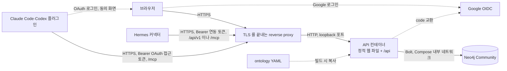

# 코드 구조

## 전체 배치

```text
저장소 루트/
  ontology/financial-ontology.yaml   온톨로지의 첫 버전과 코드 소유 부분. API 빌드가 jar 에 복사한다
  api/                               Kotlin + Spring Boot API. 자체 Gradle Wrapper
  web/                               React + TypeScript + Vite. Cytoscape.js 그래프
  web/e2e/                           Playwright 화면 테스트와 가짜 API, 응답 스냅샷(fixtures/)
  scripts/                           백업, 복원, Compose 설정 검사 스크립트
  Dockerfile                         웹 빌드, API 빌드, 실행 이미지를 한 파일에서 만든다
  compose.yml                        운영 Compose. Neo4j 포트를 공개하지 않는다
  compose.dev.yml                    개발 Compose. Neo4j 와 가짜 OIDC 공급자를 loopback 에 묶는다
  docs/                              이 문서들
  plugin/                            Claude Code·Codex 플러그인. 원격 MCP 연결 설정(.mcp.json)과 비개발자용 스킬
  .claude-plugin/marketplace.json    Claude Code·Codex 마켓플레이스 목록. ./plugin 을 가리킨다
  .github/workflows/                 GHCR 이미지 workflow 와 테스트 workflow
```

브라우저는 API 하고만 통신한다. Neo4j 자격증명과 Cypher 실행 기능은 클라이언트에 없다.



## 버전

| 구성 | 버전 | 근거 |
| --- | --- | --- |
| JDK | 21 (Temurin) | Spring Boot 4.1 이 지원하는 LTS |
| Spring Boot | 4.1.0 | `api/gradle/libs.versions.toml` |
| Kotlin | 2.3.21 | Spring Boot 4.1.0 BOM 의 `kotlin.version` |
| Neo4j Java Driver | 6.1.0 | Spring Boot 4.1.0 BOM 의 `neo4j-java-driver.version` |
| Neo4j 테스트 하네스(neo4j-harness) | 5.26.30 | 운영 이미지와 같은 패치. BOM 밖의 Gradle 설정 `neo4jHarness` |
| 가짜 OIDC 공급자 라이브러리(mock-oauth2-server) | 3.0.1 | 개발 Compose 의 이미지와 같은 버전 |
| MCP Java SDK(`io.modelcontextprotocol.sdk:mcp`) | 2.1.0 | 최신 GA. `mcp-core` 와 Jackson 3 모듈(`mcp-json-jackson3`)을 묶은 것이다. MCP `2025-11-25` 까지 말한다. 테스트의 MCP 클라이언트도 같은 jar 다 |
| Neo4j | `neo4j:5.26.30-community` | 5.26 LTS |
| Gradle | 8.14.3 | `api/gradle/wrapper/gradle-wrapper.properties` |
| Node | 24 | 이 머신의 `v24.15.0` |
| React | 19.3.1 | |
| Vite | 8.3.3 | |
| TypeScript | 6.0.3 | 7.x 는 네이티브 컴파일러 전환 직후라 도구 호환을 기다린다 |
| Cytoscape.js | 3.34.4 | |
| Playwright | 1.64.1 | |
| Tailwind CSS, `@tailwindcss/vite` | 4.3.3 | |
| shadcn CLI | 4.21.3 | 컴포넌트 소스를 `web/src/components/ui/` 로 복사할 때만 쓴다. 의존성에 넣지 않는다 |
| radix-ui | 1.7.0 | |
| class-variance-authority | 0.7.1 | |
| clsx | 2.1.1 | |
| tailwind-merge | 3.7.0 | |
| lucide-react | 1.52.0 | |
| tw-animate-css | 1.4.0 | |

web 의 새 의존성은 나온 지 14일이 넘은 버전 가운데 가장 최근 것으로 고정한다(2026-10-21 기준). 나온 직후의 버전에서 악성 배포가 발견되는 일이 있어서다.

확인한 출처는 다음과 같다.

- Spring Boot 4.1.0 이 관리하는 의존성 버전: https://docs.spring.io/spring-boot/appendix/dependency-versions/coordinates.html (로컬 Gradle 캐시의 `spring-boot-dependencies-4.1.0.pom` 과 대조)
- Spring Boot 4 의 Kotlin 최소 버전 2.2: https://docs.spring.io/spring-boot/system-requirements.html
- Neo4j 드라이버와 서버 호환: https://neo4j.com/developer/kb/neo4j-supported-versions/ , https://neo4j.com/docs/java-manual/current/
- Neo4j 5.26 LTS 지원 기간: https://neo4j.com/developer/kb/neo4j-supported-versions/
- Neo4j Community 백업(`neo4j-admin database dump`)의 오프라인 조건: https://neo4j.com/docs/operations-manual/5/backup-restore/offline-backup/
- MCP 인증 규격과 Streamable HTTP: https://modelcontextprotocol.io/specification/2025-11-25/basic/authorization , https://modelcontextprotocol.io/specification/2026-07-28/basic/authorization (2026-10-26 확인)
- MCP Java SDK 모듈과 버전: https://github.com/modelcontextprotocol/java-sdk , https://repo1.maven.org/maven2/io/modelcontextprotocol/sdk/ (2026-10-26 확인)
- Claude Code 의 원격 MCP 와 플러그인 마켓플레이스: https://code.claude.com/docs/en/mcp , https://code.claude.com/docs/en/plugin-marketplaces
- Codex 의 원격 MCP 와 OAuth 로그인: https://learn.chatgpt.com/docs/extend/mcp?surface=cli , https://learn.chatgpt.com/docs/config-file/config-reference

드라이버 6.1.0 과 Neo4j 5.26.30 의 조합은 JUnit 안의 Neo4j 통합 테스트와 Compose 실행으로 실제 확인했다.

## API 패키지

루트 패키지는 `dev.fos.workbench` 다.

| 패키지 | 책임 |
| --- | --- |
| `config` | 설정 속성(`WorkbenchProperties`), Spring Security, Neo4j 제약 조건 생성. 시작 순서(`Neo4jSchemaInitializer`: 제약 조건, 예전 값 정리, 초기 데이터, 첫 관리자) |
| `ontology` | YAML 읽기와 일관성 검사(`OntologyLoader`), 모델(`Ontology`), 쓰기 검증(`OntologyValidator`), 최신 버전을 들고 있는 `OntologyHolder`, `:OntologyVersion` 저장과 시작할 때의 첫 버전(`OntologyVersionStore`), 바뀐 점과 영향 계산(`OntologyDiff`, `OntologyImpactCounter`), 편집 API(`OntologyController`) |
| `auth` | `:User` 저장소, Google OIDC 허용 목록 검사(`AllowlistOidcUserService`), 요청마다 역할을 다시 읽는 필터, 첫 관리자 생성 |
| `users` | ADMIN 의 허용 사용자 관리 API |
| `knowledge` | 노드, 관계, Claim 의 서비스와 컨트롤러. revision 잠금과 갱신. 시작할 때 목록 밖 enum 값을 고치는 `LegacyValueCleanup`, 초기 데이터를 넣는 `SeedLoader` |
| `graph` | 주변 그래프 조회와 한도 적용 |
| `learning` | 근거 따라가기와 내 이해 표시의 서비스와 컨트롤러. 계약은 [API 계약](api-contract.md) 의 「근거 따라가기」, 「내 이해 표시」 다. `knowledge` 의 읽기 도우미로 노드 표현을 만든다 |
| `history` | ChangeEvent 기록(`ChangeEventRecorder`)과 이력 조회 |
| `agent` | 연동 토큰과 `/api/v1`, `/mcp` 의 Bearer 인증, 요청 한도. 결정은 [ADR-012](adr/012-agent-integration-token.md) 와 [ADR-013](adr/013-owner-trades-and-agent-proposals.md) 이다 |
| `oauth` | OAuth 인가 서버와 연결된 앱 API. 경로는 [API 계약](api-contract.md) 의 「OAuth 인가 서버」, 「연결된 앱」 이 소유한다. 결정은 [ADR-015](adr/015-remote-mcp-oauth.md) 다 |
| `mcp` | 원격 MCP(`/mcp`). MCP Java SDK 의 세션 없는 servlet 전송을 걸고, 도구 정의와 처리기를 둔다. 도구는 `agent.v1` 의 조회 서비스와 `trade`, `proposal` 의 서비스를 부른다. 계약은 [API 계약](api-contract.md) 의 「원격 MCP(`/mcp`)」 다 |
| `agent.v1` | 에이전트 API(`/api/v1`)의 입출력과 v1 응답. 화면용 조회 서비스의 결과를 v1 으로 옮긴다. 쓰기는 범위를 확인한 뒤 `trade`, `proposal` 의 서비스를 부른다. 계약은 [API 계약](api-contract.md) 의 「에이전트 API」 절이다 |
| `trade` | 주인 전용 체결 기록과 그 세션 API. 저장 모델은 [데이터 스키마](data-schema.md) 의 「체결 기록」, 결정은 [ADR-013](adr/013-owner-trades-and-agent-proposals.md) 이다 |
| `proposal` | 에이전트 제안의 검사, 저장, 승인과 거절. 저장 모델은 [데이터 스키마](data-schema.md) 의 「제안」 이다 |
| `web` | 오류 형식(`ApiError`), 예외 처리기, health, 화면 경로(`/workspace` 등)의 GET 을 `index.html` 로 넘기는 `SpaRouteController` |

호출 방향은 `컨트롤러 → 서비스 → Neo4jClient` 다. 서비스가 트랜잭션 경계다.
`knowledge` 서비스는 `ontology` 의 검증기와 `history` 의 기록기를 부른다. `agent.v1` 은 `knowledge`, `learning`, `graph` 의 조회 서비스를 부르고 그 결과를 v1 DTO 로 옮긴다. `proposal` 은 승인을 실행하려고 `knowledge`(노드와 관계 만들기), `learning`(이해 표시), `trade`(체결과 결정 잇기)를 부르고, `agent.v1` 과 `mcp` 는 `trade`, `proposal` 을 부르고, `mcp` 는 `agent.v1` 의 조회 서비스(`AgentQueryService`, `SecurityLookupService`, `V1Mapper`)도 부른다. `mcp` 와 `agent.v1` 은 서로 HTTP 로 부르지 않는다. `oauth` 는 `auth`(사용자 저장소, 역할, 연결 범위 `TokenScope`, 세션 주체)와 `config`(설정, 요청 한도 `RateLimiter`), `web`(오류 분류)만 부른다. `oauth` 를 부르는 곳은 `mcp` 의 인증(`McpAuthenticator`, `McpSecurity`)과, 공개 주소(`OAuthUrls`)를 `/mcp` 체인에 넘기는 `config.SecurityConfig` 뿐이다. `agent` 와 `oauth` 는 서로 부르지 않는다. `trade` 는 노드 참조와 표시 이름을 만들려고 `knowledge`, `ontology` 를 부른다. `trade` 와 `proposal` 을 부르는 지식 패키지(`knowledge`, `graph`, `learning`, `history`)는 없다. `mcp` 와 보안 설정(`config.SecurityConfig`) 밖의 어느 패키지도 `agent` 를 부르지 않는다. 보안 설정이 `agent` 의 필터를 건다. `learning` 은 `knowledge` 의 읽기 도우미를 부르고, `knowledge` 는 `learning` 을 부르지 않는다. 노드 상세의 `concepts` 는 `knowledge` 가 직접 읽는다. 반대 방향 호출은 없다.

온톨로지를 쓰는 코드는 `Ontology` 를 주입받지 않고 `OntologyHolder.current()` 로 최신 버전을 받는다. 서비스는 메서드 처음에 한 번 받아 끝까지 그 값을 쓴다. 검증기와 읽기 도우미는 따로 받으므로, 요청 도중에 저장이 끼면 한 요청이 두 버전을 읽을 수 있다. 결과는 대부분 거절 쪽이라 받아들인다.
`OntologyHolder` 는 최신 버전을 메모리에 두고, 저장 트랜잭션이 커밋된 뒤 새 버전으로 바꾼다. 번호가 지금보다 클 때만 바꾼다. API 는 프로세스 하나로만 돈다. 여러 개로 늘리면 요청마다 `OntologyHead` 의 번호를 읽어 비교하도록 바꿔야 한다.
모든 응답에 `X-Ontology-Version` 을 붙이는 필터도 `ontology` 에 있다.

## Cypher 작성 규칙

- 값은 모두 parameter 로 넘긴다. 사용자 입력을 Cypher 문자열에 잇지 않는다.
- label 과 관계 타입은 Cypher parameter 가 될 수 없다. 이 둘은 `OntologyValidator` 가 온톨로지의 허용 목록과 대조한 이름만 문자열에 넣는다.
  대조는 `Ontology.requireNodeType()`, `Ontology.requireRelationshipType()` 한 곳에서 한다.
- 가변 길이 경로의 홉 수는 서버 설정 상한과 비교한 정수만 넣는다.

## 설정

| 키 | 환경변수 | 기본값 | 설명 |
| --- | --- | --- | --- |
| `spring.neo4j.uri` | `NEO4J_URI` | `bolt://localhost:7689` | |
| `spring.neo4j.authentication.username` | `NEO4J_USERNAME` | `neo4j` | |
| `spring.neo4j.authentication.password` | `NEO4J_PASSWORD` | 없음 | 비어 있으면 시작에 실패한다 |
| `workbench.graph.max-hops` | | 2 | |
| `workbench.graph.max-nodes` | | 150 | |
| `workbench.graph.max-relationships` | | 300 | |
| `workbench.graph.timeout` | | `5s` | 그래프 조회 트랜잭션 시간 제한 |
| `server.servlet.session.cookie.secure`, `workbench.security.secure-cookies` | `WORKBENCH_SECURE_COOKIE` | `prod` 는 `true`, 그 밖은 `false` | 세션 쿠키와 CSRF 쿠키의 Secure |
| `server.forward-headers-strategy` | `WORKBENCH_FORWARD_HEADERS_STRATEGY` | `none` (운영 Compose 는 `native`) | 앞단의 `X-Forwarded-*` 로 redirect URI 와 scheme 을 만든다 |
| `server.servlet.session.timeout` | `WORKBENCH_SESSION_TIMEOUT` | `8h` | 유휴 세션 만료 |
| `workbench.security.hsts` | `WORKBENCH_HSTS` | `false` | 앞단이 HSTS 를 붙이지 않을 때만 켠다 |
| `server.tomcat.remoteip.internal-proxies` | `WORKBENCH_TRUSTED_PROXIES` | loopback 과 `172.16.0.0/12` | X-Forwarded-* 를 믿을 프록시 주소(정규식) |
| `workbench.detail.max-relationships`, `max-claims` | | 100, 50 | 노드 상세 목록 상한 |
| `workbench.seeds.enabled` | `WORKBENCH_SEEDS_ENABLED` | `true` | 시작할 때 `ontology/seeds/*.yaml` 을 적용한다. `docs/data-schema.md` 「초기 데이터」 |
| `workbench.bootstrap.admin-email` | `WORKBENCH_BOOTSTRAP_ADMIN_EMAIL` | 없음 | 사용자가 없을 때 만들 첫 ADMIN |
| `workbench.agent.rate-limit-per-minute` | | 60 | 연동 토큰 하나가 1분에 부를 수 있는 `/api/v1` 요청 수 |
| `workbench.agent.max-tokens-per-user` | | 5 | 사용자마다 폐기하지 않은 연동 토큰 수 |
| `workbench.agent.write-rate-limit-per-minute` | | 10 | 연동 토큰 하나가 1분에 부를 수 있는 `/api/v1` 쓰기 요청 수. 전체 한도에도 함께 센다. `/mcp` 의 연결마다의 한도도 이 두 값이다 |
| `workbench.oauth.access-token-ttl`, `refresh-token-ttl`, `code-ttl` | | `1h`, `30d`, `60s` | OAuth 접근 토큰, 갱신 토큰, 인가 코드의 수명 |
| `workbench.oauth.max-grants-per-user` | | 20 | 사용자마다 남기는 앱 연결 수. 넘으면 가장 오래 쓰지 않은 것부터 지운다 |
| `workbench.oauth.register-rate-limit-per-minute`, `token-rate-limit-per-minute` | | 10, 30 | 같은 IP 가 1분에 부를 수 있는 `/oauth/register`, `/oauth/token`(과 `/oauth/revoke`) 수. IPv6 는 /64 단위로 센다 |
| `workbench.oauth.max-unapproved-clients` | | 1000 | 한 번도 승인받지 못한 클라이언트 전체 수. 넘으면 등록이 `503 temporarily_unavailable` 이다 |
| `workbench.oauth.allowed-https-redirect-hosts` | | 없음 | 동적 등록이 받는 https redirect URI 의 host. 비어 있으면 loopback 만 받는다 |
| `workbench.oauth.public-url` | `WORKBENCH_PUBLIC_URL` | 없음 | OAuth 발급 주소와 MCP 자원 주소, Origin 비교의 기준. 비어 있으면 요청의 scheme 과 host 로 만든다. 운영에서는 공개 origin 을 넣어 Host 헤더에 기대지 않게 한다 |
| `spring.security.oauth2.client.registration.google.client-id`, `client-secret` | `GOOGLE_CLIENT_ID`, `GOOGLE_CLIENT_SECRET` | 없음 | 운영 프로필에서 비어 있으면 시작에 실패한다 |

프로필은 아래와 같다.

| 프로필 | 들어 있는 것 | 쓰는 곳 |
| --- | --- | --- |
| `prod` | `container`, 실제 Google 등록, Secure 쿠키 기본값 true | 운영 이미지 기본값 |
| `e2e` | `container`, `mockoidc` | 쓰지 않는다 |
| `container` | 이미지 안의 정적 파일 위치 | prod 가 쓴다 |
| `mockoidc` | 가짜 OIDC 공급자(`ghcr.io/navikt/mock-oauth2-server`) | 개발 실행, 자동 테스트 |

`prod` 는 시작할 때 `ProdStartupGuard` 가 아래를 확인하고 하나라도 어기면 멈춘다.

- `mockoidc` 가 함께 켜지지 않았다. 가짜 공급자는 아무 이메일이나 확인된 것으로 발급하기 때문이다.
- Neo4j 비밀번호와 Google client id, secret 이 비어 있지 않다.
- `google` 등록의 발급자가 `https://accounts.google.com` 이고 인가 주소가 Google 이다.

## 보안 기본값

| 항목 | 값 |
| --- | --- |
| 인증 없이 열린 경로 | `/api/health`(`status` 만), `/api/auth/csrf`, Google 로그인 경로, OAuth 인가 서버의 메타데이터와 `/oauth/**`, 정적 파일 |
| 보안 필터 체인 | 넷이다. `/api/v1/**` 를 맡는 `agentFilterChain` 은 세션을 만들지도 읽지도 않고(`RequestAttributeSecurityContextRepository`), CSRF 를 끄고, `BearerTokenFilter` 로 연동 토큰만 받는다. `/mcp` 를 맡는 `mcpFilterChain` 은 같은 방식으로 OAuth 접근 토큰과 연동 토큰을 받고, 인증에 실패하면 `WWW-Authenticate` 를 붙인 `401` 을 쓴다. `/oauth/register`, `/oauth/token`, `/oauth/revoke`, `/.well-known/**` 를 맡는 `oauthFilterChain` 은 세션 없이 모두 열고 CSRF 를 끈다. 이 셋이 먼저 돈다. 그 밖의 경로(`/oauth/authorize`, `/api/oauth/**` 포함)를 맡는 `filterChain` 은 Google 로그인 세션과 쿠키 CSRF 다. 한 요청은 체인 하나만 탄다 |
| 연동 토큰과 OAuth 토큰 | 원문(연동 토큰, 인가 코드, 접근 토큰, 갱신 토큰)은 저장하지 않고 SHA-256 만 둔다. 로그에 `Authorization` 헤더, 토큰 요청 본문, 원문을 남기지 않는다. 인증 실패 응답은 이유를 가르지 않는다 |
| 응답 헤더 | `Content-Security-Policy`(같은 origin 의 스크립트, 스타일, API 만), `X-Content-Type-Options: nosniff`, `Referrer-Policy: same-origin`, `X-Frame-Options: DENY`, `frame-ancestors 'none'` |
| CSP 와 화면 부품 | `style-src 'self'` 를 유지한다. Tailwind 는 빌드한 CSS 파일 하나라 이 정책 안에서 동작한다. shadcn 의 Dialog, Sheet 가 여는 스크롤 잠금은 실행 중에 `<style>` 을 넣어 막힌다. 창은 그대로 열리고 닫히며, 뒤 화면이 스크롤되고 콘솔에 CSP 위반이 남는다 |
| 오류 응답 | 문서화한 `{code, message, details}` 만. 스택 트레이스, 경로, Neo4j 오류 원문을 담지 않는다 |
| actuator | 의존성에 없다 |
| 컨테이너 | `cap_drop: [ALL]`, `no-new-privileges`, docker.sock 마운트 없음. Neo4j 만 시작과 종료에 필요한 cap 을 되살린다 |

## 웹 구조

| 경로 | 책임 |
| --- | --- |
| `web/src/api/` | fetch 래퍼, CSRF 처리, 계약 타입 |
| `web/src/components/` | 화면 조각. 그래프, 상세 패널, 표, 폼. `ErrorBoundary` 가 탭 단위로 렌더링 오류를 붙잡아 머리글과 탭을 지키고, 앱 최상위(`main.tsx`)에도 하나 있다 |
| `web/src/lib/` | 화면과 무관한 순수 함수와 그 단위 테스트. 타입 순서, 관계 문장, 조사 고르기의 규칙은 [흐름](flow.md) 의 「타입 순서」, 「관계 문장」, 「조사 고르기」 가 소유한다. `utils.ts` 의 `cn` 은 Tailwind class 를 합친다. shadcn 부품도 이것을 import 하고, registry 가 내려주는 `import { cn } from "cn"` 은 `@/lib/utils` 로 바꾼다 |
| `web/src/components/ui/` | shadcn 으로 복사한 화면 부품. 저장소가 소스를 소유하고 고칠 때는 이 폴더를 직접 고친다 |
| `web/components.json` | shadcn CLI 설정. 부품을 더할 때 CLI 가 읽는다 |
| `web/src/hooks/` | 화면 상태 훅. `useMediaQuery` 가 배치 경계를 판정한다 |
| `web/src/components/header/` | 머리글의 상단 탭과 「더보기」 메뉴 |
| `web/src/components/map/` | 개념 지도 화면 |
| `web/src/components/add/` | 전역 「＋ 추가」 메뉴와 만들기 창 |
| `web/src/components/learning/` | 근거 따라가기, 공부 탭, 이해 표시, 개념 칩과 개념 상세 화면. 화면 규칙은 [흐름](flow.md) 의 「근거 따라가기」, 「공부」, 「개념 설명」 이 소유하고, 순수 규칙은 `web/src/lib/trace.ts` 에 있다 |
| `web/src/components/tokens/` | 더보기 메뉴의 「연동」 화면(연결된 앱과 연동 토큰). 화면 규칙은 [흐름](flow.md) 의 「연동」 이 소유한다 |
| `web/src/components/connect/` | 앱 연결 동의 화면(`/connect`). 머리글과 탭, 첫 접속 가이드 없이 그린다. 화면 규칙은 [흐름](flow.md) 의 「앱 연결」 이 소유한다 |
| `web/src/components/proposals/` | 더보기 메뉴의 「제안」 화면과 대기 수 배지. 제안 내용을 문장으로 바꾸는 순수 규칙은 `web/src/lib/proposals.ts` 에 있다. 화면 규칙은 [흐름](flow.md) 의 「제안」 이 소유한다 |
| `web/src/components/trades/` | 더보기 메뉴의 「내 체결」 화면과, 상세와 근거 따라가기에 끼우는 체결 목록. 수와 금액 표시는 `web/src/lib/trades.ts` 에 있다. 화면 규칙은 [흐름](flow.md) 의 「내 체결」 이 소유한다 |
| `web/src/components/ontology/` | 온톨로지 상세 화면의 보기, YAML 편집기, 미리보기 결과, 버전 기록. 초안(YAML 문자열)은 `App` 이 들고 있어 화면을 옮겨도 남는다. 웹에 YAML 라이브러리와 코드 편집기 라이브러리를 들이지 않는다([ADR-016](adr/016-ontology-yaml-only-editor.md)). 미리보기 결과의 바뀐 점과 영향 목록은 「제안」 화면의 온톨로지 변경 카드도 쓴다 |
| `web/src/components/guide/` | 첫 접속 가이드. 단계 정의, 진행 상태(`localStorage` 의 `workbench.guide`), 말풍선. 만들기 폼과 주장 폼은 가이드가 넘긴 미리 채울 값을 props 로 받고, 만들기에 성공하면 가이드에 알린다 |
| `web/src/routes.ts` | 화면 경로 목록과 query 를 읽고 쓰는 순수 함수(기본값 생략, 옛 `/?node=` 넘기기, 로그인 뒤 돌아갈 주소 검사). 경로와 query 의 뜻은 [흐름](flow.md) 의 「주소와 뒤로가기」 가 소유한다 |
| `web/src/styles.css` | Tailwind 진입점과 색 토큰. shadcn 의 CSS 변수(`--background`, `--primary` 등)를 여기 둔다 |
| `web/src/legacy.css` | 아직 shadcn 으로 옮기지 않은 화면의 옛 규칙. `styles.css` 가 `legacy` 레이어로 읽는다. 레이어 순서는 `theme, base, legacy, components, utilities` 라서 옛 규칙은 Tailwind 의 기본 초기화를 이기고, shadcn 부품과 utility class 에는 진다. 기본 초기화가 지우는 제목 굵기, 목록 글머리, 문단 여백은 이 파일이 되살린다. 화면을 옮기면 그 화면의 규칙을 지우고, 모두 옮기면 파일을 지운다 |

화면 부품은 shadcn 으로 만든다. 소스를 복사해 저장소가 소유하므로 버전 올림에 끌려가지 않고, 접근성(키보드, 포커스)은 Radix 가 맡는다.
선택 칸은 HTML 기본 `<select>` 를 감싼 `NativeSelect` 를 쓴다. 휴대폰에서 시스템 선택기가 뜨고, Radix Select 가 여는 스크롤 잠금이 없어 CSP 와 부딪히지 않는다.
경로 별칭 `@/` 는 `web/src/` 를 가리킨다. `tsconfig.json`, `tsconfig.app.json`, `vite.config.ts` 에 함께 둔다. shadcn CLI 는 루트 `tsconfig.json` 의 별칭을 읽어 부품을 놓을 폴더를 정한다. TypeScript 6 에서 `baseUrl` 은 폐기 경고로 빌드를 멈추므로 `paths` 만 쓴다.

`App` 은 화면을 경로로 고른다. `/map` 은 `ConceptMapTab`, `/workspace` 는 `Workspace` 다. `AddProvider` 와 첫 접속 가이드(`GuideProvider`)는 탭 단위 `ErrorBoundary` 바깥에 있어 화면을 옮겨도 남는다. 만들기 성공 안내(`flash`)는 `App` 이 들고 `Workspace` 에 넘긴다. 만든 곳이 작업 공간 밖일 수 있기 때문이다.
창(Dialog)과 메뉴(DropdownMenu)는 shadcn 부품으로 만든다. 메뉴는 `modal={false}` 로 연다. 모달 메뉴가 여는 스크롤 잠금은 실행 중에 `<style>` 을 넣어 CSP 에 막히기 때문이다. 만들기 창은 모달이고, 같은 이유로 뒤 화면 스크롤은 막히지 않는다.
작업 공간 상세(`DetailPanel`)는 읽기 카드(`NodeReadCard`)가 기본이고 편집 여부를 상태로 들고 있다. 동시 수정 비교용 입력(`EditDraft`)도 지금처럼 `DetailPanel` 이 들고 있어 편집 폼이 다시 그려져도 남는다.

배치는 폭 1024px 를 경계로 두 가지다. 이상이면 `Workspace` 가 세 칸(왼쪽 260px, 그래프, 오른쪽 380px)으로 놓고, 미만이면 `Workspace` 가 `Tabs` 로 검색, 그래프, 상세를 나눈다.
탭 배치에서도 세 칸을 모두 그려 두고 고르지 않은 칸만 숨긴다(`Tabs` 의 `forceMount` 와 `hidden`). 상세에서 쓰던 입력이 탭을 옮겨도 남아야 하기 때문이다.
넓은 배치와 탭 배치는 한 트리를 공유하지 않아서 경계를 넘으면 패널이 새로 그려지고 입력은 사라진다. 이 손실은 받아들인다.
경계 판정은 CSS 의 `lg:` 가 아니라 `web/src/hooks/useMediaQuery.ts` 의 `useMediaQuery('(min-width: 1024px)')` 로 한다. 숨겨진 동안 크기가 0 이던 그래프는 다시 보일 때 크기를 다시 재야 하므로, `GraphPanel` 이 보이는지를 `visible` prop 으로 받는다.

화면에 보이는 타입, 속성, 선택지, 관계, 검토 상태 이름은 코드에 적지 않고 `/api/ontology` 의 표시 이름(`label`, `valueLabels`)을 `labels.ts` 로 읽는다. 이름이 없으면 키를 그대로 보인다. 규칙은 [데이터 스키마](data-schema.md) 의 「표시 이름」 이다.

개발할 때는 Vite 가 `/api`, Google 로그인 경로, `/oauth/`, `/.well-known`, `/mcp` 를 `127.0.0.1:8080` 으로 넘겨 같은 origin 을 흉내 낸다.
운영에서는 API 컨테이너가 빌드된 웹 파일을 함께 제공한다.

## 플러그인

`plugin/` 은 Claude Code 와 Codex 가 함께 읽는 플러그인 하나다. 도구는 서버의 `/mcp` 가 가지고, 플러그인은 연결 설정과 쓰는 법(스킬)만 담는다([ADR-015](adr/015-remote-mcp-oauth.md)).

| 경로 | 책임 |
| --- | --- |
| `.claude-plugin/marketplace.json` | 저장소 루트의 마켓플레이스 목록. 이름과 경로는 파일이 소유한다 |
| `plugin/.claude-plugin/plugin.json` | Claude Code 플러그인 정보(이름 `valuation-ontology`, 설명, 저장소) |
| `plugin/.codex-plugin/plugin.json` | Codex 플러그인 정보. 같은 이름과 스킬 목록을 담는다. MCP 설정은 키로 가리키지 않아도 Codex 0.164.0 이 플러그인 루트의 `.mcp.json` 을 읽는다(2026-10-26 확인). Codex 는 이 파일이 있으면 `.claude-plugin/plugin.json` 을 읽지 않는다 |
| `plugin/.mcp.json` | 원격 MCP 연결 설정. 운영 공개 주소의 `/mcp` 를 가리킨다 |
| `plugin/skills/ontology-start/` | 처음 시작하기. 연결 확인부터 첫 데이터 추가와 승인 위치 안내까지 이끈다. 「연결해 줘」 가 이미 이 스킬을 불러 처음 시작 스킬을 따로 두지 않는다 |
| `plugin/skills/ontology-explore/` | 개념과 근거 찾기 스킬. 출처를 붙여 답한다 |
| `plugin/skills/ontology-record/` | 기록과 제안. 체결 기록과 인스턴스 제안 올리기를 이끌고 승인은 웹의 「제안」 에서 한다고 안내한다 |
| `plugin/skills/ontology-change/` | 온톨로지 정의 바꾸기. 지금 YAML 받기, 고치기, 온톨로지 변경 제안 올리기를 이끌고 관리자가 「제안」 에서 승인한다고 알린다 |
| `plugin/README.md` | 비개발자용 설치와 연결 안내 |

스킬은 한국어로 쓰고 비개발자에게 다음 할 일만 말한다. 사라, 팔라는 권유는 하지 않는다. 플러그인 파일의 형식은 `scripts/tests/test_plugin.py` 가 검사한다.

## 테스트

모든 자동 테스트는 Docker 없이 돈다([ADR-018](adr/018-tests-without-containers.md)).

| 종류 | 위치 | 서버와 Neo4j |
| --- | --- | --- |
| 온톨로지 단위 테스트 | `api/src/test/kotlin/.../ontology/` | 쓰지 않음 |
| 통합 테스트 | `api/src/test/kotlin/.../` 의 `*IntegrationTest` | 실제 서버 포트와 테스트 JVM 안의 Neo4j 5.26(`neo4j-harness`), 같은 JVM 안의 가짜 OIDC 공급자(`mock-oauth2-server` 라이브러리) |
| 응답 스냅샷 | `api/src/test/kotlin/.../snapshot/ApiSnapshotTest.kt` 가 `web/e2e/fixtures/*.json` 을 쓴다 | 통합 테스트와 같다. 다만 Neo4j 는 다른 테스트의 데이터가 섞이지 않게 따로 띄운다 |
| 웹 단위 테스트 | `web/src/**/*.test.ts`, `*.test.tsx` | 쓰지 않음. 컴포넌트는 `react-dom/server` 로 렌더링해 확인한다 |
| 화면 테스트 | `web/e2e/` | Playwright 가 웹을 빌드해 Vite preview 서버로 띄우고(운영과 같은 CSP 헤더), `web/e2e/mock/` 의 가짜 API 가 `page.route` 로 응답한다. 넓은 화면(1440×900)과 휴대폰 폭(390×844) 두 project 로 돈다. 휴대폰 project 는 `mobile.spec.ts` 만 돈다 |
| 플러그인 형식 검사 | `scripts/tests/test_plugin.py` | 쓰지 않음. 검사 항목은 그 스크립트가 소유한다 |
| 운영 확인 | `scripts/smoke-prod.ts`, 검사는 `scripts/tests/smoke-prod.test.ts` | 배포 뒤 운영 주소에 읽기 요청만 보낸다. 검사는 Node 가 띄운 가짜 HTTP 서버로 한다 |

mock 으로 Neo4j 를 대신한 서버 테스트는 없다. 트랜잭션 일관성 테스트만 실패하는 `ChangeEventRecorder` 를 주입한다. 이때도 Neo4j 는 실제 서버다.

### JUnit 안의 Neo4j

- 테스트 JVM 하나에 Neo4j 하나를 띄워 모든 통합 테스트가 나눠 쓴다. 띄우는 코드는 `api/src/test/kotlin/dev/fos/workbench/support/EmbeddedServers.kt` 다.
  운영 Compose 와 같은 서버 상한(`db.transaction.timeout` 10s, `db.lock.acquisition.timeout` 5s)을 준다. bolt 로 붙는다. 하네스는 인증이 꺼져 있어(`dbms.security.auth_enabled` 기본값 false) 설정의 placeholder 비밀번호를 무시한다.
- Neo4j 5.26 서버는 Netty 4.1 을 쓰고, 앱의 Neo4j Java Driver 6.1 은 Spring Boot BOM 이 고른 Netty 4.2 를 쓴다. 한 클래스로더에 두면 서버가 내부 채널을 열지 못한다.
  그래서 하네스는 BOM 을 받지 않는 Gradle 설정 `neo4jHarness` 로 받는다. `test` task 가 그 jar 경로를 시스템 속성 `neo4j.harness.classpath` 로 넘기고, `EmbeddedServers` 가 그 jar 만 담은 클래스로더(부모는 platform 클래스로더)에서 하네스를 리플렉션으로 띄운다.
  하네스는 자기 SLF4J provider 를 들고 오지만 격리 클래스로더 안에만 있어 앱의 Logback 과 부딪히지 않는다.
- 가짜 OIDC 공급자 `mock-oauth2-server` 는 개발 Compose 와 같은 3.0.1 이다. 6.x 는 Jackson 3.2 를 요구해 BOM 의 Jackson 3.1 과 어긋난다. 3.0.1 은 Jackson 2 를 써 앱의 Jackson 3 과 패키지가 다르다.
- 버전은 `api/gradle/libs.versions.toml` 이 소유한다. Neo4j 하네스는 운영 이미지와 같은 5.26 패치 버전으로 올린다.

### 응답 스냅샷

- `ApiSnapshotTest` 가 화면 테스트에 필요한 대표 데이터를 API 로 만들고, 대표 응답을 정규화해 `web/e2e/fixtures/<이름>.json` 에 쓴다. 테스트를 돌릴 때마다 다시 쓰고, 바뀌었으면 `git diff` 로 드러난다.
  스냅샷 테스트는 초기 데이터를 넣지 않는다. 화면 테스트의 데이터는 이 테스트가 만든 것뿐이다.
- 파일 하나가 응답 하나다. `request`(`method`, `path`, `query`), `status`, `body` 를 담는다. 화면 테스트의 가짜 API 는 이 `request` 로 응답을 고른다.
  같은 요청의 다른 상태(예: 온톨로지 미리보기 여러 개, 승인 전후의 제안 목록)를 남길 때는 `namedOnly: true` 를 붙인다. 가짜 API 는 그 파일을 요청으로 고르지 않고, 테스트가 이름으로 골라 덮어쓴다.
- 정규화 규칙은 `api/src/test/kotlin/dev/fos/workbench/snapshot/SnapshotNormalizer.kt` 가 소유한다. 모든 응답을 모은 뒤 한 번에 바꾼다. UUID 는 저장한 순서에서 처음 나온 순서대로 `00000000-0000-4000-8000-<12자리 순번>` 으로, 시각은 실제 시각 순서대로 `2026-01-01T00:00:00` 부터 1초씩 늘린 값으로, 토큰 원문과 `last4`, `client_id`, 인가 코드는 고정 문자열로 바꾼다.
  OAuth 주소의 origin 은 `workbench.oauth.public-url` 을 가짜 API 와 같은 `http://127.0.0.1:5180` 으로 고정해 실행마다 같게 한다. PKCE 검증값도 고정 문자열을 쓴다.
  새 데이터와 새 저장은 기존 흐름의 끝에 붙인다. 중간에 끼우면 뒤의 자리표시가 모두 바뀐다. 화면 테스트는 id 를 코드에 적지 않고 스냅샷에서 읽는다.
  같은 실제 값은 모든 파일에서 같은 자리표시로 바뀌어, 검색 결과의 id 로 상세 응답을 찾을 수 있다.
  서버가 실제 id 순서로 정렬하는 응답(주변 그래프)은 정규화하기 전에 id 가 아닌 값으로 다시 정렬한다. 노드는 중심 다음 (타입, 이름) 순서이고, 관계는 (타입, 시작 노드, 끝 노드) 순서다. 실제 UUID 가 무작위라 그대로 두면 실행마다 순서와 자리표시가 바뀐다. 서버가 id 로 정렬한 목록(마지막 근거 문서 보관 거절의 claimIds, 같은 시각에 올린 제안의 대기 목록)도 같은 방법으로 다시 정렬한다. 키가 id 인 객체도 바뀐 키 순서로 정렬한다.
- 갱신 명령은 `README.md` 의 「검증」 에 있다.

### 가짜 API

- `web/e2e/mock/` 의 가짜 API 는 스냅샷을 읽어 `request` 가 같은 요청에 그 응답을 준다. 경로가 같고 query 가 다른 요청은 query 없는 스냅샷으로 답하지 않고 실패로 돌린다.
  같은 요청을 가리키는 스냅샷이 둘 이상이면 읽을 때 실패한다. 예외는 역할마다 다른 `GET /api/auth/me`(`auth-me-*`)와 `namedOnly` 스냅샷이다. 같은 요청의 다른 상태는 테스트가 덮어쓴다.
  테스트가 응답을 바꿔야 하면 그 테스트 안에서 덮어쓴다. 스냅샷에도 덮어쓰기에도 없는 요청은 501 로 답하고 테스트를 실패시킨다.
- 로그인 상태와 역할(VIEWER, EDITOR, ADMIN)은 테스트가 고른다. 「Google 로 로그인」 이 여는 `/oauth2/authorization/google` 을 가짜 API 가 받아 로그인 상태로 바꾸고 `/` 로 돌려보낸다.
  `/api/auth/csrf` 는 서버 계약대로 `XSRF-TOKEN` 쿠키를 심고, 쓰기 요청의 `X-XSRF-TOKEN` 헤더가 그 값과 다르면 `403 CSRF_REJECTED` 로 답한다.
- 화면 테스트의 서버는 `web/vite.config.ts` 의 `preview.headers` 로 운영 API(`SecurityConfig`)와 같은 CSP 를 건다. 그래서 Cytoscape 가 실행 중에 넣는 컨테이너 스타일(`position: relative`)이 운영처럼 막히고, 그래프 칸은 `legacy.css` 의 배치를 따른다. 두 CSP 값은 함께 고친다.
- 가짜 API 는 받은 요청을 기록한다. 화면 테스트는 화면이 보낸 요청의 경로와 본문을 확인하고, 저장 뒤 다른 사용자에게 보이는지 같은 서버 동작은 서버 JUnit 테스트가 확인한다.

## 결정

| ADR | 결정 |
| --- | --- |
| [001](adr/001-kotlin-spring-neo4jclient.md) | API 는 Kotlin, Spring Boot 4.1, Neo4jClient 로 만든다 |
| [002](adr/002-claim-as-node.md) | 근거가 필요한 금융 주장은 Claim 노드로 저장한다 |
| [003](adr/003-revision-lock-then-check.md) | revision 비교 전에 대상 노드에 쓰기 잠금을 건다 |
| [006](adr/006-google-oidc-allowlist-roles.md) | Google OpenID Connect 로 로그인하고 허용 사용자와 역할로 권한을 나눈다. ADR-004 의 비밀번호 로그인을 대체한다 |
| [007](adr/007-routes-in-url.md) | 화면 상태를 경로와 query 로 주소에 두고 React Router 로 다룬다. 서버는 화면 경로를 `index.html` 로 돌려준다 |
| [008](adr/008-ontology-versions-in-db.md) | 온톨로지를 DB 에 버전으로 쌓고 ADMIN 이 웹에서 편집한다. 서버 코드와 맞물린 부분은 저장소 YAML 이 소유한다 |
| [009](adr/009-investment-logic-chain.md) | 온톨로지를 변화, 병목, 산업, 기업, 밸류에이션, 결정을 잇는 투자 온톨로지로 바꾸고 기업 사이의 관계를 뺀다 |
| [010](adr/010-concept-map-first-screen.md) | 첫 화면을 개념 지도로 두고, 상단 탭 셋과 더보기 메뉴, 읽기 우선 상세, 전역 「＋ 추가」 로 화면 구조를 바꾼다. 탭 수는 011 이 넷으로 바꿨다 |
| [011](adr/011-learning-marks-and-trace.md) | 사용자별 이해 표시를 `KNOWS` 관계로 두고 이력에 남기지 않는다. 근거 따라가기를 서버 API 로 계산한다 |
| [012](adr/012-agent-integration-token.md) | 에이전트는 개인 연동 토큰으로 Bearer 전용 `/api/v1` 조회 API 를 부른다. 세션 API 와 경로를 나누고 Hermes 내부망을 공유하지 않는다. 쓰기와 토큰 범위는 013 이 더했다 |
| [013](adr/013-owner-trades-and-agent-proposals.md) | 체결 기록은 주인만 보는 코드 소유 모델(`:Trade`)로 지식 그래프와 나눈다. 에이전트 쓰기는 체결 사실은 바로, 해석은 제안으로 받고 승인은 기존 서비스를 거친다 |
| [014](adr/014-single-app-repository.md) | 저장소에는 가치투자 온톨로지 앱 하나만 두고 앱을 루트에 둔다. 운영 서비스 키 `financial-workbench` 는 그대로 둔다 |
| [015](adr/015-remote-mcp-oauth.md) | 서버가 원격 MCP(`/mcp`)를 직접 제공하고 OAuth 인가 서버를 겸한다. 비개발자는 플러그인 설치와 OAuth 로그인으로 Claude Code, Codex 를 붙이고, Hermes 는 연동 토큰으로 같은 `/mcp` 를 부른다 |
| [016](adr/016-ontology-yaml-only-editor.md) | 온톨로지는 웹의 YAML 편집기 하나로만 고친다. 폼 편집기를 지우고, 편집기는 화면 높이에 맞춘 줄 번호 편집칸과 늘 보이는 툴바를 둔다. 008 의 폼 편집기를 뺐다 |
| [017](adr/017-agent-ontology-and-instance-proposals.md) | 에이전트의 온톨로지 변경(`ONTOLOGY_CHANGE`)과 인스턴스 고치기, 보관, 주장 만들기도 제안으로 받는다. 온톨로지 변경은 ADMIN 이 승인하고 기준 버전이 바뀌면 승인하지 않는다 |
| [018](adr/018-tests-without-containers.md) | 테스트에서 컨테이너를 띄우지 않는다. 서버는 JUnit 안의 Neo4j 로, 화면은 서버가 남긴 응답 스냅샷을 주는 가짜 API 로 테스트한다 |

대체된 ADR 은 `adr/superseded/` 에 있다. 당시 맥락을 읽을 때만 본다.

| ADR | 결정 | 대체한 ADR |
| --- | --- | --- |
| [004](adr/superseded/004-session-csrf-same-origin.md) | 세션과 쿠키 CSRF 토큰을 쓰고 웹과 API 를 같은 origin 으로 제공한다. 세션, 쿠키 CSRF, 같은 origin 제공은 지금도 유효하다 | 006(비밀번호 로그인) |
| [005](adr/superseded/005-ontology-yaml-server-validation.md) | 온톨로지는 Git 의 YAML 로 관리하고 API 가 쓰기를 검증한다. 쓰기 검증과 허용 목록 규칙은 지금도 유효하다 | 008(YAML 로 관리하는 부분) |

ADR 로 남기지 않은 작은 결정은 다음과 같다.

- 개념 지도와 작업 공간 그래프는 Cytoscape.js 내장 `breadthfirst` 배치(directed)를 쓴다(2026-10-24). 관계 방향대로 위에서 아래로 놓여 변화에서 결정까지 읽힌다. dagre 같은 계층 배치 확장은 새 의존이라 넣지 않았다.
- 타입 순서는 온톨로지 필드가 아니라 관계 방향으로 계산한다([ADR-010](adr/010-concept-map-first-screen.md)). 깊이는 뿌리에서의 너비 우선 거리라 개념 지도의 `breadthfirst` 층과 같다.
- 개념 지도의 최근 항목은 검색 API 에 `sort=recent` 를 더해 받는다(2026-10-24). 화면이 여러 쪽을 받아 정렬하는 안은 항목이 늘면 요청이 커져 버렸다.
- 첫 접속 가이드는 라이브러리 없이 만든다(2026-10-23). 말풍선 라이브러리는 실행 중에 `<style>` 을 넣는 것이 많아 `style-src 'self'` 와 부딪히고, 가이드가 만들기 폼을 미리 채우고 만들기 성공을 받아야 해서 단계마다 화면 코드와 맞물린다. 말풍선 위치는 대상 요소의 `getBoundingClientRect` 로 계산해 React 의 `style` 속성(CSSOM)으로 둔다. 끝낸 기록은 서버의 `:User.guideDoneAt` 이다(사용자 결정 2026-10-23). 기기를 바꿔도 다시 열리지 않게 하려는 것이다.
- `prod` 와 `mockoidc` 를 함께 켜면 시작을 막는다. `prod` 에 가짜 공급자를 허용하는 안은 버렸다. 설정 실수 하나로 아무나 첫 관리자로 로그인할 수 있게 되기 때문이다.
- 시각은 고정 자릿수 문자열로 저장한다. Neo4j `datetime` 타입으로 바꾸는 안은 JSON 계약과 기존 개발 데이터를 함께 바꿔야 해서 버렸다.
- 백업은 `neo4j-admin database dump --to-stdout` 으로 받아 호스트 파일(600)에 쓴다. 호스트 디렉터리를 컨테이너에 마운트하지 않아 권한을 넓힐 필요가 없다.
- 화면 부품은 shadcn(Radix, Tailwind)으로 만든다(2026-10-21 사용자 결정). Mantine 같은 부품 라이브러리는 라이브러리 버전에 화면이 묶이고, 직접 쓴 CSS 만으로는 접근성과 반응형을 화면마다 다시 짜야 해서 버렸다.
- CSP 의 `style-src` 에 `'unsafe-inline'` 을 더하거나 요청마다 nonce 를 붙이는 안은 버렸다(2026-10-21 사용자 결정). 앞의 것은 CSS 주입을 막는 겹을 하나 빼고, 뒤의 것은 정적 파일을 요청마다 고쳐 내보내는 서버 필터가 생긴다. 얻는 것은 창 뒤의 스크롤 잠금뿐이다.
- Claim 의 이름은 저장하지 않고 읽을 때 「주체 → 대상 관계」 로 만든다(2026-10-21 사용자 결정). `KnowledgeReader` 가 노드 묶음을 바꿀 때 Claim id 들의 주체와 대상 이름을 쿼리 한 번으로 함께 읽고, 그래프 조회도 같은 함수를 쓴다. 만들 때 이름을 저장하는 안은 조회가 가볍지만 기업 이름을 고치면 주장 이름이 낡고 기존 주장도 채워야 해서 버렸다.
- 주장을 선으로 접는 일은 화면이 한다(2026-10-21 사용자 결정). 서버는 그래프 응답에 주장의 주체와 대상, `predicate` 만 더하고, 노드와 관계의 모양은 바꾸지 않는다. 접기와 펼치기가 화면의 보기 선택이라 서버 계약을 둘로 나눌 이유가 없다.
- 동시 수정 때 입력을 지키는 비교는 화면이 한다(2026-10-21 사용자 결정). 409 응답에 서버의 현재 값을 담는 안은 버렸다. 화면은 어차피 상세를 다시 읽고, 편집 시작 값은 화면만 들고 있어 서버가 세 값을 비교할 수 없다. 노드 편집 폼은 부모가 key 에 revision 을 넣어 다시 그려지므로, 내 입력은 폼이 아니라 `DetailPanel` 이 들고 있다가 새 폼에 넘긴다.
- 문자열 칸을 enum 으로 바꾼 뒤의 예전 값은 API 시작 때 고친다(2026-10-21 사용자 결정). 운영 배포가 이미지 교체뿐이라 따로 돌릴 이전 스크립트의 자리가 없고, 개발과 e2e 데이터도 같은 길로 맞춰진다. 별칭은 코드가 아니라 온톨로지의 `valueAliases` 가 소유한다. 이력 없이 데이터를 바꾸지 않으려고 `system` 작업자로 ChangeEvent 를 남긴다.
- 같은 이름은 막지 않고 저장 전에 경고한다(2026-10-21 사용자 결정). 이름이 같은 다른 기업이 실제로 있을 수 있어 서버의 유일성 제약으로 두지 않았다. 검사는 화면이 기존 검색 API 로 한다.
- 종목의 발행 기업은 종목을 만든 뒤 화면이 관계 API 를 한 번 더 불러 잇는다(2026-10-21 사용자 결정). 노드 생성 API 가 관계를 함께 받는 안은 한 트랜잭션이 되지만 생성 계약과 검증이 커진다. 관계만 실패하는 경우는 안내하고 상세의 「＋ 연결 추가」 로 다시 잇게 한다.
- 검토 대기를 「내가 검토할 주장」 과 「내가 쓰거나 고친 주장」 으로 나누는 일은 서버가 한다(2026-10-21 사용자 결정). 화면이 받은 쪽 안에서 나누면 한 쪽에 두 종류가 섞이고, 마지막 내용 수정자 규칙은 화면이 알 수 없다. `GET /api/claims` 의 `scope` 가 자기 검토 금지 규칙과 같은 조건(`createdBy`, `contentUpdatedBy`)으로 나눈다.
- 변경 이력의 노드 ID 는 읽을 때 이름으로 바꾼다(2026-10-21 사용자 결정). 쓸 때 이름을 저장하는 안은 그때의 이름이 남지만 이미 쌓인 이력은 ID 그대로라 버렸다. `ChangeController` 가 자기 쿼리로 이름을 읽는다. `history` 가 `knowledge` 를 부르지 않는다는 호출 방향을 지키기 위해서다. 바꾸는 ID 는 Claim 이 아닌 노드(주체, 대상, 근거 문서, 관계의 끝)라 `Ontology.labelOf` 로 충분하다.
- 화면 상태는 경로와 query 로 주소에 두고 React Router 로 다룬다([ADR-007](adr/007-routes-in-url.md)). 처음 링크를 만들 때는 router 를 들이지 않고 `/?node=` 만 썼으나, 뒤로가기와 새로고침을 고치면서 바꿨다(2026-10-22 사용자 결정).
- 거장의 생각은 새 인용 타입 없이 Claim 과 Document 로 담는다(2026-10-23 사용자 결정). 인용을 따로 두면 검토, 근거, 이력, 그래프 접기를 다시 만들어야 한다.
- 노드 타입의 색과 모양(`display`), 검색에 넣을 속성(`searchProperties`)을 온톨로지 YAML 이 소유한다. 타입이 늘어도 웹 코드에 타입 이름을 적지 않기 위해서다. 다음에 온톨로지를 웹에서 편집하게 되면 이 값도 함께 편집된다.
- 초기 데이터는 `ontology/seeds/*.yaml` 을 시작 때 `system` 작업자로 한 번만 적용한다. 로그인이 Google 로만 되어 바깥 스크립트가 API 를 부를 수 없고, 이력 없이 데이터를 넣지 않기 위해서다.
- 근거 따라가기에서 빼는 관계는 이름 목록이 아니라 온톨로지의 끝 타입으로 정한다(2026-10-25). 끝에 `Document` 가 있으면 근거 관계, `Concept` 가 있으면 개념 관계다. 관계 종류가 늘어도 코드에 관계 이름을 적지 않기 위해서다.
- 내 능력 범위(결정마다 근거를 다 이해했는지)는 서버의 `GET /api/me/knowledge/summary` 가 센다(2026-10-25). 웹이 결정마다 근거 따라가기를 부르면 요청이 결정 수만큼 늘어난다.
- 초기 데이터 파일이 앞 파일의 노드를 가리킬 때는 `existing: true` 를 둔다(2026-10-25). 사람이 보관하거나 이름을 바꾼 노드를 새 파일이 되살리지 않게 하려는 것이다.
- 개념 지도 글자는 화면 맞춤 배율로 나눠 화면에 그려지는 크기를 지킨다(2026-10-25). Cytoscape 의 `min-zoomed-font-size` 는 작아진 글자를 숨기기만 해서 버렸다.
- `/api/v1` 의 요청 한도는 API 프로세스 메모리의 고정 창(토큰마다 60초 창 하나와 셈)으로 센다(2026-10-25). API 는 프로세스 하나로만 돌고 두 사람이 쓰는 도구라 Redis 같은 공유 저장소를 들이지 않는다. 창이 끝난 토큰의 항목은 다음 요청에서 덮어써 메모리가 토큰 수만큼만 쓰인다. 인스턴스를 늘리면 공유 저장소로 옮긴다.
- 연동 토큰의 마지막 사용 시각은 인증 필터가 1분에 한 번만 따로 쓴다(2026-10-25). 조회 요청마다 쓰기 트랜잭션을 만들지 않으려는 것이다. 쓰기가 실패하면 `warn` 로그만 남기고 조회는 계속한다.
- v1 응답은 화면용 조회 서비스(`NodeQueryService`, `TraceService`, `GraphService`, `KnowledgeMarkService`)의 결과를 옮겨 만든다(2026-10-25). v1 전용 Cypher 를 따로 쓰면 보관, 한도, 상태 판정 규칙이 두 벌이 된다. 종목 찾기만 화면에 같은 조회가 없어 `SecurityLookupService` 가 자기 쿼리를 쓴다. `AgentQueryService` 는 클래스 단위 트랜잭션을 두지 않는다. 주변 그래프와 근거 따라가기의 시간 제한은 그 서비스가 스스로 연 트랜잭션에만 걸려, 바깥 트랜잭션에 합류하면 제한이 사라지기 때문이다.
- v1 의 관계 문장은 서버가 온톨로지 문장 틀의 `{from}`, `{to}` 만 바꿔 만든다. 조사 고르기(화면의 `lib`)는 서버로 옮기지 않았다. 읽는 쪽이 언어 모델이라 「은(는)」 표기를 그대로 읽는다.
- 체결과 제안의 한 요청 상한(50건, 20건), 대기 제안 상한(200개), 결정한 제안을 지우는 기한(90일)은 `config.Limits` 의 상수다(2026-10-25). 운영에서 바꿀 일이 드문 계약 값이라 설정으로 두지 않았다. 쓰기 요청 한도만 조회 한도처럼 설정이다.
- 결정한 제안의 정리는 그 사용자가 다음에 제안을 올리는 트랜잭션이 한다(2026-10-25). 시작 작업이나 예약 작업은 두 사람이 쓰는 도구에 비해 움직이는 부분이 늘어 버렸다.
- 제안 승인의 실행 실패는 실행 트랜잭션을 롤백한 뒤 별도 트랜잭션으로 `lastError*` 만 쓴다(2026-10-25). 같은 트랜잭션에서 쓰면 롤백에 함께 사라진다. 이 처리는 `ProposalService` 가 `TransactionTemplate` 으로 두 트랜잭션을 연다.
- 체결의 종목 연결은 저장할 때 한 번 찾고, 같은 체결을 다시 받을 때 아직 없으면 다시 찾는다(2026-10-25). 읽을 때마다 `market`, `ticker` 로 찾는 안은 관계가 없어 종목 상세의 「내 체결」 을 종목 id 로 고를 수 없어 버렸다. 종목을 만들 때 체결을 찾아 잇는 안은 `knowledge` 가 `trade` 를 부르게 되어 버렸다.
- 반응형 경계는 1024px 하나다. 768px 에 두 칸 배치를 더하는 안은 검사할 배치가 늘어나는 데 비해 두 사람이 쓰는 도구에서 얻는 것이 작아 버렸다.

- 작성자와 마지막으로 내용을 고친 사람은 그 Claim 을 검토할 수 없다. 다른 사람이 확인하는 것이 검토의 목적이다.
- Claim 내용을 고치면 검토 상태가 `DRAFT` 로 돌아간다. 검토한 내용과 다른 내용이 검토 완료로 남지 않게 한다.
- 개발 Compose 는 Neo4j 를 `127.0.0.1:7476`, `127.0.0.1:7689` 에 연다. 기본 포트(7474, 7687)를 쓰는 다른 Neo4j 와 겹치지 않는다.
- 운영 Compose 의 app 은 기본으로 `127.0.0.1:8081` 에 연다. 앞단 reverse proxy 가 이 포트로 넘긴다. 8080 은 다른 서비스와 겹치기 쉬워 기본값으로 쓰지 않는다.
- 운영 Neo4j 이미지는 digest 로 고정한다. 태그가 다른 이미지를 가리키게 되어도 배포 결과가 바뀌지 않는다.
