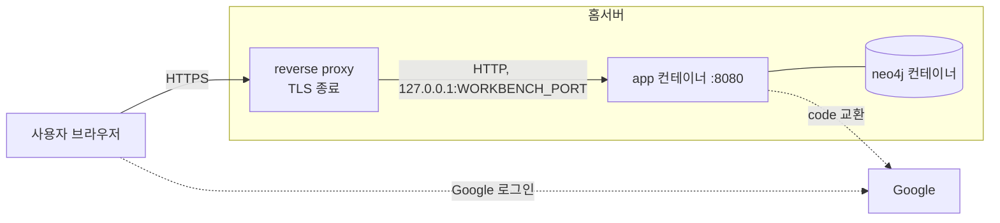

# 배포와 백업

## 기본 시나리오: 공개 HTTPS 경로와 앱 로그인

워크벤치는 TLS 를 끝내는 reverse proxy(Traefik 같은 것) 뒤에 두고 공개 HTTPS 경로로 연다.
**앱의 Google 로그인과 허용 사용자 목록이 유일한 접근 제어다.**
VPN 이나 Cloudflare Access 같은 접근 제어 계층을 앞에 더 두면 더 안전하다. 그때도 앱 로그인은 두 번째 계층으로 그대로 쓴다.



- `app` 은 호스트의 `${WORKBENCH_BIND}:${WORKBENCH_PORT}` 에만 열린다. 기본값은 `127.0.0.1:8081` 이다.
  reverse proxy 가 같은 호스트에 있으면 그대로 둔다. 8080 은 다른 서비스와 겹치기 쉬워 기본값으로 쓰지 않는다.
- `neo4j` 는 호스트 포트를 열지 않는다. Compose 내부 네트워크에서 `app` 만 접근한다.
- reverse proxy 는 `X-Forwarded-Proto`, `X-Forwarded-Host`, `X-Forwarded-For` 를 붙인다.
  app 은 `WORKBENCH_FORWARD_HEADERS_STRATEGY=native` 로 이 헤더를 읽어 OAuth redirect URI 를 `https://<공개 origin>/login/oauth2/code/google` 로 만든다.
  app 은 `WORKBENCH_TRUSTED_PROXIES`(Java 정규식)에 맞는 주소에서 온 요청의 `X-Forwarded-*` 만 믿는다.
  기본값은 loopback 과 Docker 브리지 대역 `172.16.0.0/12` 다. 같은 호스트의 프록시가 published 포트로 넘기면 Docker 게이트웨이(`172.x.0.1`)에서 온 것으로 보이기 때문이다.
  프록시 컨테이너 IP 를 고정할 수 있으면 그 주소 하나로 좁힌다(예: `172\.20\.0\.10`). 믿지 않는 주소가 보낸 헤더는 무시하고, redirect URI 는 `http://` 로 만들어져 Google 이 거절한다.
  **이 기본값은 `WORKBENCH_BIND` 가 loopback(`127.0.0.1`)일 때만 안전하다.**
  bind 를 loopback 밖(`0.0.0.0`, LAN 주소)으로 바꾸면 외부 클라이언트의 요청도 Docker 게이트웨이 주소에서 온 것으로 보여 신뢰 대상이 된다.
  그러면 누구나 `X-Forwarded-For`, `X-Forwarded-Proto` 를 마음대로 넣을 수 있다.
  그래서 운영 프로필은 forward headers 를 읽고(`native`) bind 가 loopback 이 아닌데 `WORKBENCH_TRUSTED_PROXIES` 가 비어 있으면 시작하지 않는다.
  bind 를 바꿀 때는 앞단 프록시 주소만 `WORKBENCH_TRUSTED_PROXIES` 에 넣는다.
- 앞단에서 요청 본문 크기를 제한한다(예: Traefik `buffering.maxRequestBodyBytes` 를 1MiB). app 도 `/api` 요청 본문을 64KiB 로 막지만 앞단에서 먼저 막는 편이 자원을 덜 쓴다.
- 세션 쿠키와 CSRF 쿠키는 `WORKBENCH_SECURE_COOKIE=true`(운영 기본값)로 Secure 다. HTTPS 가 없는 로컬 확인에서만 끈다.
- HSTS 는 앞단이 붙이는 것을 기본으로 한다. 앞단이 붙이지 않으면 `WORKBENCH_HSTS=true` 로 앱이 붙인다.
- 에이전트 API(`/api/v1/**`)는 같은 공개 주소로 들어온다. 앞단은 `Authorization` 헤더를 지우지 않고 그대로 넘기고, 접근 로그에 이 헤더를 남기지 않는다. 앞단에서 경로를 따로 막지 않는다. 앱이 연동 토큰으로 인증하고 토큰마다 1분에 60번으로 막는다([ADR-012](adr/012-agent-integration-token.md)).
  앱의 한도는 인증에 성공한 요청만 센다. 형식만 맞춘 가짜 토큰은 요청마다 해시 조회를 한 번씩 일으키므로, 앞단이 IP 기준 요청 한도를 걸 수 있으면 `/api/v1/` 에도 건다. 토큰을 맞출 수는 없지만(무작위 256비트) 조회 부하를 앞단에서 줄인다.
- 원격 MCP(`/mcp`)와 OAuth 인가 서버(`/oauth/**`, `/.well-known/oauth-protected-resource`, `/.well-known/oauth-authorization-server`)도 같은 공개 주소로 들어온다. 앞단은 이 경로를 막지 않고 `Authorization` 헤더를 그대로 넘긴다. `/oauth/token` 의 요청 본문(인가 코드, 갱신 토큰)을 접근 로그에 남기지 않는다. 메타데이터의 `issuer` 와 자원 주소는 `WORKBENCH_PUBLIC_URL` 이 있으면 그 값이고, 없으면 `X-Forwarded-Proto`, `X-Forwarded-Host` 로 만들어져 위의 forward headers 설정이 맞아야 `https://<공개 origin>` 이 된다. Host 헤더에 기대지 않도록 운영의 `.env` 에 `WORKBENCH_PUBLIC_URL=https://<공개 origin>` 을 넣는 것을 권한다([ADR-015](adr/015-remote-mcp-oauth.md)).
- 실제 홈서버 주소, 계정, 키, 경로는 이 저장소에 넣지 않는다. 홈서버의 `.env` 에만 둔다. 공개 주소는 예외로 `scripts/deploy-prod.sh` 와 플러그인의 `plugin/.mcp.json` 에 있다.

이번 작업에서는 홈서버에 배포하지 않았다. 아래 절차는 로컬 Compose 에서 확인했다(2026-10-20, macOS, Colima).
실제 Google 로그인은 client 가 없어 확인하지 못했다. 가짜 OIDC 공급자로 같은 리다이렉트 흐름을 확인했다.

## Google OAuth client 만들기

1. Google Cloud Console 에서 프로젝트를 고르거나 새로 만든다.
2. 「API 및 서비스 → OAuth 동의 화면」 에서 사용자 유형을 「외부」 로 고른다. 개인 Gmail 사용자가 들어와야 하기 때문이다.
   앱 이름, 지원 이메일을 넣고 범위는 `openid`, `email`, `profile` 만 고른다. 게시 상태가 「테스트」 면 테스트 사용자에 쓸 Gmail 을 넣는다.
3. 「사용자 인증 정보 → 사용자 인증 정보 만들기 → OAuth 클라이언트 ID」 에서 유형을 「웹 애플리케이션」 으로 고른다.
4. 「승인된 리디렉션 URI」 에 `https://<공개 origin>/login/oauth2/code/google` 을 넣는다. 끝의 경로가 정확히 같아야 한다.
   「승인된 JavaScript 원본」 은 비워 둔다. 브라우저가 Google API 를 직접 부르지 않는다.
5. 만든 뒤 나오는 두 값을 홈서버의 `.env` 에 넣는다.

| 받은 값 | 환경변수 |
| --- | --- |
| 클라이언트 ID | `GOOGLE_CLIENT_ID` |
| 클라이언트 보안 비밀번호 | `GOOGLE_CLIENT_SECRET` |

두 값이 비어 있으면 운영 프로필의 app 은 시작하지 않는다.

## 준비

```bash
# cwd: 저장소 루트
cp .env.example .env
# .env 에서 NEO4J_PASSWORD, GOOGLE_CLIENT_ID, GOOGLE_CLIENT_SECRET, WORKBENCH_BOOTSTRAP_ADMIN_EMAIL 을 채운다
bash scripts/check-compose.sh
```

| 변수 | 필수 | 설명 |
| --- | --- | --- |
| `NEO4J_PASSWORD` | 예 | Neo4j 비밀번호. 비어 있으면 Compose 와 API 가 모두 시작하지 않는다 |
| `GOOGLE_CLIENT_ID`, `GOOGLE_CLIENT_SECRET` | 예 | Google OAuth client. 비어 있으면 API 가 시작하지 않는다 |
| `WORKBENCH_BOOTSTRAP_ADMIN_EMAIL` | 처음 한 번 | 사용자가 한 명도 없을 때 만들 첫 ADMIN 의 Gmail. 사용자가 있으면 무시한다 |
| `WORKBENCH_SEEDS_ENABLED` | 아니오 | 기본 `true`. `false` 면 시작할 때 초기 데이터(`ontology/seeds/*.yaml`)를 넣지 않는다. 적용 결과는 API 로그의 `초기 데이터` 줄로 본다 |
| `WORKBENCH_BIND`, `WORKBENCH_PORT` | 아니요 | app 을 열 호스트 주소와 포트. 기본 `127.0.0.1`, `8081` |
| `WORKBENCH_SECURE_COOKIE` | 아니요 | 기본 `true`. 운영 프로필은 값이 없어도 `true` 다 |
| `WORKBENCH_FORWARD_HEADERS_STRATEGY` | 아니요 | 기본 `native`. 앞단 없이 직접 열면 `none` |
| `WORKBENCH_SESSION_TIMEOUT` | 아니요 | 유휴 세션 만료. 기본 `8h` |
| `WORKBENCH_HSTS` | 아니요 | 기본 `false` |
| `WORKBENCH_PUBLIC_URL` | 아니요 | OAuth 발급 주소, MCP 자원 주소, Origin 비교의 기준이 되는 공개 origin(`https://<공개 origin>`). 비우면 요청의 scheme 과 host 로 만든다 |
| `WORKBENCH_TRUSTED_PROXIES` | 아니요 | X-Forwarded-* 를 믿을 프록시 주소(정규식). 비우면 loopback 과 `172.16.0.0/12` |
| `NEO4J_TX_TIMEOUT`, `NEO4J_LOCK_TIMEOUT` | 아니요 | Neo4j 서버의 트랜잭션 시간 제한(기본 `10s`)과 잠금 대기 상한(기본 `5s`) |
| `WORKBENCH_IMAGE` | 아니요 | GHCR 이미지를 쓸 때 `ghcr.io/jon890/fos-valuation-ontology:sha-<7자리>` |

## 실행과 첫 관리자

```bash
# cwd: 저장소 루트
docker compose up -d --build --wait     # GHCR 이미지를 쓰면 WORKBENCH_IMAGE 를 두고 docker compose pull app 다음 --build 없이 실행
curl -fsS http://127.0.0.1:8081/api/health
```

첫 관리자는 `WORKBENCH_BOOTSTRAP_ADMIN_EMAIL` 의 Gmail 로 로그인한다. 그 뒤 오른쪽 위 「더보기」 메뉴의 「사용자」 에서 다른 사람의 Gmail 과 역할을 추가한다.
공개 가입은 없다. 목록에 없는 계정은 로그인 화면에서 「접근 권한이 없습니다」 를 본다.

| 역할 | 할 수 있는 일 |
| --- | --- |
| `VIEWER` | 조회만 |
| `EDITOR` | 지식 데이터의 생성, 수정, 검토, 보관, 복원 |
| `ADMIN` | EDITOR 권한과 사용자 관리 |

마지막 활성 ADMIN 은 강등하거나 비활성화할 수 없다. 사용자를 비활성화하면 그 사람의 세션은 다음 요청에서 끊긴다.

## 이미지 배포

`.github/workflows/workbench-image.yml` 이 `ghcr.io/jon890/fos-valuation-ontology` 에 `latest` 와 `sha-<7자리>` 태그로 올린다.
이 workflow 는 GitHub-hosted runner(`ubuntu-latest`)에서 Buildx 로 빌드하고, `GITHUB_TOKEN` 으로 GHCR 에 로그인해 올린다.
공개 저장소이므로 홈서버 self-hosted runner 를 쓰지 않는다(사용자 결정: 2026-10-24). 홈서버 runner 는 비공개 저장소에만 쓴다.
이미지 이름과 태그, OCI label(`org.opencontainers.image.source`, `org.opencontainers.image.revision`)은 workflow 에 명시한다.
`workflow_dispatch` 로 main 에서만 실행하고 플랫폼은 `linux/amd64` 다. 기존 이미지와 같이 provenance 는 만들지 않는다(`provenance: false`).
action 은 commit SHA 로 고정하고 버전 주석을 단다.
로컬에서 확인하려면 `docker buildx build --platform linux/amd64 .` 를 실행한다.
홈서버에서는 `latest` 대신 `sha-<7자리>` 를 `WORKBENCH_IMAGE` 에 고정해 쓴다.

운영 배포는 `scripts/deploy-prod.sh` 한 명령으로 한다. main 의 이미지 workflow 를 돌려 성공을 기다리고, 홈서버의 `scripts/deploy/host-deploy-service.sh financial-workbench`(fos-home-infra)로 배포한 뒤 공개 주소의 health 를 보고, 마지막에 아래 「배포 뒤 확인」 을 돈다.
PR 을 머지 큐(`merge-with-finish.py`)로 머지하면 `.orch/config.json` 의 머지 뒤 명령이 이 스크립트를 부른다. 문서만 머지했으면 배포하지 않는다.

## 배포 뒤 확인

`scripts/smoke-prod.ts` 가 공개 origin 에 읽기 요청만 보내 배포 결과를 확인한다. 외부 패키지 없이 Node 24 로 바로 돈다. `scripts/deploy-prod.sh` 가 마지막 단계로 부르고, 직접 부를 수도 있다.

```bash
# cwd: 저장소 루트
node scripts/smoke-prod.ts https://<공개 origin>
```

| 검사 | 기대값 |
| --- | --- |
| `GET /api/health` | 200 |
| 토큰 없는 `GET /api/v1/ontology` | 401 |
| 토큰 없는 `POST /mcp` | 401, `WWW-Authenticate` 가 `Bearer resource_metadata="https://<공개 origin>/.well-known/oauth-protected-resource/mcp"` 를 담는다 |
| `GET /.well-known/oauth-protected-resource/mcp` | `resource` 가 `https://<공개 origin>/mcp` |
| `GET /.well-known/oauth-authorization-server` | `issuer` 가 `https://<공개 origin>` |
| `GET /.well-known/oauth-authorization-server` | `code_challenge_methods_supported` 가 `S256` 을 담는다 |
| `SMOKE_TOKEN` 으로 `GET /api/v1/me` | 200. 환경 변수가 없으면 건너뛴다 |

검사마다 `통과:` 나 `실패:` 로 시작하는 줄을 찍고, 하나라도 실패하면 종료 코드 1 이다. origin 은 `https://` 여야 한다. `import.meta.main` 이 없는 Node(24.2 미만)에서도 직접 실행한 파일이면 검사를 돈다.
토큰 확인을 하려면 웹의 더보기 → 연동 토큰에서 「조회만」 확인용 토큰을 발급해 환경 변수로 넘긴다. 토큰 원문은 터미널 기록과 로그에 남기지 않고, 확인이 끝나면 화면에서 폐기한다.

```bash
read -rs SMOKE_TOKEN && export SMOKE_TOKEN
node scripts/smoke-prod.ts https://<공개 origin>
unset SMOKE_TOKEN
```

## 에이전트 연동 확인

연동 토큰과 `/api/v1` 을 처음 배포한 뒤 한 번 확인한다. 토큰 원문은 터미널 기록에 남지 않게 환경 변수로 넘기고, 확인이 끝나면 화면에서 폐기한다.

```bash
# 웹의 더보기 → 연동 토큰에서 「확인용」 토큰을 발급해 복사한 뒤
read -rs WORKBENCH_TOKEN && export WORKBENCH_TOKEN
curl -sS -o /dev/null -w '%{http_code}\n' -H "Authorization: Bearer $WORKBENCH_TOKEN" https://<공개 origin>/api/v1/ontology   # 200
curl -sS -o /dev/null -w '%{http_code}\n' https://<공개 origin>/api/v1/ontology                                                # 401
unset WORKBENCH_TOKEN
```

Hermes 에 넣는 토큰은 확인용과 따로 발급한다. 커넥터 설정 방법은 fos-assistant 의 커넥터 문서가 소유한다.

체결 기록과 제안(쓰기)을 처음 배포한 뒤에는 아래를 더 확인한다. 범위를 둔 배포 전에 발급한 토큰은 「조회만」 이라, 기록을 맡길 Hermes 토큰은 「조회와 기록」 으로 새로 발급하고 예전 토큰을 폐기한다.

```bash
# 「조회만」 확인용 토큰으로. 쓰기는 403 이어야 한다
curl -sS -o /dev/null -w '%{http_code}\n' -X POST -H "Authorization: Bearer $WORKBENCH_TOKEN" -H 'Content-Type: application/json' \
  -d '{"trades":[]}' https://<공개 origin>/api/v1/trades   # 403
curl -sS -o /dev/null -w '%{http_code}\n' -H "Authorization: Bearer $WORKBENCH_TOKEN" https://<공개 origin>/api/v1/trades   # 200
```

실제 체결을 넣는 확인은 Hermes 커넥터가 한다. 이 확인에서 가짜 체결을 운영에 넣지 않는다.

이 배포는 데이터 구조를 바꾸지 않고 새 label(`:Trade`, `:Proposal`)과 제약 조건만 더한다. 시작할 때 제약 조건이 생기므로 따로 옮길 데이터가 없다. 저장된 온톨로지에 코드가 소유하는 이름(`Trade`, `Proposal` 등, [데이터 스키마](data-schema.md) 의 「코드가 소유하는 이름」)을 쓴 타입이 있으면 시작할 때 그 버전을 읽지 못해 저장소 YAML 로 새 버전을 만든다. 운영 온톨로지에는 그런 타입이 없다.

## 원격 MCP 확인

원격 MCP 와 OAuth 인가 서버를 처음 배포한 뒤 한 번 확인한다. 데이터 구조는 새 label(`:OAuthClient`, `:OAuthCode`, `:OAuthGrant`)과 제약 조건만 더하고, 시작할 때 생기므로 옮길 데이터가 없다.

메타데이터의 `resource` 와 `issuer`, 토큰 없는 `POST /mcp` 의 401 과 `WWW-Authenticate` 는 위의 「배포 뒤 확인」 스크립트로 본다.

`resource` 나 `issuer` 가 `http://` 로 나오면 `WORKBENCH_PUBLIC_URL` 이 비어 있고 앞단의 `X-Forwarded-*` 를 app 이 믿지 않는 것이다. `WORKBENCH_PUBLIC_URL` 을 넣거나 위의 「기본 시나리오」 의 forward headers 설정을 확인한다.

그다음 실제 Claude Code 로 붙는다. 플러그인을 설치하거나 `claude mcp add --transport http valuation-ontology https://<공개 origin>/mcp` 로 더한 뒤 `/mcp` 에서 로그인한다. 동의 화면에서 「조회만」 을 고르고 「가치투자 온톨로지 연결 확인해 줘」 로 `get_connection` 을 부른다. 확인이 끝나면 웹의 더보기 → 연동 → 「연결된 앱」 에서 그 연결을 끊는다. 쓰기 도구는 운영에 가짜 체결이 들어가므로 이 확인에서 부르지 않는다.

## 자원 설정

| 서비스 | 변수 | 기본값 | 근거 |
| --- | --- | --- | --- |
| `neo4j` | `WORKBENCH_NEO4J_MEM_LIMIT` | `1536m` | heap 과 page cache 를 더한 1 GiB 에 JVM 밖 메모리(스레드, 네트워크 버퍼, 네이티브)로 0.5 GiB 를 더했다 |
| `neo4j` | `NEO4J_HEAP_SIZE` | `512m` | 두 사람이 쓰는 수천 노드 규모의 쿼리와 트랜잭션에 충분하다 |
| `neo4j` | `NEO4J_PAGECACHE_SIZE` | `512m` | 첫 버전의 저장소 크기(수십 MiB)를 모두 담고도 남는다. 데이터가 늘면 이 값을 먼저 키운다 |
| `app` | `WORKBENCH_API_MEM_LIMIT` | `768m` | JVM 은 `-XX:MaxRAMPercentage=70` 으로 이 한도의 70%(약 537 MiB)를 heap 상한으로 쓴다 |

`deploy.resources` 는 쓰지 않는다. 일반 `docker compose` 가 적용하는 `mem_limit` 을 쓴다.

## 실행 시간 상한

| 상한 | 값 | 넘으면 |
| --- | --- | --- |
| API 쓰기 트랜잭션 | 8초 | `503 QUERY_TIMEOUT` |
| API 그래프 조회 | 5초 | `503 QUERY_TIMEOUT` |
| Neo4j 서버 트랜잭션(`NEO4J_TX_TIMEOUT`) | 10초 | API 밖에서 연 트랜잭션(cypher-shell 등)도 끊는다 |
| Neo4j 잠금 대기(`NEO4J_LOCK_TIMEOUT`) | 5초 | `409 TRANSIENT_CONFLICT`. 화면은 다시 시도하라고 안내한다 |

## 컨테이너 보안

- 모든 컨테이너에 `cap_drop: [ALL]` 과 `no-new-privileges:true` 를 둔다.
- `neo4j` 만 `CHOWN`, `DAC_OVERRIDE`, `FOWNER`, `SETUID`, `SETGID`, `KILL` 을 되살린다.
  시작 스크립트가 `/data` 소유자를 맞추고 `neo4j` 사용자로 바꾸는 데 앞의 다섯이 필요하다.
  `KILL` 이 없으면 tini 가 `neo4j` 사용자 프로세스에 종료 신호를 넘기지 못한다(`Operation not permitted`). 그러면 깨끗하게 종료되지 않아 오프라인 덤프가 거부된다.
- `app` 은 uid 10001 로 돌고 cap 이 없다.
- docker.sock 은 어느 컨테이너에도 마운트하지 않는다.
- 운영 Neo4j 이미지와 Dockerfile 의 베이스 이미지(node, Temurin JDK, JRE)는 태그와 digest 로 고정한다.
- Gradle Wrapper 는 `distributionSha256Sum` 으로 배포본을 확인한다.
- 이미지 workflow 는 `main` 에서 실행했을 때만 publish 한다. 다른 ref 에서 실행하면 job 을 건너뛴다.

`scripts/check-compose.sh` 가 위 규칙과 포트 규칙을 `docker compose config` 출력으로 검사한다.

## 재시작과 데이터 보존

데이터는 `fos-workbench_neo4j-data` 볼륨에 있다.
`docker compose down` 다음 `docker compose up -d --wait` 를 해도 데이터가 남는다.
`docker compose down -v` 는 볼륨을 지운다. 운영에서 쓰지 않는다.

## 투자 온톨로지로 처음 전환할 때

[ADR-009](adr/009-investment-logic-chain.md) 전환을 아직 하지 않은 DB 에만 해당한다. 기존 온톨로지 버전이 있으면 새 이미지의 일반 타입과 관계를 자동으로 더하지 않으므로, 이미지 교체만으로 투자 온톨로지를 쓸 수는 없다.

아래 초기화는 사용자 계정만 보존하기로 승인받은 일회성 전환이다. 운영자가 별도 승인 아래 한 번 수행하며 일반 배포 때 반복하지 않는다.

1. 앱을 멈춰 전환 중 쓰기를 막는다.
2. 사용자 계정은 보존하고 지식 노드와 관계, 변경 이력, 기존 `SeedRun` 을 정리한다.
3. `OntologyHead` 와 모든 `OntologyVersion` 을 함께 초기화한다. 둘 중 하나만 남기면 최신 버전을 찾지 못하거나 버전 번호 제약에 걸려 시작하지 못한다.
4. 새 이미지를 시작한다. 저장소 YAML 로 온톨로지 버전 1 이 생기고 `investment-logic-2026-10` 초기 데이터가 적용된다.
5. 사용자 계정 수가 유지됐는지, 온톨로지 버전이 1 인지, 새 시드 하나와 결정 넷이 있는지 확인한다. health 와 초기 데이터 적용 로그를 확인하고 적용 실패나 건너뛰기 로그가 없어야 한다.
6. 다시 로그인해 결정에서 종목, 기업, 병목, 변화로 이어지는 연결을 확인한다. API 재시작으로 기존 로그인 세션은 사라진다.

전환이 끝난 뒤에는 일반 배포와 백업·복원 규칙대로 데이터를 보존한다. 초기화 없이 기존 온톨로지를 유지하는 경우에는 ADMIN 이 새 정의를 더해야 새 시드를 다음 시작 때 적용할 수 있다([데이터 스키마](data-schema.md) 의 「온톨로지 버전」).

## 저장소 온톨로지의 문구를 운영에 반영할 때

저장소 YAML 의 편집할 수 있는 부분(타입, 관계 종류, 주장 종류의 `label`, `description`, `createPicker`, `sentence`)은 DB 가 비어 있을 때의 첫 버전에만 쓰인다([ADR-008](adr/008-ontology-versions-in-db.md)). 이미지를 바꿔도 운영 온톨로지의 문구는 그대로다.

1. ADMIN 이 운영 화면의 더보기 「온톨로지 상세」 에서 「YAML 로 편집」 을 연다.
2. 저장소 YAML 과 다른 `label`, `description`, `createPicker`, `sentence` 값만 고친다. 운영에 없는 관계 종류의 `sentence` 는 새로 더한다. 키와 속성 정의는 건드리지 않는다. 운영에서 따로 더한 타입이 있으면 그대로 둔다.
3. 「저장 전에 확인」 의 바뀐 점이 문구뿐이고 영향 목록이 비어 있는지 본 뒤 메모(「저장소 문구 반영」)를 적고 저장한다.
4. 개념 지도의 선 글자, 타입 칸의 관계 문장, 상세의 연결 문장이 새 문구로 보이는지 확인한다.

Claude Code 나 Codex 에 「저장소 YAML 의 문구를 운영 온톨로지에 반영해 줘」 라고 맡겨도 된다. 에이전트가 올린 온톨로지 변경 제안을 「제안」 에서 같은 기준으로 확인하고 승인한다. 어느 쪽이든 새 버전이 쌓이므로 되돌릴 수 있다.

## 개념 설명을 운영에 반영할 때

관계 종류 `USES_CONCEPT`(「쓰는 개념」)와 개념 초기 데이터(`learning-concepts-2026-10`)는 이미지를 바꾸는 것만으로는 운영에 들어가지 않는다. 운영 온톨로지는 DB 의 버전이고, 초기 데이터는 그 관계 종류가 온톨로지에 있어야 적용된다([데이터 스키마](data-schema.md) 의 「초기 데이터」).

1. 이미지를 배포한다. 시작 로그에 `초기 데이터 learning-concepts-2026-10 를 적용하지 못했다` 가 `warn` 으로 남는다. 파일 전체가 롤백되어 개념도 만들어지지 않고 `SeedRun` 도 남지 않는다. 저장소 YAML 에만 있는 관계 종류라는 `warn` 로그(`USES_CONCEPT`)도 함께 남는다.
2. ADMIN 이 더보기 「온톨로지 상세」 의 「YAML 로 편집」 에 저장소 `ontology/financial-ontology.yaml` 의 `USES_CONCEPT` 정의를 `relationshipTypes` 아래에 더한다. 「저장 전에 확인」 의 바뀐 점이 `relationshipTypes.USES_CONCEPT` 더함 하나이고 영향 목록이 비어 있는지 본 뒤, 메모(「쓰는 개념 관계 추가」)를 적고 저장한다.
3. API 를 다시 시작한다(`docker compose restart app`). 시작할 때 `SeedRun` 이 없는 초기 데이터 파일을 다시 시도하므로 이번에는 적용되고 `초기 데이터 적용: 1개 파일` 이 남는다. 다시 시작하면 로그인 세션이 사라진다.
4. 개념 지도의 개념 개수가 0 이 아닌지, 「FLNC 간이 DCF (Valley AI 화면)」 상세에 개념 칩(DCF 등)이 보이는지, FLNC 첫 매수의 근거 따라가기와 공부 탭이 열리는지 확인한다.

## 백업

Neo4j Community 에디션은 온라인 백업(`neo4j-admin database backup`)을 지원하지 않는다.
`neo4j-admin database dump` 로 오프라인 덤프를 만든다. **덤프하는 동안 `neo4j` 가 깨끗하게 종료된 상태여야 한다.**
강제 종료되어 트랜잭션 로그가 남아 있으면 dump 가 `Active logical log detected` 로 거부한다.
그래서 `neo4j` 의 `stop_grace_period` 를 2분으로 두고, 스크립트도 `docker compose stop -t 120 neo4j` 로 멈춘다.

멈춘 동안 API 의 응답은 이렇다.

| 멈춘 것 | `/api/health` | 그 밖의 API |
| --- | --- | --- |
| `app` 과 `neo4j` 모두(백업 스크립트) | 응답 없음. 앞단은 502 나 503 을 낸다 | 응답 없음 |
| `neo4j` 만 | `503 {"status":"DOWN"}` | 조회와 쓰기 모두 `503 DATABASE_UNAVAILABLE`. 쓰기가 반쯤 남는 일은 없다 |

스크립트는 `app` 도 함께 멈춘다. 백업 중에는 쓰기가 아예 들어오지 않게 하는 편이 사용자에게 분명하다.

```bash
# cwd: 저장소 루트
scripts/backup.sh
```

1. `backups/` 를 700 으로 만들고 umask 077 로 파일을 600 으로 만든다.
2. `docker compose stop app`, `docker compose stop -t 120 neo4j`
3. `neo4j-admin database dump neo4j --to-stdout` 을 `neo4j` 이미지로 실행하고 표준 출력을 `backups/neo4j-YYYYMMDD-HHMMSS.dump` 에 쓴다.
   호스트 디렉터리를 컨테이너에 마운트하지 않으므로 neo4j uid 에 쓰기 권한을 열 필요가 없다.
   덤프가 1KiB 보다 작거나 앞에 텍스트가 섞이면 파일을 지우고 실패로 끝낸다.
4. 성공하든 실패하든 `docker compose start neo4j app` 다음 두 컨테이너가 healthy 가 될 때까지 기다린다. 컨테이너를 다시 만들지 않는다.

중단 시간은 데이터 크기에 비례한다. 첫 버전 규모에서는 수십 초다.
`backups/` 는 Git 에 넣지 않는다. 홈서버 밖(다른 디스크나 다른 장비)으로 복사해 둔다.
Compose 파일을 여러 개 겹쳐 쓰는 환경이면 `COMPOSE_FILE` 환경변수로 넘긴다(예: `COMPOSE_FILE=compose.yml:compose.override.yml`).

## 복원

```bash
scripts/restore.sh backups/neo4j-20261020-120000.dump    # 어느 디렉터리에서 실행해도 된다
```

1. 덤프 파일이 Neo4j 5 형식(크기 1KiB 이상, `DZV1` 머리말)인지 확인한다. 아니면 서비스를 멈추지 않고 끝낸다.
   그다음 안전 덤프 경로(`backups/neo4j-before-restore-<시각>.dump`)를 출력하고 `app` 과 `neo4j` 를 한 번만 멈춘다.
2. 멈춘 상태에서 현재 데이터를 안전 덤프로 저장한다. 이 덤프가 실패하면 아무것도 덮어쓰지 않았으므로 서비스를 다시 올리고 끝낸다.
3. 덤프 파일을 표준 입력으로 넘겨 `neo4j-admin database load neo4j --from-stdin --overwrite-destination=true` 를 실행한다.
4. 성공하면 `neo4j` 와 `app` 을 다시 시작하고 healthy 를 기다린다.

**load 가 실패하면 `neo4j` 와 `app` 을 멈춘 채 둔다.** `--overwrite-destination` 이 기존 DB 를 먼저 지웠거나 반쯤 바꿨을 수 있어서다.
로컬에서 형식만 맞고 내용이 깨진 파일로 확인했을 때 실패한 load 뒤에는 DB 가 없었다. 이 상태로 Neo4j 를 올리면 빈 DB 가 새로 만들어진다.
스크립트는 안전 덤프 경로와 되돌리는 명령(`scripts/restore.sh --skip-safety-dump <안전 덤프>`)을 출력한다.
`--skip-safety-dump` 는 덮어쓸 DB 가 이미 없거나 깨져 다시 안전 덤프를 뜰 수 없을 때만 쓴다. 원인을 확인한 뒤 그 명령으로 복원 전 상태로 되돌린다.
백업과 복원이 Ctrl-C 로 중단되면 반쯤 쓴 `.partial` 파일을 지운다. 백업 중단은 데이터를 바꾸지 않았으므로 서비스를 다시 올린다.
이 실패 경로는 `scripts/tests/test_backup_failures.sh` 가 가짜 docker 명령으로 검사한다.

로컬에서 확인한 순서는 이렇다. 백업을 만들고, Company 노드 하나를 지워 노드 수를 줄인 뒤 복원했다.
복원 뒤 노드 수가 백업 시점 값으로 돌아왔다. 쓰기 직후의 백업과 복원도 성공했다.

## 개발 환경

```bash
# cwd: 저장소 루트
docker compose -f compose.dev.yml up -d --wait     # Neo4j 127.0.0.1:7476(Browser), 127.0.0.1:7689(Bolt), 가짜 OIDC 127.0.0.1:8090
cd api && NEO4J_PASSWORD=... ./gradlew bootRun --args='--spring.profiles.active=mockoidc --workbench.bootstrap.admin-email=admin@example.com'
cd web && npm ci && npm run dev                    # 웹 :5173, /api 와 Google 로그인 경로, /oauth/, /.well-known, /mcp 를 :8080 으로 넘긴다
```

개발 로그인은 가짜 공급자의 폼에서 아무 sub 과 claims JSON(`{"email":"admin@example.com","email_verified":true}`)을 넣는다.
개발 Compose 의 포트는 `127.0.0.1` 에만 묶인다. 기본 포트(`7474`, `7687`)를 쓰는 다른 Neo4j 와 겹치지 않는다.
개발 Compose 의 프로젝트 이름은 `fos-workbench-dev` 이고 볼륨도 운영 Compose 와 따로 쓴다.

## 화면 테스트

화면 테스트는 Docker 없이 가짜 API 로 돈다. 가짜 API 는 서버 테스트가 만든 응답 스냅샷(`web/e2e/fixtures/`)을 돌려준다.

```bash
# cwd: web
npx playwright install chromium && npx playwright test --project=chromium --project=mobile
```
