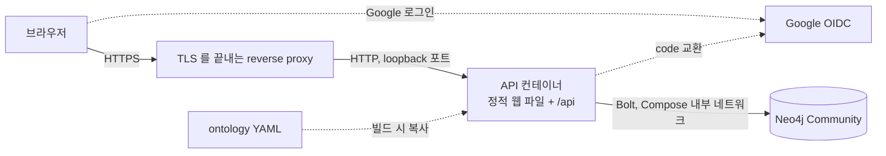

# 코드 구조

## 전체 배치

```text
financial-workbench/
  ontology/financial-ontology.yaml   온톨로지 정의. API 빌드가 jar 에 복사한다
  api/                               Kotlin + Spring Boot API. 자체 Gradle Wrapper
  web/                               React + TypeScript + Vite. Cytoscape.js 그래프
  web/e2e/                           Playwright 브라우저 테스트
  scripts/                           백업, 복원, Compose 설정 검사 스크립트
  Dockerfile                         웹 빌드, API 빌드, 실행 이미지를 한 파일에서 만든다
  compose.yml                        운영 Compose. Neo4j 포트를 공개하지 않는다
  compose.dev.yml                    개발 Compose. Neo4j 와 가짜 OIDC 공급자를 loopback 에 묶는다
  compose.e2e.yml                    브라우저 테스트용 override. 가짜 OIDC 공급자를 더한다
  docs/                              이 문서들
```

브라우저는 API 하고만 통신한다. Neo4j 자격증명과 Cypher 실행 기능은 클라이언트에 없다.



## 버전

| 구성 | 버전 | 근거 |
| --- | --- | --- |
| JDK | 21 (Temurin) | 저장소의 `java-agent-lab` 과 같다 |
| Spring Boot | 4.1.0 | `java-agent-lab/gradle/libs.versions.toml` 과 같다 |
| Kotlin | 2.3.21 | Spring Boot 4.1.0 BOM 의 `kotlin.version` |
| Neo4j Java Driver | 6.1.0 | Spring Boot 4.1.0 BOM 의 `neo4j-java-driver.version` |
| Testcontainers | 2.0.5 | Spring Boot 4.1.0 BOM 의 `testcontainers.version` |
| Neo4j | `neo4j:5.26.30-community` | 5.26 LTS. `python-graphrag` 와 같은 계열 |
| Gradle | 8.14.3 | `java-agent-lab` 의 Wrapper 와 같다 |
| Node | 24 | 이 머신의 `v24.15.0` |
| React | 19.3.1 | |
| Vite | 8.3.3 | |
| TypeScript | 6.0.3 | 7.x 는 네이티브 컴파일러 전환 직후라 도구 호환을 기다린다 |
| Cytoscape.js | 3.34.4 | |
| Playwright | 1.64.1 | |

확인한 출처는 다음과 같다.

- Spring Boot 4.1.0 이 관리하는 의존성 버전: https://docs.spring.io/spring-boot/appendix/dependency-versions/coordinates.html (로컬 Gradle 캐시의 `spring-boot-dependencies-4.1.0.pom` 과 대조)
- Spring Boot 4 의 Kotlin 최소 버전 2.2: https://docs.spring.io/spring-boot/system-requirements.html
- Neo4j 드라이버와 서버 호환: https://neo4j.com/developer/kb/neo4j-supported-versions/ , https://neo4j.com/docs/java-manual/current/
- Neo4j 5.26 LTS 지원 기간: https://neo4j.com/developer/kb/neo4j-supported-versions/
- Neo4j Community 백업(`neo4j-admin database dump`)의 오프라인 조건: https://neo4j.com/docs/operations-manual/5/backup-restore/offline-backup/

드라이버 6.1.0 과 Neo4j 5.26.30 의 조합은 Testcontainers 통합 테스트와 Compose 실행으로 실제 확인했다.

## API 패키지

루트 패키지는 `dev.fos.workbench` 다.

| 패키지 | 책임 |
| --- | --- |
| `config` | 설정 속성(`WorkbenchProperties`), Spring Security, Neo4j 제약 조건 생성 |
| `ontology` | YAML 읽기(`OntologyLoader`), 모델(`Ontology`), 쓰기 검증(`OntologyValidator`) |
| `auth` | `:User` 저장소, Google OIDC 허용 목록 검사(`AllowlistOidcUserService`), 요청마다 역할을 다시 읽는 필터, 첫 관리자 생성 |
| `users` | ADMIN 의 허용 사용자 관리 API |
| `knowledge` | 노드, 관계, Claim 의 서비스와 컨트롤러. revision 잠금과 갱신 |
| `graph` | 주변 그래프 조회와 한도 적용 |
| `history` | ChangeEvent 기록(`ChangeEventRecorder`)과 이력 조회 |
| `web` | 오류 형식(`ApiError`), 예외 처리기, health |

호출 방향은 `컨트롤러 → 서비스 → Neo4jClient` 다. 서비스가 트랜잭션 경계다.
`knowledge` 서비스는 `ontology` 의 검증기와 `history` 의 기록기를 부른다. 반대 방향 호출은 없다.

## Cypher 작성 규칙

- 값은 모두 parameter 로 넘긴다. 사용자 입력을 Cypher 문자열에 잇지 않는다.
- label 과 관계 타입은 Cypher parameter 가 될 수 없다. 이 둘은 `OntologyValidator` 가 온톨로지의 허용 목록과 대조한 이름만 문자열에 넣는다.
  대조는 `Ontology.requireNodeType()`, `Ontology.requireRelationshipType()` 한 곳에서 한다.
- 가변 길이 경로의 홉 수는 서버 설정 상한과 비교한 정수만 넣는다.

## 설정

| 키 | 환경변수 | 기본값 | 설명 |
| --- | --- | --- | --- |
| `spring.neo4j.uri` | `NEO4J_URI` | `bolt://localhost:7689` | |
| `spring.neo4j.authentication.username` | `NEO4J_USERNAME` | `neo4j` | |
| `spring.neo4j.authentication.password` | `NEO4J_PASSWORD` | 없음 | 비어 있으면 시작에 실패한다 |
| `workbench.graph.max-hops` | | 2 | |
| `workbench.graph.max-nodes` | | 150 | |
| `workbench.graph.max-relationships` | | 300 | |
| `workbench.graph.timeout` | | `5s` | 그래프 조회 트랜잭션 시간 제한 |
| `server.servlet.session.cookie.secure`, `workbench.security.secure-cookies` | `WORKBENCH_SECURE_COOKIE` | `prod` 는 `true`, 그 밖은 `false` | 세션 쿠키와 CSRF 쿠키의 Secure |
| `server.forward-headers-strategy` | `WORKBENCH_FORWARD_HEADERS_STRATEGY` | `none` (운영 Compose 는 `native`) | 앞단의 `X-Forwarded-*` 로 redirect URI 와 scheme 을 만든다 |
| `server.servlet.session.timeout` | `WORKBENCH_SESSION_TIMEOUT` | `8h` | 유휴 세션 만료 |
| `workbench.security.hsts` | `WORKBENCH_HSTS` | `false` | 앞단이 HSTS 를 붙이지 않을 때만 켠다 |
| `server.tomcat.remoteip.internal-proxies` | `WORKBENCH_TRUSTED_PROXIES` | loopback 과 `172.16.0.0/12` | X-Forwarded-* 를 믿을 프록시 주소(정규식) |
| `workbench.detail.max-relationships`, `max-claims` | | 100, 50 | 노드 상세 목록 상한 |
| `workbench.bootstrap.admin-email` | `WORKBENCH_BOOTSTRAP_ADMIN_EMAIL` | 없음 | 사용자가 없을 때 만들 첫 ADMIN |
| `spring.security.oauth2.client.registration.google.client-id`, `client-secret` | `GOOGLE_CLIENT_ID`, `GOOGLE_CLIENT_SECRET` | 없음 | 운영 프로필에서 비어 있으면 시작에 실패한다 |

프로필은 아래와 같다.

| 프로필 | 들어 있는 것 | 쓰는 곳 |
| --- | --- | --- |
| `prod` | `container`, 실제 Google 등록, Secure 쿠키 기본값 true | 운영 이미지 기본값 |
| `e2e` | `container`, `mockoidc` | 브라우저 테스트(`compose.e2e.yml`) |
| `container` | 이미지 안의 정적 파일 위치 | prod, e2e 공통 |
| `mockoidc` | 가짜 OIDC 공급자(`ghcr.io/navikt/mock-oauth2-server`) | 개발 실행, 자동 테스트, e2e |

`prod` 는 시작할 때 `ProdStartupGuard` 가 아래를 확인하고 하나라도 어기면 멈춘다.

- `mockoidc` 가 함께 켜지지 않았다. 가짜 공급자는 아무 이메일이나 확인된 것으로 발급하기 때문이다.
- Neo4j 비밀번호와 Google client id, secret 이 비어 있지 않다.
- `google` 등록의 발급자가 `https://accounts.google.com` 이고 인가 주소가 Google 이다.

## 보안 기본값

| 항목 | 값 |
| --- | --- |
| 인증 없이 열린 경로 | `/api/health`(`status` 만), `/api/auth/csrf`, OAuth 경로, 정적 파일 |
| 응답 헤더 | `Content-Security-Policy`(같은 origin 의 스크립트, 스타일, API 만), `X-Content-Type-Options: nosniff`, `Referrer-Policy: same-origin`, `X-Frame-Options: DENY`, `frame-ancestors 'none'` |
| 오류 응답 | 문서화한 `{code, message, details}` 만. 스택 트레이스, 경로, Neo4j 오류 원문을 담지 않는다 |
| actuator | 의존성에 없다 |
| 컨테이너 | `cap_drop: [ALL]`, `no-new-privileges`, docker.sock 마운트 없음. Neo4j 만 시작과 종료에 필요한 cap 을 되살린다 |

## 웹 구조

| 경로 | 책임 |
| --- | --- |
| `web/src/api/` | fetch 래퍼, CSRF 처리, 계약 타입 |
| `web/src/components/` | 화면 조각. 그래프, 상세 패널, 표, 폼. `ErrorBoundary` 가 탭 단위로 렌더링 오류를 붙잡아 머리글과 탭을 지키고, 앱 최상위(`main.tsx`)에도 하나 있다 |
| `web/src/lib/` | 그래프 병합, 입력값 변환, 표시 이름 조회(`labels.ts`)처럼 화면과 무관한 함수와 단위 테스트 |

화면에 보이는 타입, 속성, 선택지, 관계, 검토 상태 이름은 코드에 적지 않고 `/api/ontology` 의 표시 이름(`label`, `valueLabels`)을 `labels.ts` 로 읽는다. 이름이 없으면 키를 그대로 보인다. 규칙은 [데이터 스키마](data-schema.md) 의 「표시 이름」 이다.

개발할 때는 Vite 가 `/api` 를 `127.0.0.1:8080` 으로 넘겨 같은 origin 을 흉내 낸다.
운영에서는 API 컨테이너가 빌드된 웹 파일을 함께 제공한다.

## 테스트

| 종류 | 위치 | Neo4j |
| --- | --- | --- |
| 온톨로지 단위 테스트 | `api/src/test/kotlin/.../ontology/` | 쓰지 않음 |
| 통합 테스트 | `api/src/test/kotlin/.../` 의 `*IntegrationTest` | Testcontainers 로 `neo4j:5.26.30-community` 와 가짜 OIDC 공급자를 띄운다 |
| 웹 단위 테스트 | `web/src/**/*.test.ts`, `*.test.tsx` | 쓰지 않음. 컴포넌트는 `react-dom/server` 로 렌더링해 확인한다 |
| 브라우저 테스트 | `web/e2e/` | 운영 Compose 와 `compose.e2e.yml`. 가짜 OIDC 공급자로 실제 OAuth 리다이렉트를 탄다 |

mock 으로 Neo4j 를 대신한 테스트는 없다. 트랜잭션 일관성 테스트만 실패하는 `ChangeEventRecorder` 를 주입한다. 이때도 Neo4j 는 실제 컨테이너다.

## 결정

| ADR | 결정 |
| --- | --- |
| [001](adr/001-kotlin-spring-neo4jclient.md) | API 는 Kotlin, Spring Boot 4.1, Neo4jClient 로 만든다 |
| [002](adr/002-claim-as-node.md) | 근거가 필요한 금융 주장은 Claim 노드로 저장한다 |
| [003](adr/003-revision-lock-then-check.md) | revision 비교 전에 대상 노드에 쓰기 잠금을 건다 |
| [004](adr/004-session-csrf-same-origin.md) | 세션과 쿠키 CSRF 토큰을 쓰고 웹과 API 를 같은 origin 으로 제공한다. 로그인 방식은 006 이 대체했다 |
| [005](adr/005-ontology-yaml-server-validation.md) | 온톨로지는 Git 의 YAML 로 관리하고 API 가 쓰기를 검증한다 |
| [006](adr/006-google-oidc-allowlist-roles.md) | Google OpenID Connect 로 로그인하고 허용 사용자와 역할로 권한을 나눈다. ADR 004 의 비밀번호 로그인을 대체한다 |

ADR 로 남기지 않은 작은 결정은 다음과 같다.

- 브라우저 테스트는 `prod` 를 켜지 않고 `e2e` 프로필(= `container` + `mockoidc`)로 돈다. `prod` 와 `mockoidc` 를 함께 켜면 시작을 막는다.
  e2e 스택은 운영 Compose 위에 override 만 겹치므로 이미지, 보안 헤더, cap_drop, 메모리 상한, 포트 규칙이 운영과 같다. Secure 쿠키와 forward headers 만 끈다.
  `prod` 에 가짜 공급자를 허용하는 안은 버렸다. 설정 실수 하나로 아무나 첫 관리자로 로그인할 수 있게 되기 때문이다.
- 시각은 고정 자릿수 문자열로 저장한다. Neo4j `datetime` 타입으로 바꾸는 안은 JSON 계약과 기존 개발 데이터를 함께 바꿔야 해서 버렸다.
- 백업은 `neo4j-admin database dump --to-stdout` 으로 받아 호스트 파일(600)에 쓴다. 호스트 디렉터리를 컨테이너에 마운트하지 않아 권한을 넓힐 필요가 없다.

- 작성자와 마지막으로 내용을 고친 사람은 그 Claim 을 검토할 수 없다. 다른 사람이 확인하는 것이 검토의 목적이다.
- Claim 내용을 고치면 검토 상태가 `DRAFT` 로 돌아간다. 검토한 내용과 다른 내용이 검토 완료로 남지 않게 한다.
- 개발 Compose 는 Neo4j 를 `127.0.0.1:7476`, `127.0.0.1:7689` 에 연다. `python-graphrag` 의 7475, 7688 과 겹치지 않는다.
- 운영 Compose 의 app 은 기본으로 `127.0.0.1:8081` 에 연다. 앞단 reverse proxy 가 이 포트로 넘긴다. 8080 은 다른 서비스와 겹치기 쉬워 기본값으로 쓰지 않는다.
- 운영 Neo4j 이미지는 digest 로 고정한다. 태그가 다른 이미지를 가리키게 되어도 배포 결과가 바뀌지 않는다.
