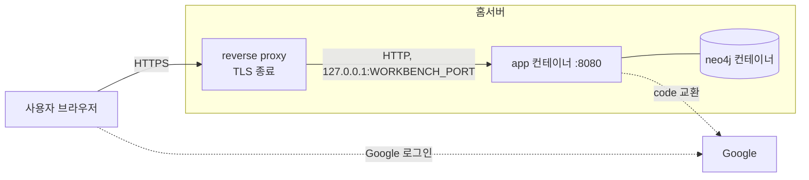

# 배포와 백업

## 기본 시나리오: 공개 HTTPS 경로와 앱 로그인

워크벤치는 TLS 를 끝내는 reverse proxy(Traefik 같은 것) 뒤에 두고 공개 HTTPS 경로로 연다.
**앱의 Google 로그인과 허용 사용자 목록이 유일한 접근 제어다.**
VPN 이나 Cloudflare Access 같은 접근 제어 계층을 앞에 더 두면 더 안전하다. 그때도 앱 로그인은 두 번째 계층으로 그대로 쓴다.



- `app` 은 호스트의 `${WORKBENCH_BIND}:${WORKBENCH_PORT}` 에만 열린다. 기본값은 `127.0.0.1:8081` 이다.
  reverse proxy 가 같은 호스트에 있으면 그대로 둔다. 8080 은 다른 서비스와 겹치기 쉬워 기본값으로 쓰지 않는다.
- `neo4j` 는 호스트 포트를 열지 않는다. Compose 내부 네트워크에서 `app` 만 접근한다.
- reverse proxy 는 `X-Forwarded-Proto`, `X-Forwarded-Host`, `X-Forwarded-For` 를 붙인다.
  app 은 `WORKBENCH_FORWARD_HEADERS_STRATEGY=native` 로 이 헤더를 읽어 OAuth redirect URI 를 `https://<공개 origin>/login/oauth2/code/google` 로 만든다.
  app 은 `WORKBENCH_TRUSTED_PROXIES`(Java 정규식)에 맞는 주소에서 온 요청의 `X-Forwarded-*` 만 믿는다.
  기본값은 loopback 과 Docker 브리지 대역 `172.16.0.0/12` 다. 같은 호스트의 프록시가 published 포트로 넘기면 Docker 게이트웨이(`172.x.0.1`)에서 온 것으로 보이기 때문이다.
  프록시 컨테이너 IP 를 고정할 수 있으면 그 주소 하나로 좁힌다(예: `172\.20\.0\.10`). 믿지 않는 주소가 보낸 헤더는 무시하고, redirect URI 는 `http://` 로 만들어져 Google 이 거절한다.
  **이 기본값은 `WORKBENCH_BIND` 가 loopback(`127.0.0.1`)일 때만 안전하다.**
  bind 를 loopback 밖(`0.0.0.0`, LAN 주소)으로 바꾸면 외부 클라이언트의 요청도 Docker 게이트웨이 주소에서 온 것으로 보여 신뢰 대상이 된다.
  그러면 누구나 `X-Forwarded-For`, `X-Forwarded-Proto` 를 마음대로 넣을 수 있다.
  그래서 운영 프로필은 forward headers 를 읽고(`native`) bind 가 loopback 이 아닌데 `WORKBENCH_TRUSTED_PROXIES` 가 비어 있으면 시작하지 않는다.
  bind 를 바꿀 때는 앞단 프록시 주소만 `WORKBENCH_TRUSTED_PROXIES` 에 넣는다.
- 앞단에서 요청 본문 크기를 제한한다(예: Traefik `buffering.maxRequestBodyBytes` 를 1MiB). app 도 `/api` 요청 본문을 64KiB 로 막지만 앞단에서 먼저 막는 편이 자원을 덜 쓴다.
- 세션 쿠키와 CSRF 쿠키는 `WORKBENCH_SECURE_COOKIE=true`(운영 기본값)로 Secure 다. HTTPS 가 없는 로컬 확인에서만 끈다.
- HSTS 는 앞단이 붙이는 것을 기본으로 한다. 앞단이 붙이지 않으면 `WORKBENCH_HSTS=true` 로 앱이 붙인다.
- 실제 홈서버 주소, 도메인, 계정, 키, 경로는 이 저장소에 넣지 않는다. 홈서버의 `.env` 에만 둔다.

이번 작업에서는 홈서버에 배포하지 않았다. 아래 절차는 로컬 Compose 에서 확인했다(2026-10-20, macOS, Colima).
실제 Google 로그인은 client 가 없어 확인하지 못했다. 가짜 OIDC 공급자로 같은 리다이렉트 흐름을 확인했다.

## Google OAuth client 만들기

1. Google Cloud Console 에서 프로젝트를 고르거나 새로 만든다.
2. 「API 및 서비스 → OAuth 동의 화면」 에서 사용자 유형을 「외부」 로 고른다. 개인 Gmail 사용자가 들어와야 하기 때문이다.
   앱 이름, 지원 이메일을 넣고 범위는 `openid`, `email`, `profile` 만 고른다. 게시 상태가 「테스트」 면 테스트 사용자에 쓸 Gmail 을 넣는다.
3. 「사용자 인증 정보 → 사용자 인증 정보 만들기 → OAuth 클라이언트 ID」 에서 유형을 「웹 애플리케이션」 으로 고른다.
4. 「승인된 리디렉션 URI」 에 `https://<공개 origin>/login/oauth2/code/google` 을 넣는다. 끝의 경로가 정확히 같아야 한다.
   「승인된 JavaScript 원본」 은 비워 둔다. 브라우저가 Google API 를 직접 부르지 않는다.
5. 만든 뒤 나오는 두 값을 홈서버의 `.env` 에 넣는다.

| 받은 값 | 환경변수 |
| --- | --- |
| 클라이언트 ID | `GOOGLE_CLIENT_ID` |
| 클라이언트 보안 비밀번호 | `GOOGLE_CLIENT_SECRET` |

두 값이 비어 있으면 운영 프로필의 app 은 시작하지 않는다.

## 준비

```bash
# cwd: financial-workbench
cp .env.example .env
# .env 에서 NEO4J_PASSWORD, GOOGLE_CLIENT_ID, GOOGLE_CLIENT_SECRET, WORKBENCH_BOOTSTRAP_ADMIN_EMAIL 을 채운다
bash scripts/check-compose.sh
```

| 변수 | 필수 | 설명 |
| --- | --- | --- |
| `NEO4J_PASSWORD` | 예 | Neo4j 비밀번호. 비어 있으면 Compose 와 API 가 모두 시작하지 않는다 |
| `GOOGLE_CLIENT_ID`, `GOOGLE_CLIENT_SECRET` | 예 | Google OAuth client. 비어 있으면 API 가 시작하지 않는다 |
| `WORKBENCH_BOOTSTRAP_ADMIN_EMAIL` | 처음 한 번 | 사용자가 한 명도 없을 때 만들 첫 ADMIN 의 Gmail. 사용자가 있으면 무시한다 |
| `WORKBENCH_SEEDS_ENABLED` | 아니오 | 기본 `true`. `false` 면 시작할 때 초기 데이터(`ontology/seeds/*.yaml`)를 넣지 않는다. 적용 결과는 API 로그의 `초기 데이터` 줄로 본다 |
| `WORKBENCH_BIND`, `WORKBENCH_PORT` | 아니요 | app 을 열 호스트 주소와 포트. 기본 `127.0.0.1`, `8081` |
| `WORKBENCH_SECURE_COOKIE` | 아니요 | 기본 `true`. 운영 프로필은 값이 없어도 `true` 다 |
| `WORKBENCH_FORWARD_HEADERS_STRATEGY` | 아니요 | 기본 `native`. 앞단 없이 직접 열면 `none` |
| `WORKBENCH_SESSION_TIMEOUT` | 아니요 | 유휴 세션 만료. 기본 `8h` |
| `WORKBENCH_HSTS` | 아니요 | 기본 `false` |
| `WORKBENCH_TRUSTED_PROXIES` | 아니요 | X-Forwarded-* 를 믿을 프록시 주소(정규식). 비우면 loopback 과 `172.16.0.0/12` |
| `NEO4J_TX_TIMEOUT`, `NEO4J_LOCK_TIMEOUT` | 아니요 | Neo4j 서버의 트랜잭션 시간 제한(기본 `10s`)과 잠금 대기 상한(기본 `5s`) |
| `WORKBENCH_IMAGE` | 아니요 | GHCR 이미지를 쓸 때 `ghcr.io/jon890/fos-graphrag-workbench:sha-<7자리>` |

## 실행과 첫 관리자

```bash
# cwd: financial-workbench
docker compose up -d --build --wait     # GHCR 이미지를 쓰면 WORKBENCH_IMAGE 를 두고 docker compose pull app 다음 --build 없이 실행
curl -fsS http://127.0.0.1:8081/api/health
```

첫 관리자는 `WORKBENCH_BOOTSTRAP_ADMIN_EMAIL` 의 Gmail 로 로그인한다. 그 뒤 「사용자」 탭에서 다른 사람의 Gmail 과 역할을 추가한다.
공개 가입은 없다. 목록에 없는 계정은 로그인 화면에서 「접근 권한이 없습니다」 를 본다.

| 역할 | 할 수 있는 일 |
| --- | --- |
| `VIEWER` | 조회만 |
| `EDITOR` | 지식 데이터의 생성, 수정, 검토, 보관, 복원 |
| `ADMIN` | EDITOR 권한과 사용자 관리 |

마지막 활성 ADMIN 은 강등하거나 비활성화할 수 없다. 사용자를 비활성화하면 그 사람의 세션은 다음 요청에서 끊긴다.

## 이미지 배포

`.github/workflows/workbench-image.yml` 이 `ghcr.io/jon890/fos-graphrag-workbench` 에 `latest` 와 `sha-<7자리>` 태그로 올린다.
이 workflow 는 GitHub-hosted runner(`ubuntu-latest`)에서 Buildx 로 빌드하고, `GITHUB_TOKEN` 으로 GHCR 에 로그인해 올린다.
공개 저장소이므로 홈서버 self-hosted runner 를 쓰지 않는다(사용자 결정: 2026-10-24). 홈서버 runner 는 비공개 저장소에만 쓴다.
이미지 이름과 태그, OCI label(`org.opencontainers.image.source`, `org.opencontainers.image.revision`)은 workflow 에 명시한다.
`workflow_dispatch` 로 main 에서만 실행하고 플랫폼은 `linux/amd64` 다. 기존 이미지와 같이 provenance 는 만들지 않는다(`provenance: false`).
action 은 commit SHA 로 고정하고 버전 주석을 단다.
로컬에서 확인하려면 `docker buildx build --platform linux/amd64 financial-workbench` 를 실행한다.
홈서버에서는 `latest` 대신 `sha-<7자리>` 를 `WORKBENCH_IMAGE` 에 고정해 쓴다.

운영 배포는 `scripts/deploy-prod.sh` 한 명령으로 한다. main 의 이미지 workflow 를 돌려 성공을 기다리고, 홈서버의 `scripts/deploy/host-deploy-service.sh financial-workbench`(fos-home-infra)로 배포한 뒤 공개 주소의 health 를 본다.
PR 을 머지 큐(`merge-with-finish.py`)로 머지하면 `.claude/orch-finish.json` 의 머지 뒤 명령이 이 스크립트를 부른다. 문서만 머지했으면 배포하지 않는다.

## 자원 설정

| 서비스 | 변수 | 기본값 | 근거 |
| --- | --- | --- | --- |
| `neo4j` | `WORKBENCH_NEO4J_MEM_LIMIT` | `1536m` | heap 과 page cache 를 더한 1 GiB 에 JVM 밖 메모리(스레드, 네트워크 버퍼, 네이티브)로 0.5 GiB 를 더했다 |
| `neo4j` | `NEO4J_HEAP_SIZE` | `512m` | 두 사람이 쓰는 수천 노드 규모의 쿼리와 트랜잭션에 충분하다 |
| `neo4j` | `NEO4J_PAGECACHE_SIZE` | `512m` | 첫 버전의 저장소 크기(수십 MiB)를 모두 담고도 남는다. 데이터가 늘면 이 값을 먼저 키운다 |
| `app` | `WORKBENCH_API_MEM_LIMIT` | `768m` | JVM 은 `-XX:MaxRAMPercentage=70` 으로 이 한도의 70%(약 537 MiB)를 heap 상한으로 쓴다 |

`deploy.resources` 는 쓰지 않는다. 일반 `docker compose` 가 적용하는 `mem_limit` 을 쓴다.

## 실행 시간 상한

| 상한 | 값 | 넘으면 |
| --- | --- | --- |
| API 쓰기 트랜잭션 | 8초 | `503 QUERY_TIMEOUT` |
| API 그래프 조회 | 5초 | `503 QUERY_TIMEOUT` |
| Neo4j 서버 트랜잭션(`NEO4J_TX_TIMEOUT`) | 10초 | API 밖에서 연 트랜잭션(cypher-shell 등)도 끊는다 |
| Neo4j 잠금 대기(`NEO4J_LOCK_TIMEOUT`) | 5초 | `409 TRANSIENT_CONFLICT`. 화면은 다시 시도하라고 안내한다 |

## 컨테이너 보안

- 모든 컨테이너에 `cap_drop: [ALL]` 과 `no-new-privileges:true` 를 둔다.
- `neo4j` 만 `CHOWN`, `DAC_OVERRIDE`, `FOWNER`, `SETUID`, `SETGID`, `KILL` 을 되살린다.
  시작 스크립트가 `/data` 소유자를 맞추고 `neo4j` 사용자로 바꾸는 데 앞의 다섯이 필요하다.
  `KILL` 이 없으면 tini 가 `neo4j` 사용자 프로세스에 종료 신호를 넘기지 못한다(`Operation not permitted`). 그러면 깨끗하게 종료되지 않아 오프라인 덤프가 거부된다.
- `app` 은 uid 10001 로 돌고 cap 이 없다.
- docker.sock 은 어느 컨테이너에도 마운트하지 않는다.
- 운영 Neo4j 이미지와 Dockerfile 의 베이스 이미지(node, Temurin JDK, JRE)는 태그와 digest 로 고정한다.
- Gradle Wrapper 는 `distributionSha256Sum` 으로 배포본을 확인한다.
- 이미지 workflow 는 `main` 에서 실행했을 때만 publish 한다. 다른 ref 에서 실행하면 job 을 건너뛴다.

`scripts/check-compose.sh` 가 위 규칙과 포트 규칙을 `docker compose config` 출력으로 검사한다.

## 재시작과 데이터 보존

데이터는 `fos-workbench_neo4j-data` 볼륨에 있다.
`docker compose down` 다음 `docker compose up -d --wait` 를 해도 데이터가 남는다.
`docker compose down -v` 는 볼륨을 지운다. 운영에서 쓰지 않는다.

## 백업

Neo4j Community 에디션은 온라인 백업(`neo4j-admin database backup`)을 지원하지 않는다.
`neo4j-admin database dump` 로 오프라인 덤프를 만든다. **덤프하는 동안 `neo4j` 가 깨끗하게 종료된 상태여야 한다.**
강제 종료되어 트랜잭션 로그가 남아 있으면 dump 가 `Active logical log detected` 로 거부한다.
그래서 `neo4j` 의 `stop_grace_period` 를 2분으로 두고, 스크립트도 `docker compose stop -t 120 neo4j` 로 멈춘다.

멈춘 동안 API 의 응답은 이렇다.

| 멈춘 것 | `/api/health` | 그 밖의 API |
| --- | --- | --- |
| `app` 과 `neo4j` 모두(백업 스크립트) | 응답 없음. 앞단은 502 나 503 을 낸다 | 응답 없음 |
| `neo4j` 만 | `503 {"status":"DOWN"}` | 조회와 쓰기 모두 `503 DATABASE_UNAVAILABLE`. 쓰기가 반쯤 남는 일은 없다 |

스크립트는 `app` 도 함께 멈춘다. 백업 중에는 쓰기가 아예 들어오지 않게 하는 편이 사용자에게 분명하다.

```bash
# cwd: financial-workbench
scripts/backup.sh
```

1. `backups/` 를 700 으로 만들고 umask 077 로 파일을 600 으로 만든다.
2. `docker compose stop app`, `docker compose stop -t 120 neo4j`
3. `neo4j-admin database dump neo4j --to-stdout` 을 `neo4j` 이미지로 실행하고 표준 출력을 `backups/neo4j-YYYYMMDD-HHMMSS.dump` 에 쓴다.
   호스트 디렉터리를 컨테이너에 마운트하지 않으므로 neo4j uid 에 쓰기 권한을 열 필요가 없다.
   덤프가 1KiB 보다 작거나 앞에 텍스트가 섞이면 파일을 지우고 실패로 끝낸다.
4. 성공하든 실패하든 `docker compose start neo4j app` 다음 두 컨테이너가 healthy 가 될 때까지 기다린다. 컨테이너를 다시 만들지 않는다.

중단 시간은 데이터 크기에 비례한다. 첫 버전 규모에서는 수십 초다.
`backups/` 는 Git 에 넣지 않는다. 홈서버 밖(다른 디스크나 다른 장비)으로 복사해 둔다.
Compose 파일을 여러 개 겹쳐 쓰는 환경이면 `COMPOSE_FILE` 환경변수로 넘긴다(예: `COMPOSE_FILE=compose.yml:compose.override.yml`).

## 복원

```bash
scripts/restore.sh backups/neo4j-20261020-120000.dump    # 어느 디렉터리에서 실행해도 된다
```

1. 덤프 파일이 Neo4j 5 형식(크기 1KiB 이상, `DZV1` 머리말)인지 확인한다. 아니면 서비스를 멈추지 않고 끝낸다.
   그다음 안전 덤프 경로(`backups/neo4j-before-restore-<시각>.dump`)를 출력하고 `app` 과 `neo4j` 를 한 번만 멈춘다.
2. 멈춘 상태에서 현재 데이터를 안전 덤프로 저장한다. 이 덤프가 실패하면 아무것도 덮어쓰지 않았으므로 서비스를 다시 올리고 끝낸다.
3. 덤프 파일을 표준 입력으로 넘겨 `neo4j-admin database load neo4j --from-stdin --overwrite-destination=true` 를 실행한다.
4. 성공하면 `neo4j` 와 `app` 을 다시 시작하고 healthy 를 기다린다.

**load 가 실패하면 `neo4j` 와 `app` 을 멈춘 채 둔다.** `--overwrite-destination` 이 기존 DB 를 먼저 지웠거나 반쯤 바꿨을 수 있어서다.
로컬에서 형식만 맞고 내용이 깨진 파일로 확인했을 때 실패한 load 뒤에는 DB 가 없었다. 이 상태로 Neo4j 를 올리면 빈 DB 가 새로 만들어진다.
스크립트는 안전 덤프 경로와 되돌리는 명령(`scripts/restore.sh --skip-safety-dump <안전 덤프>`)을 출력한다.
`--skip-safety-dump` 는 덮어쓸 DB 가 이미 없거나 깨져 다시 안전 덤프를 뜰 수 없을 때만 쓴다. 원인을 확인한 뒤 그 명령으로 복원 전 상태로 되돌린다.
백업과 복원이 Ctrl-C 로 중단되면 반쯤 쓴 `.partial` 파일을 지운다. 백업 중단은 데이터를 바꾸지 않았으므로 서비스를 다시 올린다.
이 실패 경로는 `scripts/tests/test_backup_failures.sh` 가 가짜 docker 명령으로 검사한다.

로컬에서 확인한 순서는 이렇다. 백업을 만들고, Company 노드 하나를 지워 노드 수를 줄인 뒤 복원했다.
복원 뒤 노드 수가 백업 시점 값으로 돌아왔다. 쓰기 직후의 백업과 복원도 성공했다.

## 개발 환경

```bash
# cwd: financial-workbench
docker compose -f compose.dev.yml up -d --wait     # Neo4j 127.0.0.1:7476(Browser), 127.0.0.1:7689(Bolt), 가짜 OIDC 127.0.0.1:8090
cd api && NEO4J_PASSWORD=... ./gradlew bootRun --args='--spring.profiles.active=mockoidc --workbench.bootstrap.admin-email=admin@example.com'
cd web && npm ci && npm run dev                    # 웹 :5173, /api 와 OAuth 경로를 :8080 으로 넘긴다
```

개발 로그인은 가짜 공급자의 폼에서 아무 sub 과 claims JSON(`{"email":"admin@example.com","email_verified":true}`)을 넣는다.
개발 Compose 의 포트는 `127.0.0.1` 에만 묶인다. `python-graphrag` 의 `7475`, `7688` 과 겹치지 않는다.
개발 Compose 의 프로젝트 이름은 `fos-workbench-dev` 이고 볼륨도 운영 Compose 와 따로 쓴다.

## 브라우저 테스트

```bash
# cwd: financial-workbench
COMPOSE_FILE=compose.yml:compose.e2e.yml docker compose up -d --build --wait
cd web && WORKBENCH_URL=http://127.0.0.1:8081 E2E_ADMIN_NAME=관리자 npx playwright test
```

`compose.e2e.yml` 은 가짜 OIDC 공급자를 더하고 app 을 `e2e` 프로필로 띄운다. `e2e` 는 `prod` 를 포함하지 않는다.
운영 Compose 위에 겹치므로 이미지, 보안 헤더, cap_drop, 메모리 상한은 운영과 같다. TLS 가 없으므로 Secure 쿠키와 forward headers 만 끈다.
`prod` 와 가짜 공급자(`mockoidc`)를 함께 켜면 app 이 시작하지 않는다. 운영에서 이 파일을 쓰지 않는다.
