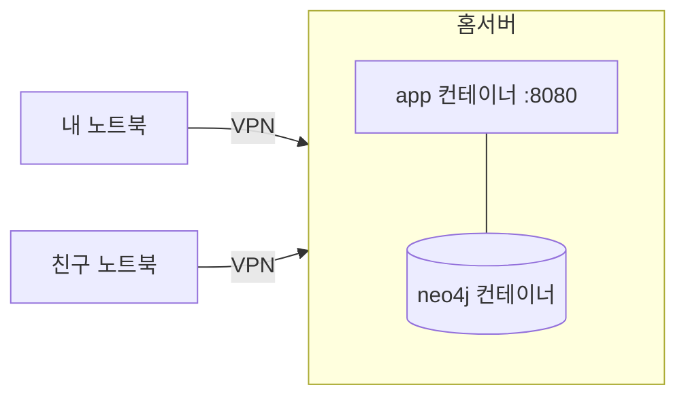

# 배포와 백업

## 기본 시나리오: 홈서버와 사설 VPN

나와 친구가 같은 사설 VPN(WireGuard, Tailscale 같은 것)에 들어와 홈서버의 워크벤치에 접속한다.
워크벤치는 인터넷에 공개하지 않는다.



- `app` 은 호스트의 `${WORKBENCH_BIND}:${WORKBENCH_PORT}` 에만 열린다. 기본값은 `127.0.0.1:8081` 이다.
  홈서버에서는 `WORKBENCH_BIND` 를 VPN 인터페이스의 주소로 둔다. `0.0.0.0` 으로 두지 않는다.
- `neo4j` 는 호스트 포트를 열지 않는다. Compose 내부 네트워크에서 `app` 만 접근한다.
- 실제 홈서버 주소, 계정, 키, 경로는 이 저장소에 넣지 않는다. 홈서버의 `.env` 에만 둔다.
- VPN 안에서 HTTP 로 접속하면 세션 쿠키가 암호화되지 않은 채 VPN 터널 안으로만 오간다.
  VPN 밖으로 공개하거나 reverse proxy 로 HTTPS 를 붙이면 `WORKBENCH_SECURE_COOKIE=true` 로 둔다.

이번 작업에서는 홈서버에 배포하지 않았다. 아래 절차는 로컬 Compose 에서 확인했다.

## 준비

```bash
# cwd: financial-workbench
cp .env.example .env
# .env 에서 NEO4J_PASSWORD 를 정한다. 기본값은 없다
docker compose config --quiet
```

| 변수 | 필수 | 설명 |
| --- | --- | --- |
| `NEO4J_PASSWORD` | 예 | Neo4j 비밀번호. 비어 있으면 Compose 와 API 가 모두 시작하지 않는다 |
| `WORKBENCH_BIND` | 아니요 | app 을 열 호스트 주소. 기본 `127.0.0.1` |
| `WORKBENCH_PORT` | 아니요 | app 호스트 포트. 기본 `8081` |
| `WORKBENCH_SECURE_COOKIE` | 아니요 | HTTPS 뒤에서 `true` |

## 실행

```bash
# cwd: financial-workbench
docker compose up -d --build --wait
curl -fsS http://127.0.0.1:8081/api/health
```

`--wait` 는 두 컨테이너의 health check 가 통과할 때까지 기다린다.
`neo4j` 는 `cypher-shell 'RETURN 1'` 로, `app` 은 `/api/health` 로 상태를 확인한다.

## 사용자 만들기

공개 가입은 없다. 아래 명령으로만 계정을 만든다. 비밀번호는 명령 인자가 아니라 환경변수로 넘겨 셸 기록에 남지 않게 한다.

```bash
# cwd: financial-workbench
read -s WORKBENCH_USER_PASSWORD && export WORKBENCH_USER_PASSWORD
scripts/user-add.sh alice "Alice"
unset WORKBENCH_USER_PASSWORD
```

`scripts/user-add.sh` 는 `docker compose run --rm --no-deps app user-add <username> <displayName>` 를 실행한다.
같은 이름이 있으면 실패한다. 비밀번호는 12자 이상이어야 한다.

## 자원 설정

`compose.yml` 은 홈서버의 다른 서비스와 메모리를 나눠 쓰도록 상한을 둔다.

| 서비스 | 메모리 상한 | 세부 |
| --- | --- | --- |
| `neo4j` | 1536 MiB | heap 512 MiB, page cache 512 MiB |
| `app` | 768 MiB | JVM `-XX:MaxRAMPercentage=70` |

데이터가 늘면 page cache 를 먼저 키운다. 두 사람이 쓰는 규모에서는 이 값으로 충분하다.

## 재시작과 데이터 보존

데이터는 `fos-workbench_neo4j-data` 볼륨에 있다.
`docker compose down` 다음 `docker compose up -d --wait` 를 해도 데이터가 남는다.
`docker compose down -v` 는 볼륨을 지운다. 운영에서 쓰지 않는다.

## 백업

Neo4j Community 에디션은 온라인 백업(`neo4j-admin database backup`)을 지원하지 않는다.
`neo4j-admin database dump` 로 오프라인 덤프를 만든다. **덤프하는 동안 `neo4j` 컨테이너가 멈춰 있어야 한다.**
데이터베이스 파일을 쓰는 프로세스가 있으면 dump 가 거부되거나 일관되지 않은 파일을 읽는다.
`app` 도 함께 멈춘다. `app` 이 떠 있으면 사용자가 쓰기 실패를 보고 재시도하는 사이에 상태가 엇갈린다.

```bash
# cwd: financial-workbench
scripts/backup.sh
```

스크립트가 하는 일은 다음과 같다.

1. `docker compose stop app neo4j`
2. `docker compose run --rm --no-deps -v ./backups:/backups neo4j neo4j-admin database dump neo4j --to-path=/backups`
3. 덤프 파일 이름에 시각을 붙인다(`backups/neo4j-YYYYMMDD-HHMMSS.dump`).
4. `docker compose start neo4j app` 다음 health 를 기다린다.

중단 시간은 데이터 크기에 비례한다. 첫 버전 규모에서는 수십 초다.
`backups/` 는 Git 에 넣지 않는다. 홈서버 밖(다른 디스크나 친구 장비)으로 복사해 둔다.

## 복원

```bash
# cwd: financial-workbench
scripts/restore.sh backups/neo4j-20261020-120000.dump
```

1. `docker compose stop app neo4j`
2. 덤프 파일을 `backups/restore/neo4j.dump` 로 복사한다. `load` 는 디렉터리에서 `<데이터베이스 이름>.dump` 를 찾는다.
3. `docker compose run --rm --no-deps -v ./backups/restore:/backups neo4j neo4j-admin database load neo4j --from-path=/backups --overwrite-destination=true`
4. `docker compose start neo4j app` 다음 health 를 기다린다.

복원은 현재 데이터베이스를 덮어쓴다. 스크립트는 덮어쓰기 전에 현재 상태를 한 번 더 덤프한다.

## 개발 환경

```bash
# cwd: financial-workbench
docker compose -f compose.dev.yml up -d --wait     # Neo4j 만. 127.0.0.1:7476(Browser), 127.0.0.1:7689(Bolt)
cd api && NEO4J_PASSWORD=... ./gradlew bootRun     # API :8080
cd web && npm ci && npm run dev                    # 웹 :5173, /api 를 :8080 으로 넘긴다
```

개발 Compose 의 포트는 `127.0.0.1` 에만 묶인다. `python-graphrag` 의 `7475`, `7688` 과 겹치지 않는다.
개발 Compose 의 프로젝트 이름은 `fos-workbench-dev` 이고 볼륨도 운영 Compose 와 따로 쓴다.
