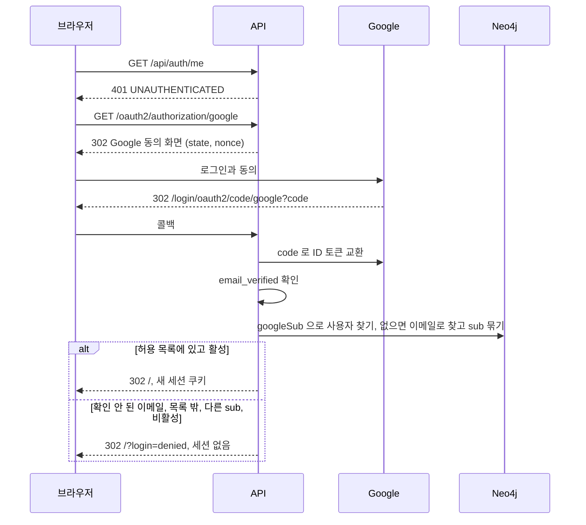
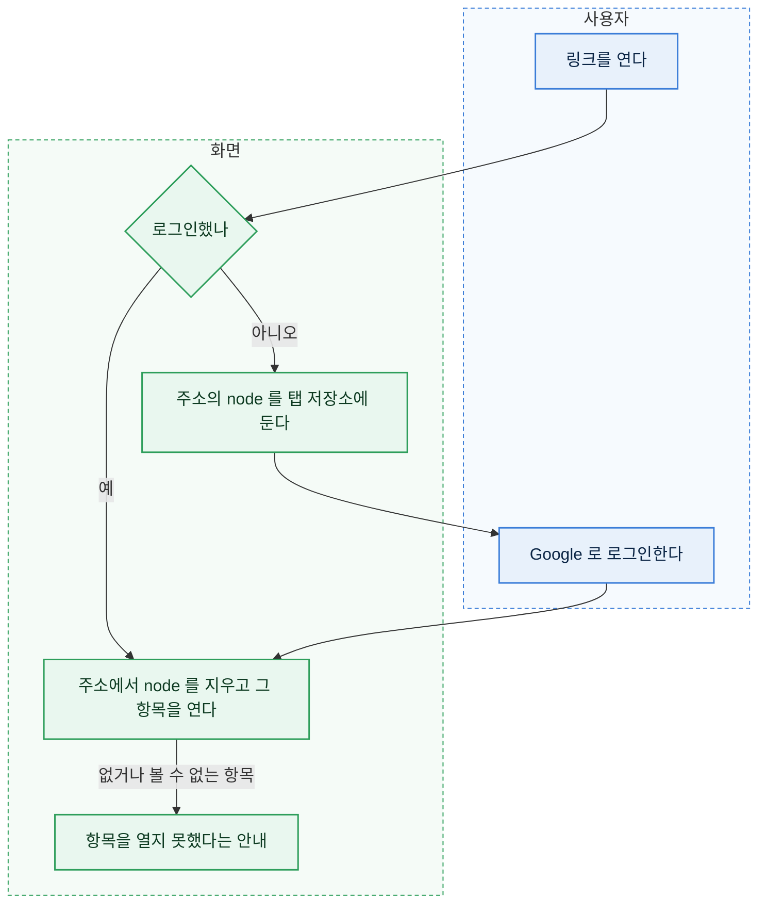
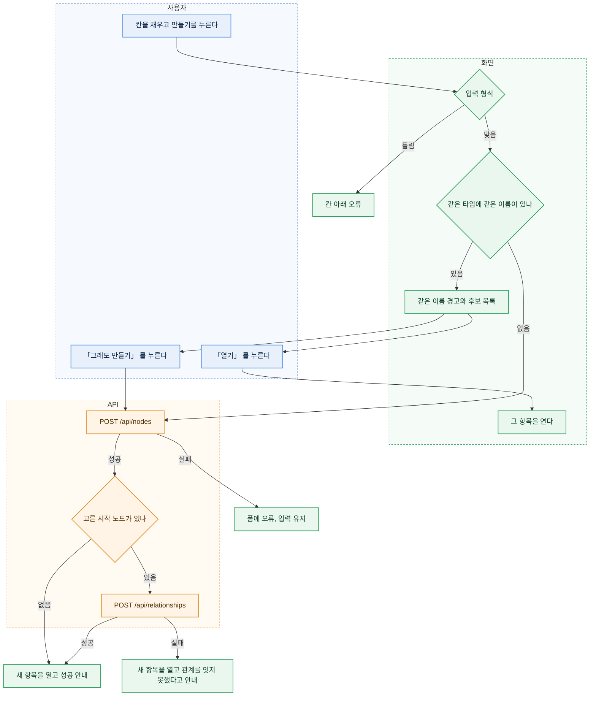
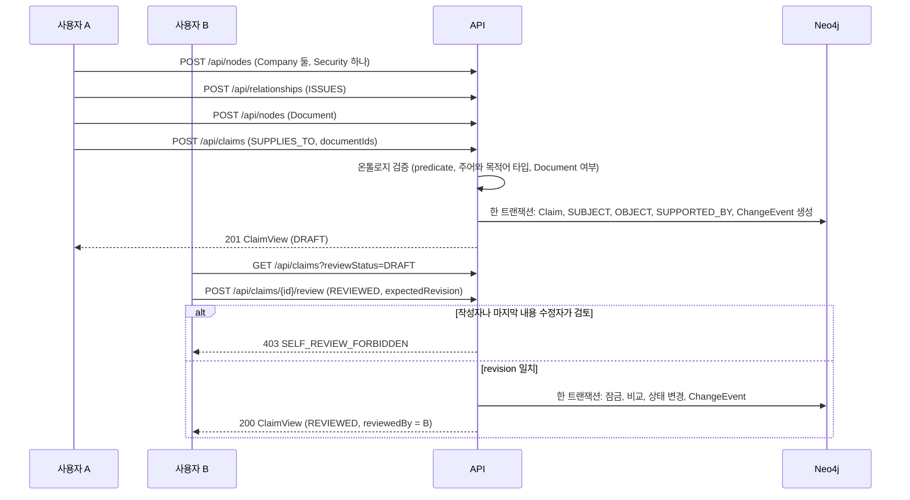
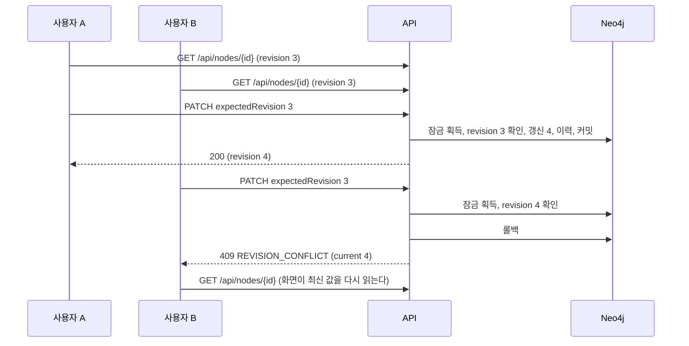
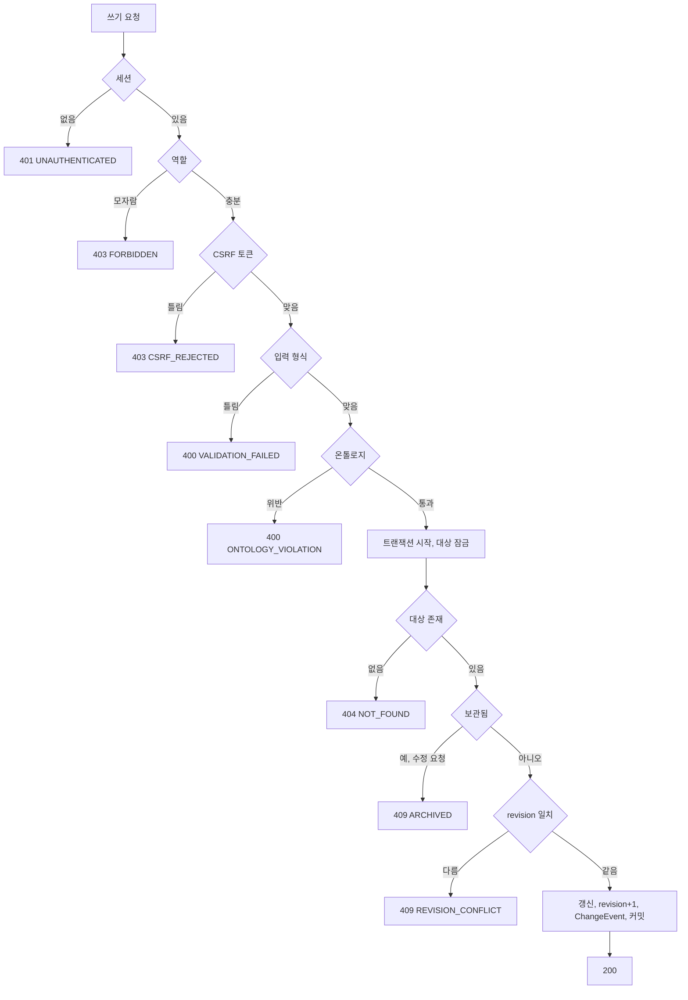
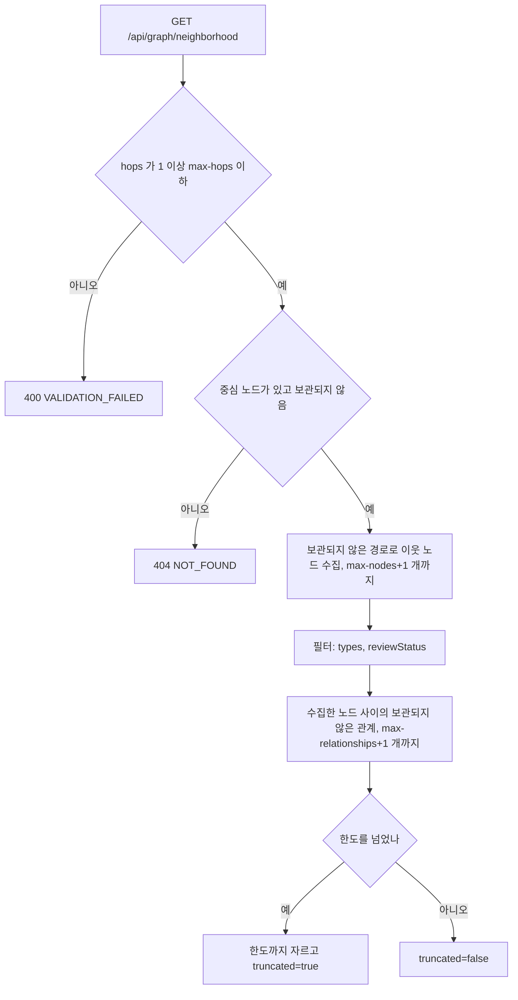
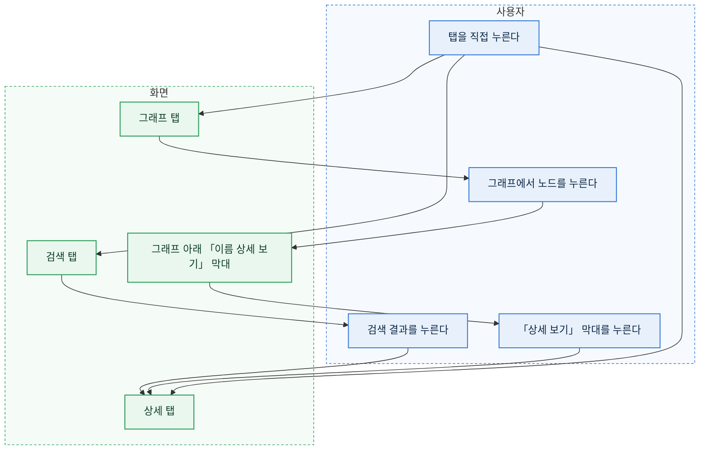
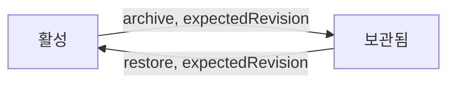

# 흐름

## 로그인

로그인한 뒤에도 API 는 요청마다 사용자 상태와 역할을 다시 읽는다.
관리자가 사용자를 비활성화하면 그 사용자의 다음 요청은 `401` 이고 세션이 지워진다.

### 링크로 항목 열기

`/?node=<id>` 주소로 들어오면 작업 공간에서 그 항목의 상세를 연다. 검토를 부탁할 때 메신저로 보내는 링크다.

- Google 로그인은 `/` 로 돌아오므로 주소의 `node` 가 사라진다. 그래서 로그인하기 전에 탭 저장소(`sessionStorage`)에 두었다가 로그인한 뒤 꺼내 연다. 꺼낸 값은 지운다. 저장소를 쓸 수 없는 브라우저(사생활 보호 창 등)에서는 로그인한 뒤 첫 화면이 열린다.
- 로그인한 상태로 링크를 열면 바로 그 항목을 연다. 주소창의 `?node=` 는 연 뒤 지운다. 새로고침해도 같은 항목을 다시 열지 않는다.
- 항목 상세의 「링크 복사」 와 검토 대기의 「링크 복사」 가 이 주소를 클립보드에 넣는다. 클립보드를 쓸 수 없으면 주소를 입력칸에 보여 직접 복사하게 한다.
- 열람자도 링크로 항목을 열 수 있다. 보관된 항목은 상세가 「보관됨」 으로 열린다.

## 노드 만들기

왼쪽 「무엇을 만들까요?」 에서 타입을 고르면 온톨로지 속성으로 만든 폼이 열린다. 주장 폼 안의 「근거 문서 새로 등록」 도 같은 폼이다.

- 같은 이름 검사는 저장 직전에 화면이 한다. 같은 타입에서 이름(`labelProperty` 값)이 앞뒤 공백과 대소문자를 무시하고 같은 보관되지 않은 항목을 찾는다. 검색 API(`GET /api/nodes?q=이름&types=타입&size=100`)의 결과 안에서만 찾는다.
  - 찾으면 저장하지 않고 「같은 이름의 기업이 이미 있습니다.」 와 후보 목록을 보인다. 후보마다 구분 정보(`hintProperties` 와 만든 날)와 「열기」 가 있다. 주장 폼 안의 근거 문서 등록에서는 「열기」 대신 「이 문서 고르기」 다. 주장 폼을 떠나지 않게 하려는 것이다.
  - 「그래도 만들기」 를 누르면 검사 없이 만든다. 같은 이름의 다른 기업이 실제로 있을 수 있어 막지 않는다.
  - 이름 칸을 고치면 경고를 지우고 다음 저장 때 다시 검사한다.
  - 검색이 실패하면 경고 없이 만든다. 검사는 돕는 기능이라 저장을 막지 않는다.
- 주소 칸(`url` 타입)은 브라우저의 주소 형식 검사를 쓰지 않는다. `example.com/report` 처럼 `scheme://` 없이 적으면 저장할 때 `https://` 를 붙인다. 붙인 뒤에도 주소가 아니면 서버가 `400 VALIDATION_FAILED` 로 막는다.
- 필수 시각 칸(`datetime` 이고 `required`, 지금은 근거 문서의 「수집 시각」)은 폼을 열 때 지금 시각으로 채운다. 편집 폼은 저장된 값을 그대로 보인다.
- 국가와 통화처럼 목록이 있는 칸은 선택 칸이다. 편집 폼에서 저장된 값이 목록에 없으면 「목록에 없는 값: 그 값」 선택지를 더해 보이고, 그 칸을 바꾸지 않으면 다른 칸을 저장할 수 있다.
- 시작 노드 고르기 칸은 `createPicker` 가 있는 관계마다 생긴다. 종목 폼의 「발행 기업」 이 그것이다. 고르지 않아도 된다.
  - 고르면 노드를 만든 뒤 그 관계(`ISSUES`, 시작은 고른 기업, 끝은 새 종목)를 만든다. 두 요청은 따로라서 관계만 실패할 수 있다.
  - 관계만 실패하면 종목은 남는다. 새 종목을 열고 「종목을 만들었지만 발행 기업을 잇지 못했습니다. 상세의 관계 추가로 다시 이으세요.」 와 실패 이유를 보인다.

## 공급 관계 Claim 등록과 검토

### 검토 대기 화면

편집자의 검토 대기 탭은 두 구역이다.

| 구역 | 조회 | 보이는 것 |
| --- | --- | --- |
| 내가 검토할 주장 | `GET /api/claims?reviewStatus=DRAFT&scope=reviewable` | 검토 메모와 「검토 완료」, 「반려」 |
| 내가 쓰거나 고친 주장 | `GET /api/claims?reviewStatus=DRAFT&scope=mine` | 「다른 편집자가 검토합니다. 링크를 복사해 검토를 요청하세요.」 와 「링크 복사」 |

- 「내가 쓰거나 고친」 은 작성자이거나 마지막으로 내용을 고친 사람이다. 서버의 자기 검토 금지 규칙과 같은 기준이다. 두 편집자가 모두 손댄 주장은 두 사람 모두에게 이 구역에 나오고, 제3의 편집자에게 「내가 검토할 주장」 으로 나온다.
- 두 구역은 쪽 나누기를 따로 한다. 한 구역을 비우면 「검토를 기다리는 주장이 없습니다.」, 다른 구역은 「내가 쓰고 아직 검토되지 않은 주장이 없습니다.」 다.
- 열람자는 한 구역만 본다. `scope` 없이 모든 초안을 보이고 검토 단추는 꺼져 있다.
- 주장 상세의 검토 칸도 같은 기준이다. 작성자나 마지막 내용 수정자(`contentUpdatedBy`)이면 단추 대신 같은 안내와 「링크 복사」 를 보인다.

### 주장 만들기 화면

주장은 문장을 채우는 폼으로 만든다. 관계 종류를 고르면 그 종류의 문장 틀(`claimPredicates.<predicate>.sentence`)이 칸의 순서를 정한다.
예를 들어 공급 관계는 「[주체 고르기]이(가) [대상 고르기]에 공급한다」 로 보인다. 조사는 고른 이름의 끝소리에 맞춰 바뀐다.

- 입구는 둘이다.
  - 왼쪽 「무엇을 만들까요?」 에서 「주장」 을 고른다. 주체와 대상이 모두 비어 있다.
  - 항목 상세 맨 아래 「주장 추가」 를 누른다. 그 항목이 주체로 채워진다.
- 「주체와 대상 바꾸기」 단추가 두 칸을 맞바꾼다. 공급받는 기업의 상세에서 시작해도 「이 기업에 공급하는 기업」 을 만들 수 있다.
- 관계 종류를 바꾸면 그 종류가 받지 않는 타입의 주체나 대상은 비운다.
- 주체나 대상을 아직 고르지 않았거나 근거 문서가 없으면 저장 단추를 눌렀을 때 칸마다 무엇이 빠졌는지 보인다. 서버 검증 오류도 같은 칸 아래에 보인다.
- 고를 기업이 하나도 없으면 고르기 칸이 「먼저 기업을 만드세요」 를 보인다.

### 주장의 이름

주장의 이름은 저장하지 않고 읽을 때 만든다. 「주체 → 대상 관계」 다(예: 「다라부품 → 가나전자 공급한다」).
기업 이름을 바꾸면 그 기업이 걸린 주장의 이름도 바로 바뀐다. 변경 이력의 대상 이름은 그때의 이름을 남긴다.

## 동시 수정

두 요청이 같은 순간에 오면 한쪽이 잠금을 기다린다. 기다린 쪽은 먼저 커밋된 revision 을 읽고 409 를 받는다.

### 화면에서 입력 지키기

노드 편집 폼은 409 를 받아도 내 입력을 버리지 않는다. 상세 패널이 편집 시작 값과 내 입력을 들고 있다가, 최신 값을 다시 읽은 뒤 칸마다 비교한다.

| 칸의 상태 | 편집 시작 값 대비 | 화면 |
| --- | --- | --- |
| 다른 쪽만 바꿈 | 최신 값만 다르다 | 최신 값을 그대로 보이고 「다른 쪽이 바꿈」 으로 알린다 |
| 나만 바꿈 | 내 입력만 다르다 | 「다시 적용」 이 내 입력을 다시 넣는다 |
| 둘 다 다르게 바꿈 | 둘 다 다르고 서로도 다르다 | 두 값을 함께 보이고 칸마다 「내 값」 과 「최신 값」 가운데 고르게 한다. 기본은 「최신 값」 이다 |
| 둘 다 같은 값으로 바꿈 | 둘 다 다르지만 서로 같다 | 알리지 않는다 |

- 안내는 「다른 탭이나 다른 사용자가 먼저 저장했습니다. 최신 내용을 불러왔습니다.」 다. 같은 사람이 두 탭에서 고쳐도 같은 409 가 나기 때문이다. 서버 응답 문장은 같은 말을 되풀이하므로 따로 보이지 않는다.
- 폼은 최신 값으로 다시 그려진다. 「다시 적용」 을 누르면 「나만 바꿈」 칸과 「내 값」 을 고른 칸에 내 입력이 들어간다. 저장은 하지 않는다. 사용자가 확인하고 저장하면 새 revision 으로 보낸다.
- 「버리기」 를 누르면 비교를 닫고 최신 값만 남는다. 다른 항목을 고르거나 저장에 성공해도 닫힌다.
- 다시 적용할 칸이 없으면(다른 쪽만 바꿨거나 같은 값으로 바꿨으면) 비교를 보이지 않고 안내만 남는다.
- 주장 내용 수정 폼(`ClaimEditForm`)과 검토, 보관, 복원은 지금처럼 최신 값을 다시 읽기만 한다. 남은 한계는 [제품 요구사항](prd.md) 에 있다.

## 쓰기 공통 분기

이력 기록이 실패하면 트랜잭션 전체가 롤백된다. 데이터만 바뀌고 이력이 없는 상태는 생기지 않는다.

## 주변 그래프

모은 노드 가운데 주장이 있으면 그 주장의 주체와 대상도 함께 돌려준다. 홉 수 밖에 있어도 더하고, 종류 필터와 노드 한도는 그대로 지킨다. 1홉에서도 주장의 상대 기업이 보이게 하려는 것이다.

이웃이 없으면 중심 노드 하나만 돌려준다. 화면은 「연결된 노드가 없습니다」 를 표시한다.

### 주장 접기

화면은 기본으로 주장을 두 항목 사이의 선 하나로 접어 그린다. 주장 노드, 그 주장의 주체와 대상 관계, 근거 문서 관계를 지우고 「주체 → 대상」 선을 그린다. 선 이름은 관계 종류의 표시 이름(예: 「공급한다」)이다.
초안 주장의 선은 점선, 반려된 주장의 선은 흐리게 그린다. 선을 누르면 그 주장이 상세에 열린다.

- 주체나 대상 가운데 하나라도 그래프에 없으면 그 주장은 접지 않고 노드로 둔다. 중심 노드가 주장이면 그 주장도 접지 않는다.
- 접힌 주장에만 걸린 근거 문서는 그리지 않는다. 근거는 선을 눌러 연 상세에서 본다. 중심 노드는 근거 문서여도 그린다.
- 그래프 도구 줄의 「주장을 따로 보기」 를 켜면 접지 않고 지금처럼 주장을 마름모 노드로 그린다. 켠 상태는 작업 공간을 떠날 때까지 남는다.
- 「그래프에 나온 항목」 목록에는 접힌 주장도 「주장」 으로 나온다. 목록에서 고르면 상세가 열린다.
- 이웃을 넓힌 뒤에는 화면 맞춤을 다시 하고, 노드 사이 간격을 넓혀 글자가 겹치지 않게 배치한다.
시간 제한(`workbench.graph.timeout`)을 넘으면 트랜잭션이 끊기고 `500 INTERNAL_ERROR` 가 아니라 `503 QUERY_TIMEOUT` 을 낸다.

## 좁은 화면의 작업 공간

폭 1024px 이상에서는 검색, 그래프, 상세가 세 칸으로 함께 보인다.
1024px 미만에서는 같은 세 칸을 탭으로 나누고 한 번에 하나만 보인다.
작업 공간을 열 때 고른 항목이 없으면 검색 탭, 있으면 상세 탭으로 시작한다. 목록, 검토 대기, 변경 이력에서 항목을 열면 상세 탭이 열린다.

- 검색 결과를 누르면 그래프 중심과 상세를 함께 바꾸고 상세 탭으로 넘어간다. 검색 탭에서 노드를 새로 만들어도 같다.
- 그래프에서 노드를 누르면 상세만 바꾸고 그래프 탭에 머문다. 이웃을 잇달아 둘러볼 수 있게 하려는 것이다. 그래프 아래 「그래프에 나온 항목」 목록에서 고를 때도 같다. 고른 노드가 그래프에 있으면 그래프 아래 막대에 그 이름이 나오고, 막대를 누르면 상세 탭으로 간다. 더블클릭이나 「이웃 확장」 으로 이웃을 넓히는 동작과 「선택한 항목을 중심으로」 는 넓은 화면과 같고 탭을 옮기지 않는다.
- 아무것도 고르지 않았으면 상세 탭은 「항목을 선택하면 상세가 여기에 나옵니다.」 를 보인다. 그래프 탭은 넓은 화면과 같은 시작 안내(`WelcomeGuide`)를 보인다.
- 그래프를 읽다 실패하면 오류는 그래프 탭 안에 나온다. 다른 탭에 있으면 그 탭으로 옮기지 않는다.
- 창 폭이 1024px 를 넘나들어도 고른 노드, 그래프, 마지막 탭은 그대로다. 다만 경계를 넘으면 검색, 그래프, 상세 칸이 새로 그려져 폼에 입력하던 값은 사라진다. 탭을 옮길 때는 남는다. 그래프 탭이 다시 보이면 그래프 크기를 다시 재고 화면에 맞춘다. 숨겨져 있던 동안에는 크기가 0 이라 그대로 두면 빈 캔버스가 남는다.
- 머리글은 두 줄이다. 첫 줄에 제목과 사용자 상자가, 둘째 줄에 탭 여섯 개가 전체 폭으로 놓인다. 제목은 길면 말줄임표로 줄고 이메일은 숨긴다.
- 머리글의 탭과 표 화면(목록, 검토 대기, 변경 이력, 사용자)은 좁은 화면에서 가로로 밀어서 본다. 페이지 전체에는 가로 스크롤이 생기지 않는다.

## 변경 이력 보기

변경 이력 탭은 최근 것부터 보인다. 칸 이름과 값은 화면에 보일 말로 바꾼다.

- 항목 이름: 온톨로지 속성이면 그 속성의 `label`, 아니면 `changeFields.<키>.label` 이다. 둘 다 없으면 키를 그대로 보인다.
- 값: enum 은 선택지 이름, 검토 상태는 `reviewStatuses` 이름, 역할은 「열람자」, 「편집자」, 「관리자」, 참과 거짓은 「예」, 「아니오」, 비어 있으면 「(없음)」 이다. 노드 ID 는 응답의 `refs` 로 이름을 보이고, 누르면 그 항목을 연다. 찾지 못한 ID 는 「(찾을 수 없는 항목)」 이다. 목록 값(`documentIds`)은 이름을 쉼표로 잇는다.
- 대상으로 좁히기: 이름으로 검색해 항목 하나를 고른다(노드 고르기 칸). 고른 항목은 이름과 「지우기」 로 보인다. 상세의 「이 항목의 변경 이력」 으로 들어오면 그 항목이 골라져 있다.
- 사용자로 좁히기: `GET /api/changes/actors` 로 받은 사용자를 표시 이름으로 고른다. 「(모두)」 가 기본이다. 고르면 바로 다시 읽는다.
- revision 열은 두지 않는다. 행에 마우스를 올리면 제목으로 보인다.

## 보관과 복원

두 전이 모두 revision 을 올리고 ChangeEvent(`ARCHIVE`, `RESTORE`)를 남긴다. 이전 이력은 지우지 않는다.
