# 흐름

## 로그인

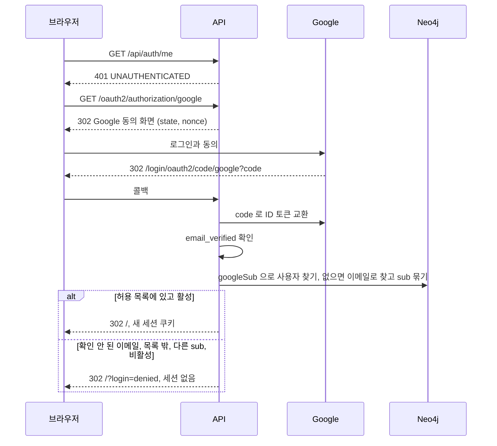

로그인한 뒤에도 API 는 요청마다 사용자 상태와 역할을 다시 읽는다.
관리자가 사용자를 비활성화하면 그 사용자의 다음 요청은 `401` 이고 세션이 지워진다.

## 주소와 뒤로가기

화면 상태는 주소에 있다. 상단 탭은 경로, 그 탭 안의 상태는 query 다. 결정과 근거는 [ADR-007](adr/007-routes-in-url.md) 이다.

| 경로 | 화면 | query |
| --- | --- | --- |
| `/workspace` | 작업 공간 | `node`(상세로 연 항목), `center`(그래프 중심, 없으면 `node`), `pane`(좁은 화면의 `search`, `graph`, `detail`), `q`, `types`(쉼표 구분, 전체면 뺀다), `status`(주장 검토 상태), `archived=1`(보관 포함), `hops`(1이면 뺀다), `claims=nodes`(주장을 따로 보기) |
| `/list` | 목록 | `type`, `q`, `archived=1`, `page`(0이면 뺀다) |
| `/review` | 검토 대기 | `page`, `minePage`(0이면 뺀다) |
| `/changes` | 변경 이력 | `target`(대상 노드 id), `actor`(사용자 이메일), `page` |
| `/ontology` | 온톨로지 | `view`(ADMIN 의 `form`, `yaml`, `history`. 없으면 지금 버전 보기), `version`(`view=history` 에서 연 버전) |
| `/users` | 사용자(ADMIN) | 없음 |

- `/` 는 `/workspace` 로 바꿔 연다. 기본값과 같은 query 는 주소에 쓰지 않는다. 그래서 처음 열면 주소가 `/workspace` 다.
- ADMIN 이 아닌 사람이 `/ontology?view=…` 를 열면 `/ontology` 로 바꿔 연다(기록을 쌓지 않는다).
- `/` 와 권한 없는 화면 경로(`/users` 를 ADMIN 이 아닌 사람이 연 경우)는 `/workspace` 로 바꿔 연다. 바꿀 때는 기록을 쌓지 않는다. 표에 없는 경로는 서버가 `404` 로 답해 화면이 뜨지 않는다.
- 이미 보낸 `/?node=<id>` 링크는 `/workspace?node=<id>&pane=detail` 로 바꿔 연다. 「링크 복사」 는 이제 `/workspace?node=<id>` 를 넣는다.
- 서버는 위 여섯 경로의 GET 을 `index.html` 로 돌려준다. 그 밖의 경로는 지금처럼 `404` 다. 정적 파일과 `/api/**` 는 그대로다.

### 뒤로가기 한 번으로 되돌리는 동작

아래 동작은 주소를 새로 쌓는다(push). 뒤로가기를 누르면 바로 앞 화면으로 돌아간다.

| 동작 | 바뀌는 주소 |
| --- | --- |
| 상단 탭 누르기 | 경로. 그 탭에 처음 들어가면 query 없이, 그 탭에서 마지막으로 보던 주소가 있으면 그 주소로 간다 |
| 항목 열기(검색 결과, 그래프 노드, 「그래프에 나온 항목」, 목록, 검토 대기, 변경 이력, 관계와 주장 카드의 이름, 상세의 「그래프 중심으로」) | `/workspace?node=…`. 좁은 화면에서는 `pane` 도 함께 바뀐다. 상세만 바꾸는 열기(그래프와 상세 안에서 누른 것)는 그때의 그래프 중심을 `center` 로 남긴다 |
| 좁은 화면의 검색, 그래프, 상세 탭 누르기, 그래프 아래 「상세 보기」 | `pane` |
| 온톨로지 탭의 「폼으로 편집」, 「YAML 로 편집」, 「버전 기록」, 버전 기록에서 버전 열기 | `view`, `version` |

나머지는 주소만 바꾸고 기록을 쌓지 않는다(replace). 검색어와 필터, 홉 수, 「주장을 따로 보기」, 그래프의 「선택한 항목을 중심으로」, 쪽 넘기기, 이력의 대상과 사용자 고르기가 여기 해당한다. 새로고침과 링크에는 남는다.

- 종류 필터를 모두 끄면 주소에서 `types` 가 빠져 전체로 돌아간다. 모두 끈 상태는 주소에 담지 않는다.
- 쪽 번호가 끝 쪽을 넘으면 끝 쪽으로 바꿔 연다(replace).

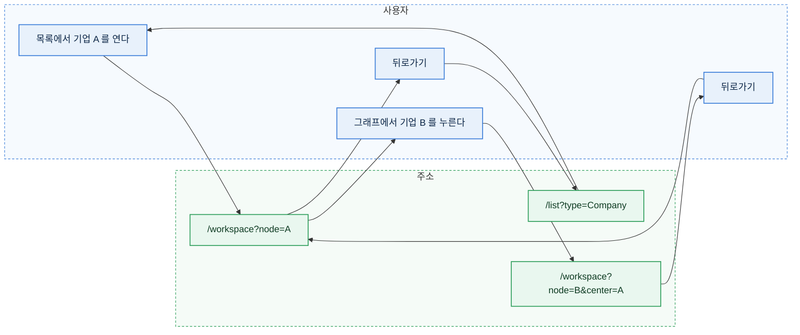

- 뒤로가기로 돌아온 화면은 주소의 상태로 다시 그린다. 검색 결과와 그래프는 다시 읽는다. 「이웃 확장」 으로 넓힌 그래프와 폼에 쓰던 입력은 주소에 없어 돌아오지 않는다.
- 상세에서 고치던 폼에 저장하지 않은 입력이 있어도 뒤로가기를 막지 않는다. 저장하지 않은 입력은 사라진다.
- 같은 항목을 다시 열면 주소가 같아 기록을 쌓지 않는다.

### 로그인을 거치는 링크

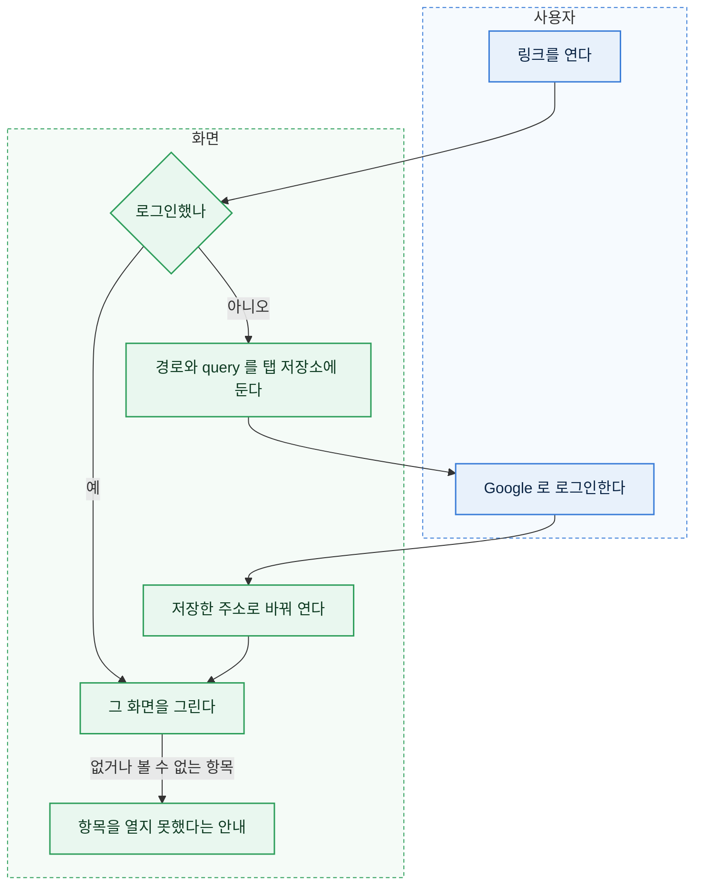

- Google 로그인은 `/` 로 돌아오므로 보던 주소가 사라진다. 로그인 화면을 보이기 전에(처음 열 때와 쓰는 중 세션이 끝나 로그인 화면으로 갈 때 모두) 경로와 query 를 탭 저장소(`sessionStorage`, 키 `workbench.returnTo`)에 두었다가, 로그인을 확인한 뒤 꺼내 그 주소로 바꿔 연다(기록을 쌓지 않는다). 꺼낸 값은 지운다. 저장소를 쓸 수 없는 브라우저(사생활 보호 창 등)에서는 `/workspace` 가 열린다.
- 저장하는 주소는 경로 부분이 위 표의 경로 가운데 하나와 정확히 같은 것만이다. 다른 값(바깥 주소, `//` 로 시작하는 값, `/workspacefoo` 같은 값)은 저장하지 않는다.
- 꺼낸 주소는 온톨로지를 받는 순간 함께 반영한다. 좁은 화면에서도 `pane` 대로 시작한다.
- 항목 상세의 「링크 복사」 와 검토 대기의 「링크 복사」 가 `/workspace?node=<id>` 를 클립보드에 넣는다. 클립보드를 쓸 수 없으면 주소를 입력칸에 보여 직접 복사하게 한다.
- 열람자도 링크로 항목을 열 수 있다. 보관된 항목은 상세가 「보관됨」 으로 열린다.

## 노드 만들기

왼쪽 「무엇을 만들까요?」 에서 타입을 고르면 온톨로지 속성으로 만든 폼이 열린다. 주장 폼 안의 「근거 문서 새로 등록」 도 같은 폼이다.

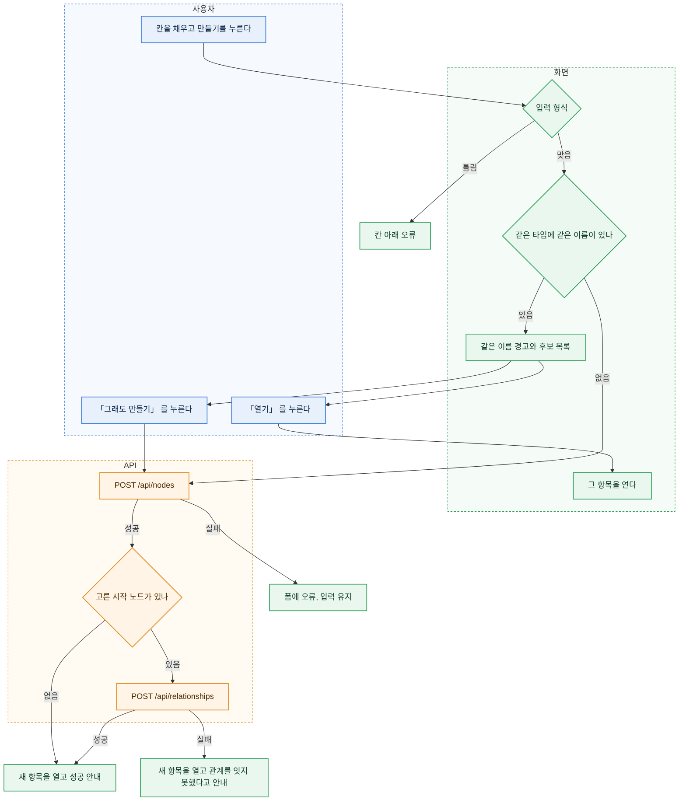

- 같은 이름 검사는 저장 직전에 화면이 한다. 같은 타입에서 이름(`labelProperty` 값)이 앞뒤 공백과 대소문자를 무시하고 같은 보관되지 않은 항목을 찾는다. 검색 API(`GET /api/nodes?q=이름&types=타입&size=100`)의 결과 안에서만 찾는다.
  - 찾으면 저장하지 않고 「같은 이름의 기업이 이미 있습니다.」 와 후보 목록을 보인다. 후보마다 구분 정보(`hintProperties` 와 만든 날)와 「열기」 가 있다. 주장 폼 안의 근거 문서 등록에서는 「열기」 대신 「이 문서 고르기」 다. 주장 폼을 떠나지 않게 하려는 것이다.
  - 「그래도 만들기」 를 누르면 검사 없이 만든다. 같은 이름의 다른 기업이 실제로 있을 수 있어 막지 않는다.
  - 이름 칸을 고치면 경고를 지우고 다음 저장 때 다시 검사한다.
  - 검색이 실패하면 경고 없이 만든다. 검사는 돕는 기능이라 저장을 막지 않는다.
- 주소 칸(`url` 타입)은 브라우저의 주소 형식 검사를 쓰지 않는다. `example.com/report` 처럼 `scheme://` 없이 적으면 저장할 때 `https://` 를 붙인다. 붙인 뒤에도 주소가 아니면 서버가 `400 VALIDATION_FAILED` 로 막는다.
- 필수 시각 칸(`datetime` 이고 `required`, 지금은 근거 문서의 「수집 시각」)은 폼을 열 때 지금 시각으로 채운다. 편집 폼은 저장된 값을 그대로 보인다.
- 국가와 통화처럼 목록이 있는 칸은 선택 칸이다. 편집 폼에서 저장된 값이 목록에 없으면 「목록에 없는 값: 그 값」 선택지를 더해 보이고, 그 칸을 바꾸지 않으면 다른 칸을 저장할 수 있다.
- 시작 노드 고르기 칸은 `createPicker` 가 있는 관계마다 생긴다. 종목 폼의 「발행 기업」 이 그것이다. 고르지 않아도 된다.
  - 고르면 노드를 만든 뒤 그 관계(`ISSUES`, 시작은 고른 기업, 끝은 새 종목)를 만든다. 두 요청은 따로라서 관계만 실패할 수 있다.
  - 관계만 실패하면 종목은 남는다. 새 종목을 열고 「종목을 만들었지만 발행 기업을 잇지 못했습니다. 상세의 관계 추가로 다시 이으세요.」 와 실패 이유를 보인다.

## 공급 관계 Claim 등록과 검토

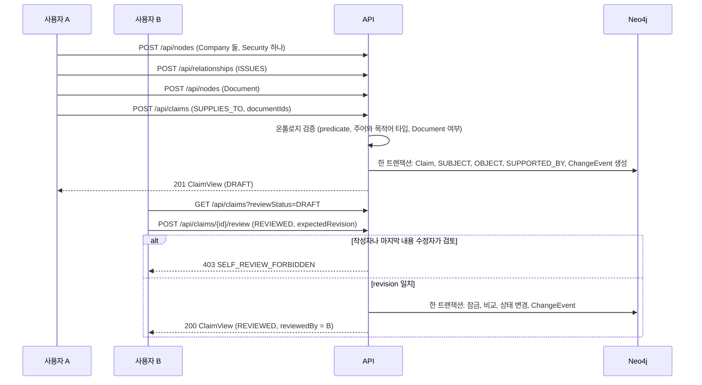

### 검토 대기 화면

편집자의 검토 대기 탭은 두 구역이다.

| 구역 | 조회 | 보이는 것 |
| --- | --- | --- |
| 내가 검토할 주장 | `GET /api/claims?reviewStatus=DRAFT&scope=reviewable` | 검토 메모와 「검토 완료」, 「반려」 |
| 내가 쓰거나 고친 주장 | `GET /api/claims?reviewStatus=DRAFT&scope=mine` | 「다른 편집자가 검토합니다. 링크를 복사해 검토를 요청하세요.」 와 「링크 복사」 |

- 「내가 쓰거나 고친」 은 작성자이거나 마지막으로 내용을 고친 사람이다. 서버의 자기 검토 금지 규칙과 같은 기준이다. 두 편집자가 모두 손댄 주장은 두 사람 모두에게 이 구역에 나오고, 제3의 편집자에게 「내가 검토할 주장」 으로 나온다.
- 두 구역은 쪽 나누기를 따로 한다. 한 구역을 비우면 「검토를 기다리는 주장이 없습니다.」, 다른 구역은 「내가 쓰고 아직 검토되지 않은 주장이 없습니다.」 다.
- 열람자는 한 구역만 본다. `scope` 없이 모든 초안을 보이고 검토 단추는 꺼져 있다.
- 주장 상세의 검토 칸도 같은 기준이다. 작성자나 마지막 내용 수정자(`contentUpdatedBy`)이면 검토 단추를 끄고, 「내가 쓰거나 마지막으로 고친 주장은 다른 편집자가 검토합니다. 링크를 복사해 검토를 요청하세요.」 와 「링크 복사」 를 보인다.
- `createdBy` 가 비어 있는 주장은 어느 구역에도 나오지 않는다. 지금 만드는 경로는 모두 작성자를 채운다.

### 주장 만들기 화면

주장은 문장을 채우는 폼으로 만든다. 관계 종류를 고르면 그 종류의 문장 틀(`claimPredicates.<predicate>.sentence`)이 칸의 순서를 정한다.
예를 들어 공급 관계는 「[주체 고르기]이(가) [대상 고르기]에 공급한다」 로 보인다. 조사는 고른 이름의 끝소리에 맞춰 바뀐다.

- 입구는 둘이다.
  - 왼쪽 「무엇을 만들까요?」 에서 「주장」 을 고른다. 주체와 대상이 모두 비어 있다.
  - 항목 상세 맨 아래 「주장 추가」 를 누른다. 그 항목이 주체로 채워진다.
- 「주체와 대상 바꾸기」 단추가 두 칸을 맞바꾼다. 공급받는 기업의 상세에서 시작해도 「이 기업에 공급하는 기업」 을 만들 수 있다.
- 관계 종류를 바꾸면 그 종류가 받지 않는 타입의 주체나 대상은 비운다.
- 주체나 대상을 아직 고르지 않았거나 근거 문서가 없으면 저장 단추를 눌렀을 때 칸마다 무엇이 빠졌는지 보인다. 서버 검증 오류도 같은 칸 아래에 보인다.
- 고를 기업이 하나도 없으면 고르기 칸이 「먼저 기업을 만드세요」 를 보인다.

### 거장의 생각 담기

책이나 주주서한에 나온 거장의 생각은 주장으로 담는다. 새 화면은 없고, 지금의 만들기와 주장 폼을 쓴다.

1. 출처를 근거 문서로 만든다. 자료 종류를 책, 서한, 강연과 인터뷰 가운데 고르고, 「저자」 칸에서 인물을 고르면 `AUTHORED` 관계가 함께 생긴다.
2. 인물 상세의 「주장 추가」 에서 관계 종류를 「강조한다」 나 「비판한다」 로 고르면 문장이 「[워런 버핏]이(가) [개념 고르기]을(를) 강조한다」 로 보인다. 근거 문서에 1의 책을 고르고, 근거 문장에 짧은 인용을 넣는다.
3. 다른 편집자가 출처와 인용을 확인해 검토한다. 그래프에서는 인물과 개념 사이에 「강조한다」 선 하나로 보인다.

### 주장의 이름

주장의 이름은 저장하지 않고 읽을 때 만든다. 「주체 → 대상 관계」 다(예: 「다라부품 → 가나전자 공급한다」).
기업 이름을 바꾸면 그 기업이 걸린 주장의 이름도 바로 바뀐다. 변경 이력의 대상 이름은 그때의 이름을 남긴다.

## 동시 수정

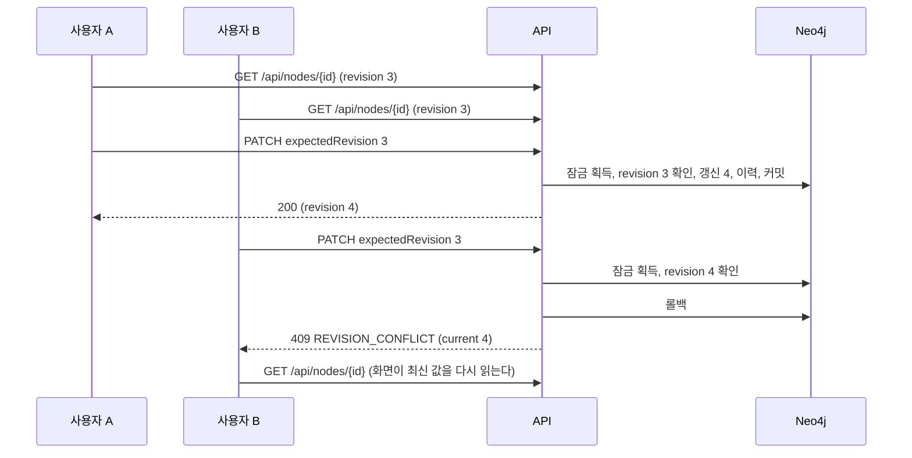

두 요청이 같은 순간에 오면 한쪽이 잠금을 기다린다. 기다린 쪽은 먼저 커밋된 revision 을 읽고 409 를 받는다.

### 화면에서 입력 지키기

노드 편집 폼은 409 를 받아도 내 입력을 버리지 않는다. 상세 패널이 편집 시작 값과 내 입력을 들고 있다가, 최신 값을 다시 읽은 뒤 칸마다 비교한다.

| 칸의 상태 | 편집 시작 값 대비 | 화면 |
| --- | --- | --- |
| 다른 쪽만 바꿈 | 최신 값만 다르다 | 최신 값을 그대로 보이고 「다른 쪽이 바꿈」 으로 알린다 |
| 나만 바꿈 | 내 입력만 다르다 | 「다시 적용」 이 내 입력을 다시 넣는다 |
| 둘 다 다르게 바꿈 | 둘 다 다르고 서로도 다르다 | 두 값을 함께 보이고 칸마다 「내 값」 과 「최신 값」 가운데 고르게 한다. 기본은 「최신 값」 이다 |
| 둘 다 같은 값으로 바꿈 | 둘 다 다르지만 서로 같다 | 알리지 않는다 |

- 안내는 「다른 탭이나 다른 사용자가 먼저 저장했습니다. 최신 내용을 불러왔습니다.」 다. 같은 사람이 두 탭에서 고쳐도 같은 409 가 나기 때문이다. 서버 응답 문장은 같은 말을 되풀이하므로 따로 보이지 않는다.
- 폼은 최신 값으로 다시 그려진다. 「다시 적용」 을 누르면 「나만 바꿈」 칸과 「내 값」 을 고른 칸에 내 입력이 들어간다. 저장은 하지 않는다. 사용자가 확인하고 저장하면 새 revision 으로 보낸다.
- 「버리기」 를 누르면 비교를 닫고 최신 값만 남는다. 다른 항목을 고르거나 저장에 성공해도 닫힌다.
- 다시 적용할 칸이 없으면(다른 쪽만 바꿨거나 같은 값으로 바꿨으면) 비교를 보이지 않고 안내만 남는다.
- 주장 내용 수정 폼(`ClaimEditForm`)과 검토, 보관, 복원은 지금처럼 최신 값을 다시 읽기만 한다. 남은 한계는 [제품 요구사항](prd.md) 에 있다.

## 쓰기 공통 분기

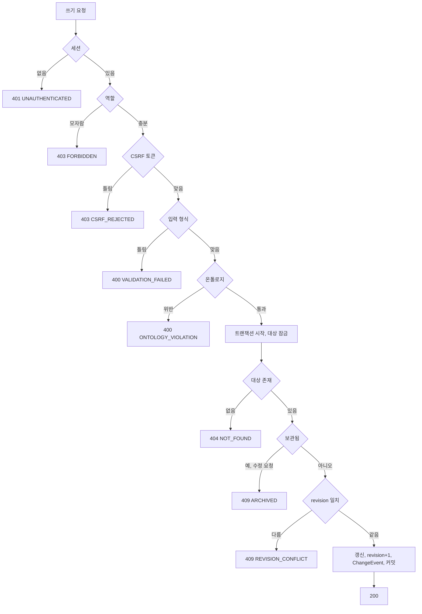

이력 기록이 실패하면 트랜잭션 전체가 롤백된다. 데이터만 바뀌고 이력이 없는 상태는 생기지 않는다.

## 주변 그래프

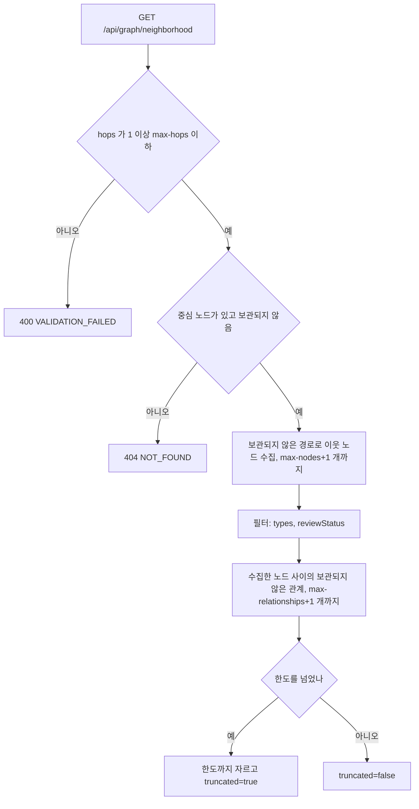

모은 노드 가운데 주장이 있으면 그 주장의 주체와 대상도 함께 돌려준다. 홉 수 밖에 있어도 더하고, 종류 필터와 노드 한도는 그대로 지킨다. 1홉에서도 주장의 상대 기업이 보이게 하려는 것이다.

이웃이 없으면 중심 노드 하나만 돌려준다. 화면은 「연결된 노드가 없습니다」 를 표시한다.

### 주장 접기

화면은 기본으로 주장을 두 항목 사이의 선 하나로 접어 그린다. 주장 노드, 그 주장의 주체와 대상 관계, 근거 문서 관계를 지우고 「주체 → 대상」 선을 그린다. 선 이름은 관계 종류의 표시 이름(예: 「공급한다」)이다.
초안 주장의 선은 점선, 반려된 주장의 선은 흐리게 그린다. 선을 누르면 그 주장이 상세에 열린다.

- 주체나 대상 가운데 하나라도 그래프에 없으면 그 주장은 접지 않고 노드로 둔다. 중심 노드가 주장이면 그 주장도 접지 않는다.
- 접힌 주장에만 걸린 근거 문서는 그리지 않는다. 근거는 선을 눌러 연 상세에서 본다. 중심 노드는 근거 문서여도 그린다.
- 그래프 도구 줄의 「주장을 따로 보기」 를 켜면 접지 않고 지금처럼 주장을 마름모 노드로 그린다. 켠 상태는 작업 공간을 떠날 때까지 남는다.
- 「그래프에 나온 항목」 목록에는 접힌 주장도 「주장」 으로 나온다. 목록에서 고르면 상세가 열린다.
- 이웃을 넓힌 뒤에는 화면 맞춤을 다시 하고, 노드 사이 간격을 넓혀 글자가 겹치지 않게 배치한다.
시간 제한(`workbench.graph.timeout`)을 넘으면 트랜잭션이 끊기고 `500 INTERNAL_ERROR` 가 아니라 `503 QUERY_TIMEOUT` 을 낸다.

## 좁은 화면의 작업 공간

폭 1024px 이상에서는 검색, 그래프, 상세가 세 칸으로 함께 보인다.
1024px 미만에서는 같은 세 칸을 탭으로 나누고 한 번에 하나만 보인다.
어느 탭을 보일지는 주소의 `pane` 이 정한다. `pane` 이 없으면 고른 항목(`node`)이 있을 때 상세, 없을 때 검색이다. 목록, 검토 대기, 변경 이력에서 항목을 열면 `pane=detail` 로 열린다. 넓은 화면에서는 `pane` 을 쓰지 않는다.

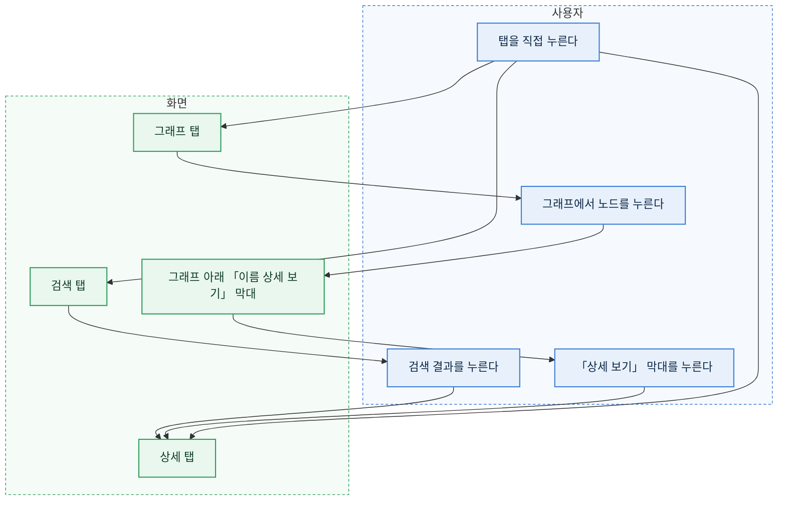

- 검색 결과를 누르면 그래프 중심과 상세를 함께 바꾸고 상세 탭으로 넘어간다. 검색 탭에서 노드를 새로 만들어도 같다.
- 그래프에서 노드를 누르면 상세만 바꾸고 그래프 탭에 머문다. 이웃을 잇달아 둘러볼 수 있게 하려는 것이다. 그래프 아래 「그래프에 나온 항목」 목록에서 고를 때도 같다. 고른 노드가 그래프에 있으면 그래프 아래 막대에 그 이름이 나오고, 막대를 누르면 상세 탭으로 간다. 더블클릭이나 「이웃 확장」 으로 이웃을 넓히는 동작과 「선택한 항목을 중심으로」 는 넓은 화면과 같고 탭을 옮기지 않는다.
- 아무것도 고르지 않았으면 상세 탭은 「항목을 선택하면 상세가 여기에 나옵니다.」 를 보인다. 그래프 탭은 넓은 화면과 같은 시작 안내(`WelcomeGuide`)를 보인다.
- 그래프를 읽다 실패하면 오류는 그래프 탭 안에 나온다. 다른 탭에 있으면 그 탭으로 옮기지 않는다.
- 창 폭이 1024px 를 넘나들어도 고른 노드, 그래프, 마지막 탭은 그대로다. 다만 경계를 넘으면 검색, 그래프, 상세 칸이 새로 그려져 폼에 입력하던 값은 사라진다. 탭을 옮길 때는 남는다. 그래프 탭이 다시 보이면 그래프 크기를 다시 재고 화면에 맞춘다. 숨겨져 있던 동안에는 크기가 0 이라 그대로 두면 빈 캔버스가 남는다.
- 머리글은 두 줄이다. 첫 줄에 제목과 사용자 상자가, 둘째 줄에 탭 여섯 개가 전체 폭으로 놓인다. 제목은 길면 말줄임표로 줄고 이메일은 숨긴다.
- 머리글의 탭과 표 화면(목록, 검토 대기, 변경 이력, 사용자)은 좁은 화면에서 가로로 밀어서 본다. 페이지 전체에는 가로 스크롤이 생기지 않는다.

## 변경 이력 보기

변경 이력 탭은 최근 것부터 보인다. 칸 이름과 값은 화면에 보일 말로 바꾼다.

- 항목 이름: 온톨로지 속성이면 그 속성의 `label`, 아니면 `changeFields.<키>.label` 이다. 둘 다 없으면 키를 그대로 보인다.
- 값: enum 은 선택지 이름, 검토 상태는 `reviewStatuses` 이름, 역할은 「열람자」, 「편집자」, 「관리자」, 참과 거짓은 「예」, 「아니오」, 시각(`reviewedAt`)은 날짜와 시각, 비어 있으면 「(없음)」 이다. 노드 ID 와 검토자 ID 는 응답의 `refs` 로 이름을 보인다. 노드 ID 하나는 이름을 누르면 그 항목을 연다. 목록 값(`documentIds`)은 이름을 쉼표로 잇고 누를 수 없다. 찾지 못한 ID 는 「(찾을 수 없는 항목)」 이다.
- 대상으로 좁히기: 이름으로 검색해 항목 하나를 고른다(노드 고르기 칸). 고른 항목은 이름과 「지우기」 로 보인다. 상세의 「이 항목의 변경 이력」 으로 들어오면 그 항목이 골라져 있다. 고르기 칸은 보관된 항목을 찾지 않으므로, 보관된 항목의 이력은 「보관 포함」 검색으로 상세를 연 뒤 「이 항목의 변경 이력」 으로 본다.
- 사용자로 좁히기: `GET /api/changes/actors` 로 받은 사용자를 표시 이름으로 고른다. 「(모두)」 가 기본이다. 고르면 바로 다시 읽는다.
- revision 열은 두지 않는다. 행에 마우스를 올리면 제목으로 보인다.

## 보관과 복원

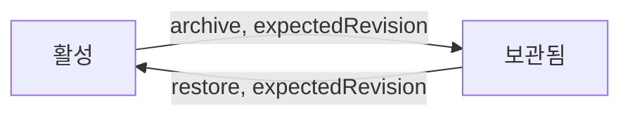

두 전이 모두 revision 을 올리고 ChangeEvent(`ARCHIVE`, `RESTORE`)를 남긴다. 이전 이력은 지우지 않는다.

## 온톨로지 편집

온톨로지 탭은 모든 역할에게 지금 버전을 보여 준다. 머리에 버전 번호와 저장한 사람, 시각이 있다.
ADMIN 에게만 「폼으로 편집」, 「YAML 로 편집」, 「버전 기록」, 「YAML 내려받기」 단추가 보인다. 결정과 근거는 [ADR-008](adr/008-ontology-versions-in-db.md), 저장 규칙은 [데이터 스키마](data-schema.md) 의 「온톨로지 버전」 이다.

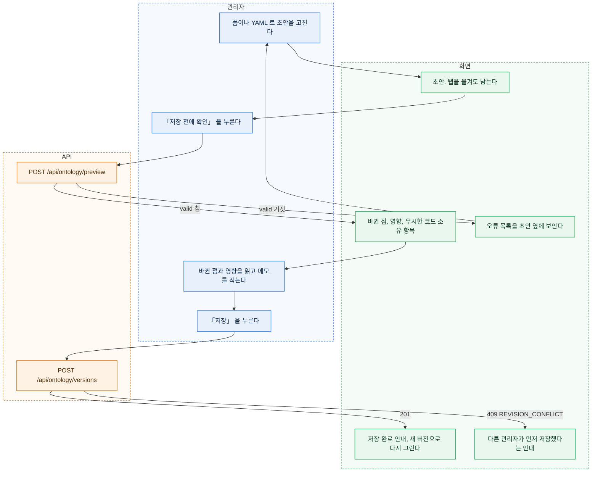

### 초안

- 폼 편집기와 YAML 편집기는 초안 하나를 함께 쓴다. 처음 열면 지금 버전에서 시작하고, 시작한 버전이 `baseVersion` 이다.
- 폼에서 YAML 로 옮기거나 YAML 에서 폼으로 옮길 때는 미리보기 API 가 정규화한 `yaml` 과 `definition` 으로 바꾼다. 웹은 YAML 을 직접 읽거나 쓰지 않는다. YAML 이 틀려 바꿀 수 없으면 옮기지 않고 오류를 보인다.
- 초안은 화면 메모리에 있다. 다른 탭에 다녀와도 남고, 저장하거나 「초안 버리기」 를 누르면 사라진다. 새로고침과 창 닫기 전에는 브라우저가 떠날지 묻는다(`beforeunload`). 새로고침하면 초안은 사라진다.
- 미리보기와 저장은 초안 전체를 보낸다. 고친 부분만 보내지 않는다.
- 서버가 정규화한 YAML 에는 주석이 남지 않는다. YAML 편집기 위에 키 설명(`label`, `valueLabels`, `description`, `hintProperties`, `display`, `searchProperties`, `createPicker`, `valueAliases` 의 뜻과 흐름 표기의 따옴표 규칙)을 접힌 도움말로 둔다.

### 미리보기와 저장

- 「저장 전에 확인」 은 미리보기 API 를 부른다. 결과에 바뀐 점(더함, 뺌, 바뀜)과 영향 목록, 무시한 코드 소유 항목이 나온다. 바뀐 점이 없으면 「바뀐 점이 없습니다」 를 보이고 「저장」 을 두지 않는다.
- 영향이 있으면 항목마다 「노드 3개가 이 속성 값을 가지고 있습니다」 처럼 보이고, 「기존 데이터와 어긋나는 것을 알고 저장합니다」 확인란을 켜야 「저장」 이 눌린다. 확인란을 켜면 저장 요청에 `confirm: true` 를 담는다.
- 저장에 성공하면 화면이 새 버전으로 온톨로지를 다시 읽고 보기 화면(`/ontology`)으로 간다(push). 안내는 「버전 N 을 저장했습니다.」 다.
- 미리보기와 저장 사이에 데이터가 바뀌어 영향이 새로 생기면 저장이 `409 ONTOLOGY_IMPACT_UNCONFIRMED` 로 거절될 수 있다. 화면은 그 응답의 영향 목록으로 미리보기를 다시 그린다.
- 다른 관리자가 먼저 저장하면 저장이 `409 REVISION_CONFLICT` 다. 초안은 남는다. 화면은 「다른 관리자가 버전 N 을 저장했습니다.」 와 두 단추를 보인다.
  - 「최신 버전에서 다시 시작」: 초안을 버리고 최신 버전으로 새 초안을 연다.
  - 「내 초안을 최신 버전 위에 저장」: `baseVersion` 을 최신 번호로 바꾸고 미리보기를 다시 부른다. 바뀐 점은 최신 버전과 비교한 것이라, 다른 관리자의 변경을 덮어쓰면 그것이 「뺌」 이나 「바뀜」 으로 보인다.

### 폼 편집기

폼은 자주 하는 변경만 다룬다. 그 밖의 항목(`hintProperties`, `searchProperties`, `valueAliases`, `createPicker`, `labelProperty`)은 YAML 편집기에서 고친다. 폼은 이 항목을 읽기만 하고 그대로 둔다.

| 대상 | 더하기 | 고치기 | 빼기 |
| --- | --- | --- | --- |
| 노드 타입 | 키, 표시 이름, 설명, 라벨 속성(새 타입의 첫 속성), 색과 모양 | 표시 이름, 설명, 색과 모양 | 된다. 영향은 미리보기에서 본다 |
| 속성 | 키, 값 타입, 필수, 표시 이름, 설명, 길이와 범위, enum 값과 그 표시 이름 | 표시 이름, 설명, 필수, 길이와 범위, enum 값 더하기와 빼기, enum 표시 이름 | 된다. 라벨 속성은 뺄 수 없다 |
| 관계 종류 | 키, 표시 이름, 설명, 시작 타입, 끝 타입 | 표시 이름, 설명, 시작과 끝 타입 | 된다 |
| 주장 종류 | 키, 표시 이름, 문장 틀, 설명, 주체 타입, 대상 타입 | 표시 이름, 문장 틀, 설명, 주체와 대상 타입 | 된다 |

- 키는 더할 때만 적는다. 이미 있는 키는 입력칸이 아니라 글자로 보인다. 키 형식은 타입이 `PascalCase`, 관계 종류와 주장 종류가 `UPPER_SNAKE_CASE`, 속성이 `camelCase` 다. 형식이 틀리면 입력칸 아래에 바로 알린다.
- Claim 타입과 코드 소유 항목(검토 상태, 이력 이름, 주장 관계)은 폼에 나오지 않는다. 코드가 이름으로 읽는 키는 「빼기」 와 값 타입, 필수 칸이 꺼져 있다.
- 빼기는 그 자리에서 지우지 않고 줄에 「뺄 예정」 표시를 남긴다. 「되살리기」 로 되돌린다. 미리보기에 들어가야 영향이 보이기 때문이다.

### 버전 기록과 되돌리기

- 「버전 기록」(`view=history`)은 최근 버전부터 번호, 시각, 저장한 사람, 메모를 보인다. 되돌린 버전은 「버전 N 으로 되돌림」 이 함께 보인다.
- 버전을 누르면(`version=N`) 그 버전의 YAML 을 읽기 전용으로 보이고, 「이 버전 내려받기」 와 「이 버전으로 되돌리기」 가 있다.
- 「이 버전으로 되돌리기」 는 그 버전의 YAML 로 미리보기를 부른다. 바뀐 점과 영향은 최신 버전과 비교한 것이다. 확인하고 저장하면 `POST /api/ontology/versions/{N}/restore` 로 새 버전이 생긴다. 예전 버전은 그대로 남는다.
- 「YAML 내려받기」 는 `GET /api/ontology/export` 로 최신 버전 파일을 받는다. Git 에 백업하거나 저장소 YAML 과 비교할 때 쓴다.

### 다른 화면이 버전 바뀜을 아는 방법

- 모든 API 응답에 `X-Ontology-Version` 헤더가 있다. 화면은 들고 있는 온톨로지의 `version` 과 다르면 머리글 아래에 「온톨로지가 바뀌었습니다(버전 N). 다시 읽으면 바뀐 타입과 칸이 보입니다.」 와 「다시 읽기」 를 보인다.
- 저절로 다시 읽지 않는다. 쓰던 폼의 칸이 바뀌어 입력이 사라질 수 있기 때문이다. 「다시 읽기」 는 온톨로지만 다시 받고 주소와 쓰던 입력은 그대로 둔다.
- 다시 읽기 전에 저장한 쓰기도 서버는 최신 버전으로 검증한다. 빠진 속성이나 타입을 보내면 지금처럼 `400 ONTOLOGY_VIOLATION` 이다.
- 자기가 저장한 관리자의 화면은 저장 응답을 받은 뒤 바로 다시 읽으므로 이 안내가 나오지 않는다.
