# 흐름

## 로그인

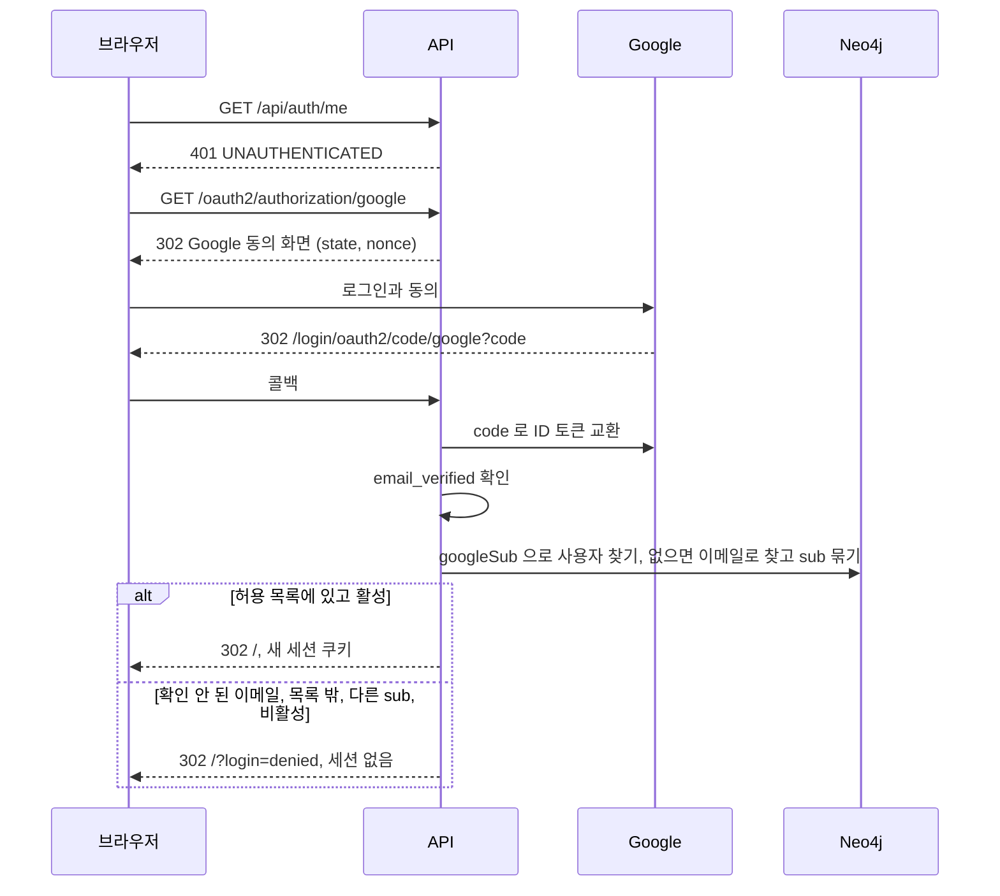

로그인한 뒤에도 API 는 요청마다 사용자 상태와 역할을 다시 읽는다.
관리자가 사용자를 비활성화하면 그 사용자의 다음 요청은 `401` 이고 세션이 지워진다.

## 주소와 뒤로가기

화면 상태는 주소에 있다. 화면은 경로, 그 화면 안의 상태는 query 다. 결정과 근거는 [ADR-007](adr/007-routes-in-url.md) 이다.
상단 탭은 「개념 지도」, 「작업 공간」, 「목록」, 「공부」 넷이다. 나머지 화면은 오른쪽 위 「더보기」 메뉴에 있다. 화면 구조의 결정은 [ADR-010](adr/010-concept-map-first-screen.md), 「공부」 탭과 근거 따라가기는 [ADR-011](adr/011-learning-marks-and-trace.md) 이다.

| 경로 | 화면 | 여는 곳 | query |
| --- | --- | --- | --- |
| `/map` | 개념 지도 | 상단 탭 | `type`(지도에서 고른 타입 키) |
| `/workspace` | 작업 공간 | 상단 탭 | `node`(상세로 연 항목), `center`(그래프 중심, 없으면 `node`), `pane`(좁은 화면의 `search`, `graph`, `detail`), `q`, `types`(쉼표 구분, 전체면 뺀다), `status`(주장 검토 상태), `archived=1`(보관 포함), `hops`(1이면 뺀다), `claims=nodes`(주장을 따로 보기) |
| `/list` | 목록 | 상단 탭 | `type`, `q`, `archived=1`, `page`(0이면 뺀다) |
| `/study` | 공부 | 상단 탭 | `level`(`UNSURE`, `LEARNING` 가운데 하나. 없으면 둘 다), `page`(0이면 뺀다) |
| `/trace` | 근거 따라가기 | 상세의 「근거 따라가기」, 개념 지도 타입 칸의 최근 항목, 공부 목록의 항목 | `node`(따라갈 항목) |
| `/changes` | 변경 이력 | 더보기(모든 역할) | `target`(대상 노드 id), `actor`(사용자 이메일), `page` |
| `/ontology` | 온톨로지 상세 | 더보기(모든 역할) | `view`(ADMIN 의 `form`, `yaml`, `history`. 없으면 지금 버전 보기), `version`(`view=history` 에서 연 버전) |
| `/review` | 검토 대기 | 더보기(EDITOR, ADMIN) | `page`, `minePage`(0이면 뺀다) |
| `/users` | 사용자 | 더보기(ADMIN) | 없음 |

- `/` 는 `/map` 으로 바꿔 연다. 기본값과 같은 query 는 주소에 쓰지 않는다. 그래서 처음 열면 주소가 `/map` 이다.
- ADMIN 이 아닌 사람이 `/ontology?view=…` 를 열면 `/ontology` 로 바꿔 연다(기록을 쌓지 않는다).
- `/` 와 모르는 경로, 권한 없는 화면 경로(`/users` 를 ADMIN 이 아닌 사람이 연 경우)는 `/map` 으로 바꿔 연다. 바꿀 때는 기록을 쌓지 않는다. 표에 없는 경로는 서버가 `404` 로 답해 화면이 뜨지 않는다.
- 열람자의 더보기 메뉴에는 「검토 대기」 가 없다. 주소로 `/review` 를 열면 지금처럼 모든 초안을 검토 단추 없이 본다. 이미 보낸 링크를 깨지 않으려는 것이다.
- 더보기 메뉴의 화면이 열려 있으면 「더보기」 단추가 선택된 탭처럼 보인다.
- 이미 보낸 `/?node=<id>` 링크는 `/workspace?node=<id>&pane=detail` 로 바꿔 연다. 「링크 복사」 는 `/workspace?node=<id>` 를 넣는다.
- 서버는 위 표의 경로의 GET 을 `index.html` 로 돌려준다. 그 밖의 경로는 지금처럼 `404` 다. 정적 파일과 `/api/**` 는 그대로다.

### 뒤로가기 한 번으로 되돌리는 동작

아래 동작은 주소를 새로 쌓는다(push). 뒤로가기를 누르면 바로 앞 화면으로 돌아간다.

| 동작 | 바뀌는 주소 |
| --- | --- |
| 상단 탭이나 더보기 메뉴 항목 누르기 | 경로. 그 화면에 처음 들어가면 query 없이, 그 화면에서 마지막으로 보던 주소가 있으면 그 주소로 간다 |
| 개념 지도에서 타입 고르기 | `type` |
| 개념 지도의 「목록에서 보기」, 「작업 공간에서 보기」 | `/list?type=…`, `/workspace?types=…` |
| 「근거 따라가기」 열기(상세, 개념 지도 타입 칸, 공부 목록), 근거 따라가기 안에서 다른 항목을 따라가기 | `/trace?node=…` |
| 항목 열기(검색 결과, 그래프 노드, 「그래프에 나온 항목」, 개념 지도의 최근 항목, 목록, 검토 대기, 변경 이력, 연결과 주장 카드의 이름, 상세의 「그래프 중심으로」, 「＋ 추가」 로 만든 새 항목) | `/workspace?node=…`. 좁은 화면에서는 `pane` 도 함께 바뀐다. 상세만 바꾸는 열기(그래프와 상세 안에서 누른 것)는 그때의 그래프 중심을 `center` 로 남긴다 |
| 좁은 화면의 검색, 그래프, 상세 탭 누르기, 그래프 아래 「상세 보기」 | `pane` |
| 온톨로지 상세의 「폼으로 편집」, 「YAML 로 편집」, 「버전 기록」, 버전 기록에서 버전 열기 | `view`, `version` |

나머지는 주소만 바꾸고 기록을 쌓지 않는다(replace). 검색어와 필터, 홉 수, 「주장을 따로 보기」, 그래프의 「선택한 항목을 중심으로」, 쪽 넘기기, 이력의 대상과 사용자 고르기가 여기 해당한다. 새로고침과 링크에는 남는다.

- 종류 필터를 모두 끄면 주소에서 `types` 가 빠져 전체로 돌아간다. 모두 끈 상태는 주소에 담지 않는다.
- 쪽 번호가 끝 쪽을 넘으면 끝 쪽으로 바꿔 연다(replace).

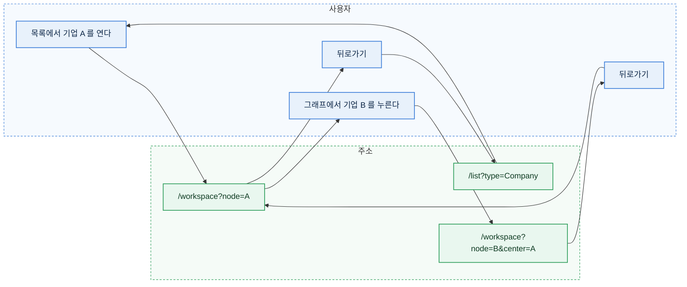

- 뒤로가기로 돌아온 화면은 주소의 상태로 다시 그린다. 검색 결과와 그래프는 다시 읽는다. 「이웃 확장」 으로 넓힌 그래프와 폼에 쓰던 입력은 주소에 없어 돌아오지 않는다.
- 상세에서 고치던 폼에 저장하지 않은 입력이 있어도 뒤로가기를 막지 않는다. 저장하지 않은 입력은 사라진다.
- 같은 항목을 다시 열면 주소가 같아 기록을 쌓지 않는다.

### 로그인을 거치는 링크

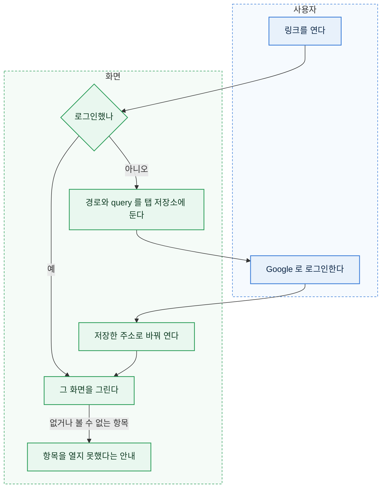

- Google 로그인은 `/` 로 돌아오므로 보던 주소가 사라진다. 로그인 화면을 보이기 전에(처음 열 때와 쓰는 중 세션이 끝나 로그인 화면으로 갈 때 모두) 경로와 query 를 탭 저장소(`sessionStorage`, 키 `workbench.returnTo`)에 두었다가, 로그인을 확인한 뒤 꺼내 그 주소로 바꿔 연다(기록을 쌓지 않는다). 꺼낸 값은 지운다. 저장소를 쓸 수 없는 브라우저(사생활 보호 창 등)에서는 첫 화면(`/map`)이 열린다.
- 저장하는 주소는 경로 부분이 위 표의 경로 가운데 하나와 정확히 같은 것만이다. 다른 값(바깥 주소, `//` 로 시작하는 값, `/workspacefoo` 같은 값)은 저장하지 않는다.
- 꺼낸 주소는 온톨로지를 받는 순간 함께 반영한다. 좁은 화면에서도 `pane` 대로 시작한다.
- 항목 상세 「⋯」 메뉴의 「링크 복사」 와 검토 대기의 「링크 복사」 가 `/workspace?node=<id>` 를 클립보드에 넣는다. 클립보드를 쓸 수 없으면 주소를 입력칸에 보여 직접 복사하게 한다.
- 열람자도 링크로 항목을 열 수 있다. 보관된 항목은 상세가 「보관됨」 으로 열린다.

## 개념 지도

첫 화면이다. 온톨로지(`GET /api/ontology`)의 노드 타입과 관계 종류(`relationshipTypes`)를 그림으로 보이고, 타입마다 등록한 항목 수를 붙인다. 결정과 근거는 [ADR-010](adr/010-concept-map-first-screen.md) 이다.
타입 이름은 코드에 적지 않는다. 온톨로지에 타입이나 관계 종류가 늘면 지도도 그대로 늘어난다.

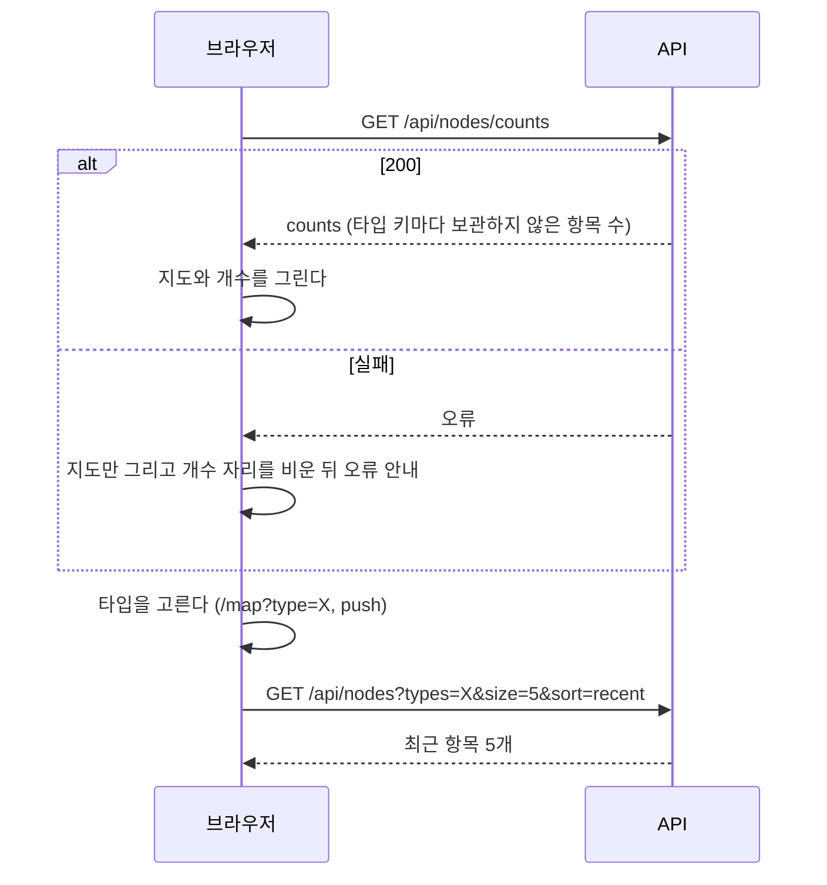

- 그림은 Cytoscape.js 의 `breadthfirst` 배치(directed)다. 뿌리는 들어오는 관계가 없는 타입이다. 자기 자신을 잇는 관계(개념과 개념을 잇는 관계)는 배치 계산에서 빼고 선으로만 그린다. 뿌리가 하나도 없으면 아래 「타입 순서」 의 첫 타입을 뿌리로 쓴다.
- 노드 글자는 타입 이름과 개수(「병목 4개」)다. 색과 모양은 작업 공간 그래프와 같은 온톨로지 `display` 값이다. 선 글자는 관계의 표시 이름이다. 키 이름은 보이지 않는다. 선 글자는 흰 배경 위에 그려 선과 겹쳐도 읽힌다. 화면 맞춤 배율이 1 보다 작으면 글자 크기를 배율로 나눠, 화면에 그려지는 크기가 노드 글자 13px, 선 글자 11px 아래로 내려가지 않게 한다. 확대하면 원래 크기 규칙대로 커진다. 넓은 화면의 지도 높이는 600px 다. 좁은 화면(1024px 미만)에서는 선 글자가 서로 겹쳐 숨기고, 관계는 타입 칸의 문장으로 읽는다.
- 주장(Claim)은 지도에 그리지 않는다. 지도 아래에 「주장은 어느 항목에나 붙일 수 있습니다」 와 주장 개수를 보인다.
- 지도 아래에 타입 목록(이름과 개수)을 함께 둔다. 그림을 누르기 어려운 휴대폰과 키보드 사용자를 위한 것이다. 목록에서 골라도 그림에서 고른 것과 같다. 순서는 아래 「타입 순서」 다.
- 지도 위에는 제목 「투자 온톨로지」 와 짧은 소개 「투자 판단을 근거와 함께 쌓는 온톨로지입니다. 상자를 누르면 그 종류의 항목을 보고 바로 추가할 수 있습니다.」 를 둔다. 예전에 작업 공간 그래프 자리에 있던 시작 안내를 옮긴 것이다.
- 타입을 고르면 넓은 화면은 지도 오른쪽, 좁은 화면(1024px 미만)은 지도 아래에 타입 칸이 열린다. 타입 칸에는 아래가 있다.
  - 타입의 설명(`description`)과 개수.
  - 최근에 만든 항목 5개(`GET /api/nodes?types=X&size=5&sort=recent`). 이름을 누르면 작업 공간에서 그 항목의 상세를 연다. 줄마다 「근거 따라가기」 가 있어 그 항목의 근거 따라가기(`/trace?node=…`)를 연다. 없으면 「아직 없습니다」 다.
  - 이 타입이 시작이나 끝인 관계를 문장으로(아래 「관계 문장」). 예: 병목 칸에서 「세상의 변화가 병목을 만듭니다」, 「병목이 기업에 이익을 줍니다」.
  - 단추 「＋ {타입} 추가」(편집 권한이 있을 때. 그 타입을 고른 채 만들기 창을 연다), 「목록에서 보기」(`/list?type=X`), 「작업 공간에서 보기」(`/workspace?types=X`).
- 주소의 `type` 이 온톨로지에 없거나 주장 타입이면 타입 칸을 열지 않는다. 주소는 바꾸지 않는다.
- 빈 상태: 개수가 모두 0 이면 지도 위에 「아직 등록한 항목이 없습니다.」 를 보이고, 편집 권한이 있으면 「오른쪽 위 「＋ 추가」 로 첫 항목을 만드세요.」 를 함께 보인다.
- 개수를 받지 못하면 지도는 그리고 개수 자리만 비운다. 지도 위에 「항목 수를 불러오지 못했습니다.」 와 오류 이유를 보인다. 최근 항목을 받지 못하면 타입 칸 안에 같은 방식으로 알린다.

### 타입 순서

「＋ 추가」 메뉴, 작업 공간의 종류 칩, 개념 지도의 타입 목록은 같은 순서를 쓴다.
온톨로지에 순서 필드를 두지 않고 관계 방향으로 계산한다. 운영 온톨로지는 DB 의 버전이라 저장소 YAML 에 새 필드를 넣어도 운영에 닿지 않기 때문이다.

1. `relationshipTypes` 의 `from` 에서 `to` 로 가는 방향 그래프를 만든다. 자기 자신을 잇는 관계는 뺀다. 별도 API 가 관리하는 타입(`managedBy`, 지금은 Claim)은 순서에서 빼고 맨 아래에 따로 둔다.
2. 들어오는 관계가 없는 타입이 뿌리이고 깊이는 0 이다. 뿌리에서 너비 우선으로 잰 가장 가까운 거리가 그 타입의 깊이다.
3. 깊이가 얕은 순서로 놓고, 깊이가 같으면 온톨로지에 적힌 순서를 따른다. 뿌리에서 닿지 않는 타입은 맨 뒤에 온톨로지 순서로 둔다.

### 관계 문장

작업 공간 상세의 「연결」 절과 개념 지도의 타입 칸은 관계를 문장 하나로 보인다. 문장은 관계 종류의 문장 틀(`relationshipTypes.<관계>.sentence`)로 만든다.

- 문장 틀은 `{from}`(시작)과 `{to}`(끝)를 한 번씩 담는다. 예: `{from}이(가) {to}을(를) 발행한다`, `{to}은(는) {from}에 대한 결정이다`. 틀은 한다체로 적고 화면은 끝을 합니다체로 바꿔 보인다.
- 틀이 없는 관계는 「{from}이(가) {to}을(를) {표시 이름}」 으로 만든다. 표시 이름(`label`)은 그래프 선 글자와 칩에 쓰는 짧은 이름이다.
- 양쪽 상세에서 같은 문장을 보인다. 지금 보고 있는 항목의 이름은 굵게, 상대 이름은 누르면 그 항목을 여는 링크다. 개념 지도에서는 두 자리에 타입 이름이 들어간다(「세상의 변화가 병목을 만듭니다」).
- 조사는 아래 「조사 고르기」 대로 하나로 고른다. 두 꼴을 함께 보이지 않는다.
- 합니다체는 문장이 「다」 로 끝날 때만 만든다. 「이다」 로 끝나면 「입니다」, 「는다」 로 끝나면 「습니다」(겪는다 → 겪습니다)다. 「다」 앞 글자의 받침이 ㄴ 이면 ㅂ 으로 바꾸고 「니다」(만든다 → 만듭니다), 다른 받침이 있으면 「습니다」(썼다 → 썼습니다), 받침이 없으면 「입니다」 를 붙인다(시나리오다 → 시나리오입니다). 「다」 로 끝나지 않으면 그대로 쓴다.
- 서버는 문장 틀이 `{from}` 과 `{to}` 를 한 번씩 담지 않으면 온톨로지를 저장하지 않는다.
- 시작과 끝 타입이 같은 관계도 문장 하나다. 개념 지도 타입 칸에서는 한 번만 보인다.

### 조사 고르기

화면이 이름 뒤에 조사를 붙일 때(관계 문장, 주장 문장 틀, 안내 문장) 쓰는 규칙이다. 틀에는 `이(가)`, `은(는)`, `을(를)`, `와(과)`, `으로(로)` 로 적는다.

| 이름의 마지막 글자 | 받침이 있다고 보는 것 |
| --- | --- |
| 한글 | 받침이 있는 글자 |
| 영문자 | L, M, N, R(읽는 소리 「엘, 엠, 엔, 알」). 나머지는 받침이 없다 |
| 숫자 | 0, 1, 3, 6, 7, 8(읽는 소리 「영, 일, 삼, 육, 칠, 팔」). 나머지는 받침이 없다 |

- `으로(로)` 는 받침이 없거나 ㄹ 받침이면 「로」 다. 영문자 L, R 과 숫자 1, 7, 8 은 ㄹ 받침으로 본다.
- 이름 끝의 괄호, 따옴표, 마침표, 공백은 건너뛰고 그 앞 글자로 고른다(「SK하이닉스 (KR)」 은 R).
- 그 밖의 글자로 끝나거나 이름이 비어 있으면 틀의 표기를 그대로 둔다.

## 노드 만들기

만들기는 「＋ 추가」 에서 시작한다. 타입을 고르면 온톨로지 속성으로 만든 폼이 창(radix-ui Dialog)으로 열린다. 주장 폼 안의 「근거 문서 새로 등록」 도 같은 폼을 주장 폼 안에서 연다.

- 「＋ 추가」 는 머리글 오른쪽, 「더보기」 왼쪽에 있고 모든 화면에서 같은 자리다. 편집 권한이 있을 때만 보인다. 작업 공간 그래프 오른쪽 아래의 둥근 ＋ 단추도 같은 메뉴를 연다.
- 메뉴의 줄마다 타입 배지, 이름, 짧은 설명(온톨로지 `description` 의 첫 문장)이 있다. 순서는 「타입 순서」 이고, 주장은 맨 아래 구분선 밑에 따로 있다. 주장 종류(`claimPredicates`)가 하나도 없으면 주장 줄은 없다.
- 개념 지도 타입 칸의 「＋ {타입} 추가」 는 메뉴를 건너뛰고 그 타입의 창을 연다.
- 창 위쪽에 단계 표시 「1. 종류 고르기 → 2. 내용 적기 → 3. 연결하기」 가 있다. 창이 열리면 1단계는 끝난 것으로 보인다. 2단계는 속성 칸, 3단계는 시작 노드 고르기 칸이다. 고르기 칸이 없는 타입은 3단계를 보이지 않는다. 주장 창은 「1. 종류 고르기 → 2. 내용 적기」 다.
- 처음에는 필수 속성만 보인다. 선택 속성은 「선택 항목 더 보기」 를 눌러 펼친다. 선택 속성에 오류가 생기면(서버 검증 오류 포함) 저절로 펼친다.
- 저장에 성공하면 창을 닫고 작업 공간에서 새 항목의 상세를 연다(`/workspace?node=<id>&pane=detail`, push). 상세 위에 성공 안내가 보인다.
- 「취소」, 창 밖 누르기, `Escape` 는 창을 닫고 입력을 버린다.
- 고르기 칸에서 새 항목을 바로 만들지는 않는다(사용자 결정 2026-10-24). 고를 항목이 없으면 비워 두고 만든 뒤 상세의 「＋ 연결 추가」 로 잇는다.
- 열람자에게는 「＋ 추가」 와 그래프의 ＋ 단추가 없다.

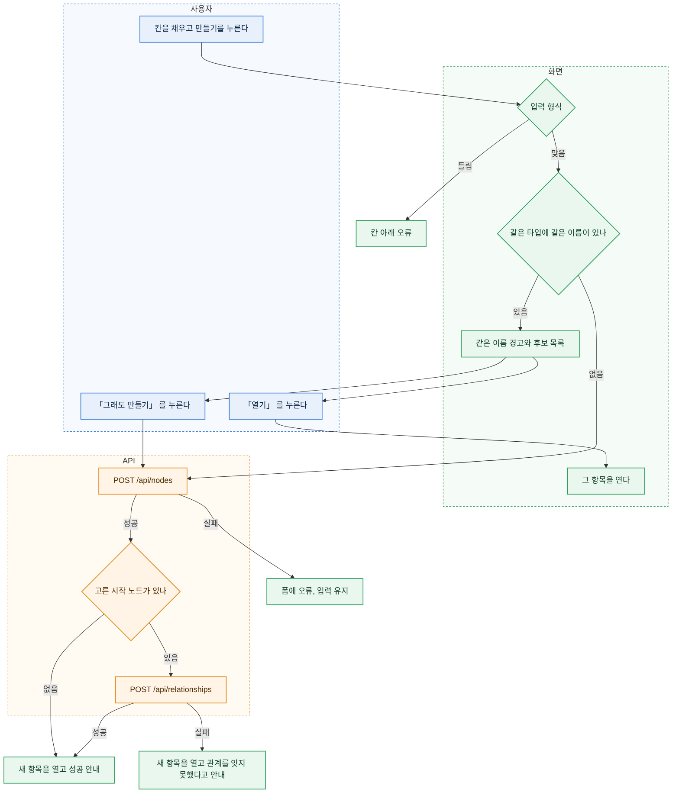

- 같은 이름 검사는 저장 직전에 화면이 한다. 같은 타입에서 이름(`labelProperty` 값)이 앞뒤 공백과 대소문자를 무시하고 같은 보관되지 않은 항목을 찾는다. 검색 API(`GET /api/nodes?q=이름&types=타입&size=100`)의 결과 안에서만 찾는다.
  - 찾으면 저장하지 않고 「같은 이름의 기업이 이미 있습니다.」 와 후보 목록을 보인다. 후보마다 구분 정보(`hintProperties` 와 만든 날)와 「열기」 가 있다. 「열기」 는 창을 닫고 그 항목을 연다. 주장 폼 안의 근거 문서 등록에서는 「열기」 대신 「이 문서 고르기」 다. 주장 폼을 떠나지 않게 하려는 것이다.
  - 「그래도 만들기」 를 누르면 검사 없이 만든다. 같은 이름의 다른 기업이 실제로 있을 수 있어 막지 않는다.
  - 이름 칸을 고치면 경고를 지우고 다음 저장 때 다시 검사한다.
  - 검색이 실패하면 경고 없이 만든다. 검사는 돕는 기능이라 저장을 막지 않는다.
- 주소 칸(`url` 타입)은 브라우저의 주소 형식 검사를 쓰지 않는다. `example.com/report` 처럼 `scheme://` 없이 적으면 저장할 때 `https://` 를 붙인다. 붙인 뒤에도 주소가 아니면 서버가 `400 VALIDATION_FAILED` 로 막는다.
- 필수 시각 칸(`datetime` 이고 `required`, 지금은 근거 문서의 「수집 시각」)은 폼을 열 때 지금 시각으로 채운다. 편집 폼은 저장된 값을 그대로 보인다.
- 국가와 통화처럼 목록이 있는 칸은 선택 칸이다. 편집 폼에서 저장된 값이 목록에 없으면 「목록에 없는 값: 그 값」 선택지를 더해 보이고, 그 칸을 바꾸지 않으면 다른 칸을 저장할 수 있다.
- 시작 노드 고르기 칸은 `createPicker` 가 있는 관계마다 생긴다. 종목 폼의 「발행 기업」, 병목 폼의 「이 병목을 만든 변화」 가 그것이다. 고르지 않아도 된다. 투자 온톨로지의 항목은 이 칸으로 앞 항목에 이어 간다(아래 「투자 온톨로지 항목 이어 만들기」).
  - 고르면 노드를 만든 뒤 그 관계(`ISSUES`, 시작은 고른 기업, 끝은 새 종목)를 만든다. 두 요청은 따로라서 관계만 실패할 수 있다.
  - 관계만 실패하면 종목은 남는다. 새 종목을 열고 「종목을 만들었지만 발행 기업을 잇지 못했습니다. 상세의 「＋ 연결 추가」 로 다시 이으세요.」 와 실패 이유를 보인다.

## 투자 온톨로지 항목 이어 만들기

세상의 변화에서 투자 결정까지 앞에서 뒤로 만든다. 「＋ 추가」 의 만들기 창을 쓰고, 각 창의 시작 노드 고르기 칸이 앞 노드와의 관계를 함께 만든다. 저장 모델은 [데이터 스키마](data-schema.md) 의 「투자 온톨로지」 가 소유한다.

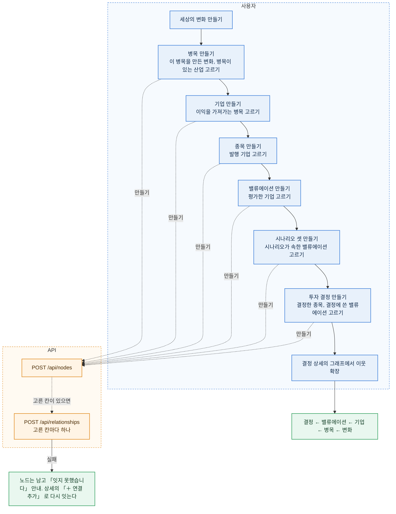

- 고르기 칸에 고를 노드가 없으면 비워 두고 만든다. 나중에 상세의 「＋ 연결 추가」 로 잇는다.
- 결정 폼의 두 고르기 칸은 관계를 하나씩 따로 만든다. 하나만 실패하면 그 관계만 다시 잇는다.
- 다시 평가할 때는 기존 밸류에이션을 고치지 않고 새 밸류에이션과 시나리오를 만든다. 결정은 그때 쓴 밸류에이션을 가리킨다.
- 근거 자료는 근거 문서 폼의 「이 자료가 근거인 항목」 칸으로 변화, 병목, 밸류에이션에 잇는다.
- 주변 그래프는 최대 2홉이라 결정 하나에서 변화(4홉)까지 한 번에 보이지 않는다. 「이웃 확장」 을 두 번 눌러 따라간다.

## 산업 소속 Claim 등록과 검토

### 검토 대기 화면

편집자의 검토 대기 화면은 두 구역이다.

| 구역 | 조회 | 보이는 것 |
| --- | --- | --- |
| 내가 검토할 주장 | `GET /api/claims?reviewStatus=DRAFT&scope=reviewable` | 검토 메모와 「검토 완료」, 「반려」 |
| 내가 쓰거나 고친 주장 | `GET /api/claims?reviewStatus=DRAFT&scope=mine` | 「다른 편집자가 검토합니다. 링크를 복사해 검토를 요청하세요.」 와 「링크 복사」 |

- 「내가 쓰거나 고친」 은 작성자이거나 마지막으로 내용을 고친 사람이다. 서버의 자기 검토 금지 규칙과 같은 기준이다. 두 편집자가 모두 손댄 주장은 두 사람 모두에게 이 구역에 나오고, 제3의 편집자에게 「내가 검토할 주장」 으로 나온다.
- 두 구역은 쪽 나누기를 따로 한다. 한 구역을 비우면 「검토를 기다리는 주장이 없습니다.」, 다른 구역은 「내가 쓰고 아직 검토되지 않은 주장이 없습니다.」 다.
- 열람자는 한 구역만 본다. `scope` 없이 모든 초안을 보이고 검토 단추는 꺼져 있다.
- 주장 상세의 검토 칸도 같은 기준이다. 작성자나 마지막 내용 수정자(`contentUpdatedBy`)이면 검토 단추를 끄고, 「내가 쓰거나 마지막으로 고친 주장은 다른 편집자가 검토합니다. 링크를 복사해 검토를 요청하세요.」 와 「링크 복사」 를 보인다.
- `createdBy` 가 비어 있는 주장은 어느 구역에도 나오지 않는다. 지금 만드는 경로는 모두 작성자를 채운다.

### 주장 만들기 화면

주장은 문장을 채우는 폼으로 만든다. 관계 종류를 고르면 그 종류의 문장 틀(`claimPredicates.<predicate>.sentence`)이 칸의 순서를 정한다.
예를 들어 산업 소속은 「[주체 고르기]이(가) [대상 고르기]에 속한다」 로 보인다. 조사는 고른 이름의 끝소리에 맞춰 바뀐다.

- 입구는 둘이다.
  - 「＋ 추가」 메뉴 맨 아래의 「주장」 을 고른다. 만들기 창이 열리고 주체와 대상이 모두 비어 있다.
  - 항목 상세 「주장」 절 머리의 「＋ 주장 추가」 를 누른다. 그 항목이 주체로 채워진다.
- 「주체와 대상 바꾸기」 단추가 두 칸을 맞바꾼다. 산업의 상세에서 시작해도 「이 산업에 속하는 기업」 을 만들 수 있다.
- 관계 종류를 바꾸면 그 종류가 받지 않는 타입의 주체나 대상은 비운다.
- 주체나 대상을 아직 고르지 않았거나 근거 문서가 없으면 저장 단추를 눌렀을 때 칸마다 무엇이 빠졌는지 보인다. 서버 검증 오류도 같은 칸 아래에 보인다.
- 고를 기업이 하나도 없으면 고르기 칸이 「먼저 기업을 만드세요」 를 보인다.

### 거장의 생각 담기

책이나 주주서한에 나온 거장의 생각은 주장으로 담는다. 새 화면은 없고, 지금의 만들기와 주장 폼을 쓴다.

1. 출처를 근거 문서로 만든다. 자료 종류를 책, 서한, 강연과 인터뷰 가운데 고르고, 「저자」 칸에서 인물을 고르면 `AUTHORED` 관계가 함께 생긴다.
2. 인물 상세의 「＋ 주장 추가」 에서 관계 종류를 「강조한다」 나 「비판한다」 로 고르면 문장이 「[워런 버핏]이(가) [개념 고르기]을(를) 강조한다」 로 보인다. 근거 문서에 1의 책을 고르고, 근거 문장에 짧은 인용을 넣는다.
3. 다른 편집자가 출처와 인용을 확인해 검토한다. 그래프에서는 인물과 개념 사이에 「강조한다」 선 하나로 보인다.

### 주장의 이름

주장의 이름은 저장하지 않고 읽을 때 만든다. 「주체 → 대상 관계」 다(예: 「가나전자 → 메모리 반도체 속한다」).
기업 이름을 바꾸면 그 기업이 걸린 주장의 이름도 바로 바뀐다. 변경 이력의 대상 이름은 그때의 이름을 남긴다.

## 동시 수정

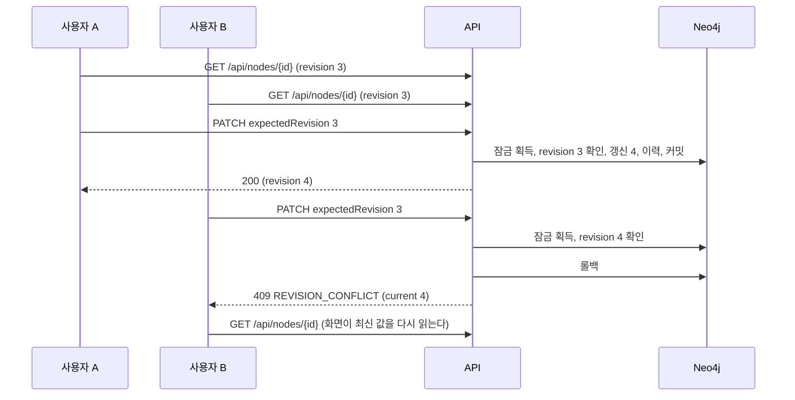

두 요청이 같은 순간에 오면 한쪽이 잠금을 기다린다. 기다린 쪽은 먼저 커밋된 revision 을 읽고 409 를 받는다.

### 화면에서 입력 지키기

노드 편집 폼은 409 를 받아도 내 입력을 버리지 않는다. 상세 패널이 편집 시작 값과 내 입력을 들고 있다가, 최신 값을 다시 읽은 뒤 칸마다 비교한다.

| 칸의 상태 | 편집 시작 값 대비 | 화면 |
| --- | --- | --- |
| 다른 쪽만 바꿈 | 최신 값만 다르다 | 최신 값을 그대로 보이고 「다른 쪽이 바꿈」 으로 알린다 |
| 나만 바꿈 | 내 입력만 다르다 | 「다시 적용」 이 내 입력을 다시 넣는다 |
| 둘 다 다르게 바꿈 | 둘 다 다르고 서로도 다르다 | 두 값을 함께 보이고 칸마다 「내 값」 과 「최신 값」 가운데 고르게 한다. 기본은 「최신 값」 이다 |
| 둘 다 같은 값으로 바꿈 | 둘 다 다르지만 서로 같다 | 알리지 않는다 |

- 안내는 「다른 탭이나 다른 사용자가 먼저 저장했습니다. 최신 내용을 불러왔습니다.」 다. 같은 사람이 두 탭에서 고쳐도 같은 409 가 나기 때문이다. 서버 응답 문장은 같은 말을 되풀이하므로 따로 보이지 않는다.
- 폼은 최신 값으로 다시 그려진다. 「다시 적용」 을 누르면 「나만 바꿈」 칸과 「내 값」 을 고른 칸에 내 입력이 들어간다. 저장은 하지 않는다. 사용자가 확인하고 저장하면 새 revision 으로 보낸다.
- 「버리기」 를 누르면 비교를 닫고 최신 값만 남는다. 다른 항목을 고르거나 저장에 성공해도 닫힌다.
- 다시 적용할 칸이 없으면(다른 쪽만 바꿨거나 같은 값으로 바꿨으면) 비교를 보이지 않고 안내만 남는다.
- 주장 내용 수정 폼(`ClaimEditForm`)과 검토, 보관, 복원은 지금처럼 최신 값을 다시 읽기만 한다. 남은 한계는 [제품 요구사항](prd.md) 에 있다.

## 쓰기 공통 분기

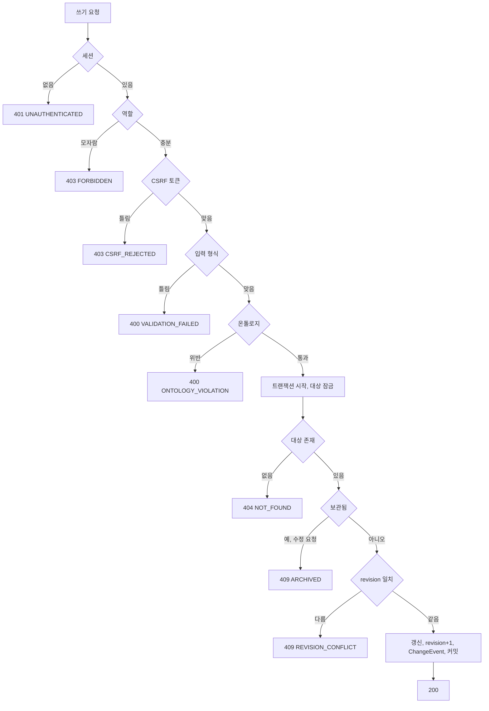

이력 기록이 실패하면 트랜잭션 전체가 롤백된다. 데이터만 바뀌고 이력이 없는 상태는 생기지 않는다.

## 주변 그래프

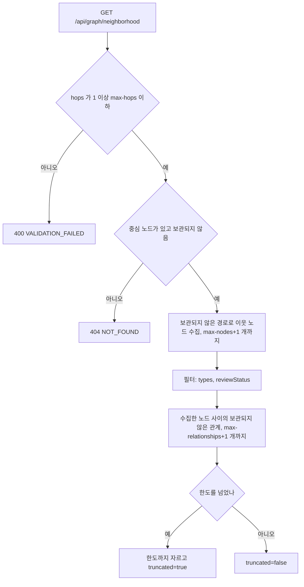

모은 노드 가운데 주장이 있으면 그 주장의 주체와 대상도 함께 돌려준다. 홉 수 밖에 있어도 더하고, 종류 필터와 노드 한도는 그대로 지킨다. 1홉에서도 주장의 상대 기업이 보이게 하려는 것이다.

이웃이 없으면 중심 노드 하나만 돌려준다. 화면은 「연결된 노드가 없습니다」 를 표시한다.

### 주장 접기

화면은 기본으로 주장을 두 항목 사이의 선 하나로 접어 그린다. 주장 노드, 그 주장의 주체와 대상 관계, 근거 문서 관계를 지우고 「주체 → 대상」 선을 그린다. 선 이름은 관계 종류의 표시 이름(예: 「속한다」)이다.
초안 주장의 선은 점선, 반려된 주장의 선은 흐리게 그린다. 선을 누르면 그 주장이 상세에 열린다.

- 주체나 대상 가운데 하나라도 그래프에 없으면 그 주장은 접지 않고 노드로 둔다. 중심 노드가 주장이면 그 주장도 접지 않는다.
- 접힌 주장에만 걸린 근거 문서는 그리지 않는다. 근거는 선을 눌러 연 상세에서 본다. 중심 노드는 근거 문서여도 그린다.
- 검색 칸 「고급 필터」 의 「주장을 따로 보기」 를 켜면 접지 않고 지금처럼 주장을 마름모 노드로 그린다. 켠 상태는 작업 공간을 떠날 때까지 남는다.
- 「그래프에 나온 항목」 목록에는 접힌 주장도 「주장」 으로 나온다. 목록에서 고르면 상세가 열린다.
- 이웃을 넓힌 뒤에는 화면 맞춤을 다시 하고, 노드 사이 간격을 넓혀 글자가 겹치지 않게 배치한다.
시간 제한(`workbench.graph.timeout`)을 넘으면 트랜잭션이 끊기고 `500 INTERNAL_ERROR` 가 아니라 `503 QUERY_TIMEOUT` 을 낸다.

## 작업 공간

검색, 그래프, 상세 세 칸이다. 처음 보는 사람이 읽기부터 하도록 필터와 편집은 접어 두고 필요할 때 연다([ADR-010](adr/010-concept-map-first-screen.md)).

### 검색 칸

- 위쪽에 검색창 하나(「이름이나 종목 코드로 찾기」)와 종류 칩이 있다. 칩 순서는 「타입 순서」 이고 주장 칩은 맨 끝이다.
- 칩은 눌린 종류만 찾는다. 처음에는 모두 눌려 있다. 칩을 모두 끄면 주소에서 `types` 가 빠져 전체로 돌아간다(지금의 `types` 규칙).
- 「주장 검토 상태」, 「보관 포함」, 그래프의 「이웃 단계」(1이나 2), 「주장을 따로 보기」 는 「고급 필터」 한 곳에 접혀 있다. 처음에는 접혀 있다. 기본값이 아닌 값이 있으면 접힌 머리가 「고급 필터 (2)」 처럼 바뀐 개수를 보인다. 접고 편 상태는 주소에 두지 않고, query 이름은 그대로다.
- 검색 칸 아래의 만들기 칸은 없다. 조건 없이 찾았는데 결과가 없으면 「아직 등록한 항목이 없습니다.」 와, 편집자에게는 「오른쪽 위 「＋ 추가」 로 첫 항목을 만드세요.」 를 보인다.

### 그래프 칸

- 배치는 `breadthfirst`(directed)다. 관계 방향대로 위에서 아래로 놓는다. 뿌리는 그래프 안에서 들어오는 선이 없는 노드이고, 그런 노드가 없으면 중심 노드다. 접힌 주장 선도 주체에서 대상으로 가는 방향에 넣는다.
- 새 노드가 생기거나 중심 노드가 바뀌면 다시 배치한다.
- 오른쪽 아래 둥근 ＋ 단추(편집 권한이 있을 때)가 「＋ 추가」 와 같은 메뉴를 연다.
- 아무것도 고르지 않았으면 「항목을 검색해 고르면 이어진 항목이 그래프로 보입니다.」 를 보인다.

### 상세 칸: 읽기 카드

상세는 읽기 카드로 열린다. 편집 폼, 보관 사유 입력, 생성과 수정 기록은 처음에 보이지 않는다.

| 자리 | 보이는 것 |
| --- | --- |
| 머리 | 타입 배지, 이름, 「{작성자}이(가) {날짜}에 등록」 한 줄. 작성자가 없으면 「시스템」 이다. 검토 상태와 「보관됨」 배지 |
| 버튼 줄 | 「편집」(편집 권한이 있고 보관되지 않았을 때), 「그래프 중심으로」, 「근거 따라가기」(보관되지 않았을 때), 「⋯」 메뉴(「링크 복사」, 「변경 이력」, 편집 권한이 있으면 「보관」 또는 「복원」) |
| 내 이해 | 「알아요」, 「잘 모르겠어요」 토글과 「메모 남기기」(아래 「내 이해 표시」). 모든 역할에게 보인다 |
| 개념 | 이 항목이 쓰는 개념의 점선 칩(아래 「개념 설명」). 없으면 이 줄을 숨긴다. 개념 노드의 상세는 이 줄 대신 「개념 상세」 절을 보인다 |
| 속성 | 속성 이름과 값의 목록. 빈 값은 숨긴다. enum 은 선택지 이름으로 보인다. 정의에서 빠진 타입의 노드는 지금처럼 저장된 값을 그대로 보인다 |
| 연결 | 관계를 문장으로 보인다(「관계 문장」). 이 항목의 이름은 굵게 보이고, 상대 이름을 누르면 그 항목을 연다(상세만 바꾸는 열기). 보관된 관계는 「보관됨」 을 붙여 흐리게 보이고, 편집자는 줄마다 「연결 보관」 이나 「연결 복원」 을 누른다. 편집 권한이 있으면 절 머리에 「＋ 연결 추가」 가 있다 |
| 주장 | 이 항목에 걸린 주장 카드. 편집 권한이 있으면 절 머리에 「＋ 주장 추가」 가 있다 |
| 자세히 | 접혀 있다. 생성(작성자, 시각), 수정(수정자, 시각), 보관 시각, revision, ID |

- 「편집」 을 누르면 속성 자리에 편집 폼(`NodeEditForm`)이 열린다. 저장에 성공하거나 「취소」 를 누르면 읽기 카드로 돌아온다. 저장이 `409` 를 받으면 편집 폼을 연 채로 「화면에서 입력 지키기」 의 비교를 보인다. 다른 항목을 고르면 편집 폼은 닫히고 입력은 사라진다.
- 「⋯」 의 「보관」 은 작은 창을 열어 사유(선택)를 묻는다. 창의 「보관」 을 누르면 보관하고 창을 닫는다. 실패하면 창을 닫고 상세 위에 오류를 보인다. 「복원」 은 묻지 않고 바로 복원한다.
- 「＋ 연결 추가」 와 「＋ 주장 추가」 는 그 절 안에 지금의 관계 추가 칸과 주장 폼을 연다.
- 주장 노드의 상세는 주장 카드와 검토 칸을 보이고 버튼 줄 규칙이 같다. 「편집」 을 누르면 주장 내용 수정 폼(`ClaimEditForm`)이 열린다.
- 열람자에게는 「편집」, 「＋ 연결 추가」, 「＋ 주장 추가」, 보관과 복원이 없다. 「열람자는 조회만 할 수 있습니다.」 안내는 그대로 보인다.

## 좁은 화면의 작업 공간

폭 1024px 이상에서는 검색, 그래프, 상세가 세 칸으로 함께 보인다.
1024px 미만에서는 같은 세 칸을 탭으로 나누고 한 번에 하나만 보인다.
어느 탭을 보일지는 주소의 `pane` 이 정한다. `pane` 이 없으면 고른 항목(`node`)이 있을 때 상세, 없을 때 검색이다. 목록, 검토 대기, 변경 이력에서 항목을 열면 `pane=detail` 로 열린다. 넓은 화면에서는 `pane` 을 쓰지 않는다.

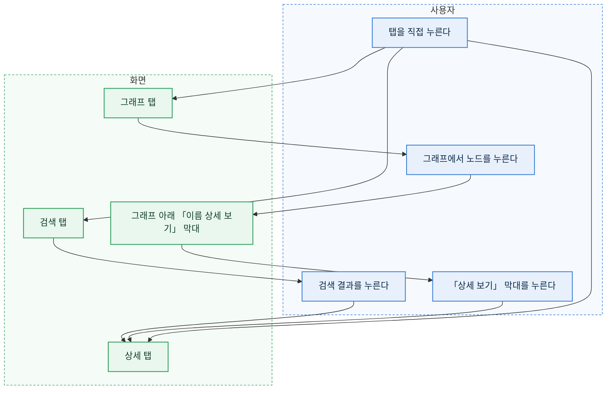

- 검색 결과를 누르면 그래프 중심과 상세를 함께 바꾸고 상세 탭으로 넘어간다. 「＋ 추가」 로 노드를 새로 만들어도 같다.
- 그래프에서 노드를 누르면 상세만 바꾸고 그래프 탭에 머문다. 이웃을 잇달아 둘러볼 수 있게 하려는 것이다. 그래프 아래 「그래프에 나온 항목」 목록에서 고를 때도 같다. 고른 노드가 그래프에 있으면 그래프 아래 막대에 그 이름이 나오고, 막대를 누르면 상세 탭으로 간다. 더블클릭이나 「이웃 확장」 으로 이웃을 넓히는 동작과 「선택한 항목을 중심으로」 는 넓은 화면과 같고 탭을 옮기지 않는다.
- 아무것도 고르지 않았으면 상세 탭은 「항목을 선택하면 상세가 여기에 나옵니다.」 를 보인다. 그래프 탭은 넓은 화면과 같은 안내를 보인다.
- 그래프를 읽다 실패하면 오류는 그래프 탭 안에 나온다. 다른 탭에 있으면 그 탭으로 옮기지 않는다.
- 창 폭이 1024px 를 넘나들어도 고른 노드, 그래프, 마지막 탭은 그대로다. 다만 경계를 넘으면 검색, 그래프, 상세 칸이 새로 그려져 폼에 입력하던 값은 사라진다. 탭을 옮길 때는 남는다. 그래프 탭이 다시 보이면 그래프 크기를 다시 재고 화면에 맞춘다. 숨겨져 있던 동안에는 크기가 0 이라 그대로 두면 빈 캔버스가 남는다.
- 머리글은 두 줄이다. 첫 줄에 제목과 사용자 상자가, 둘째 줄에 탭 넷과 「더보기」, 「＋ 추가」 가 한 줄로 놓인다. 폭 390px 에서도 줄이 넘치지 않는다. 좁은 화면의 「＋ 추가」 는 글자 없이 ＋ 만 보이고 이름은 `aria-label` 로 둔다. 제목은 길면 말줄임표로 줄고 이메일은 숨긴다.
- 표 화면(목록, 검토 대기, 변경 이력, 사용자)은 좁은 화면에서 가로로 밀어서 본다. 페이지 전체에는 가로 스크롤이 생기지 않는다.
- 개념 지도는 지도 아래에 타입 목록과 타입 칸이 차례로 놓인다.

## 근거 따라가기

한 항목에서 들어오는 관계를 거꾸로 따라가며, 그 항목이 무엇에 기대는지 단계마다 근거와 함께 보인다. 다른 사람이 세운 가설의 근거를 모르는 사람이 따라가고, 모르는 단계를 공부 목록에 담는 화면이다. 결정과 근거는 [ADR-011](adr/011-learning-marks-and-trace.md), 계산 규칙은 [API 계약](api-contract.md) 의 「근거 따라가기」 다.

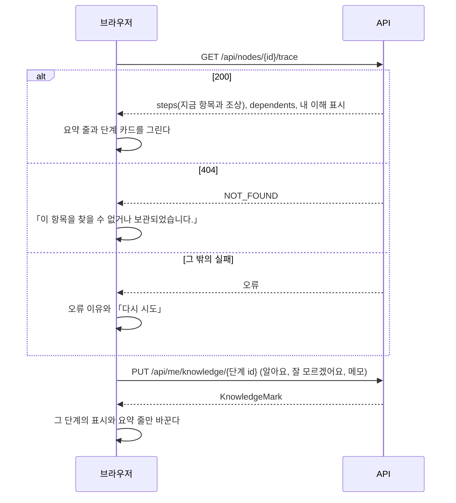

- 주소는 `/trace?node=<id>` 다. `node` 가 없으면 「작업 공간에서 항목을 고른 뒤 「근거 따라가기」 를 누르세요.」 와 「작업 공간으로」 를 보인다.
- 머리에 제목 「{이름}: 이 판단은 어디서 왔나」 와 타입 배지, 「작업 공간에서 보기」 가 있다.
- 요약 줄은 단계 수, 상태별 개수(「근거 있음 N단계」, 「초안 주장만 N단계」, 「근거 없음 N단계」), 내가 「잘 모르겠어요」 로 표시한 단계 수다. 한도에 걸려 잘렸으면 「단계가 많아 깊이 6, 60단계까지만 보입니다.」 를 함께 보인다.
- 단계 카드는 깊은 단계(출발점)가 위, 지금 항목이 맨 아래다. 같은 깊이는 만든 순서다. 카드마다 아래가 있다.
  - 타입 배지와 「출발점」(가장 깊은 단계) 또는 「지금 보는 항목」, 그 밖에는 아래 단계와의 관계 문장(「관계 문장」, 이 카드의 이름은 굵게). 이름을 누르면 그 항목을 기준으로 다시 따라간다(`/trace?node=…`, push).
  - 상태 표시. 초록 「근거 있음」, 주황 「초안 주장만」, 빨강 「근거 없음」 이다. 색만으로 가르지 않고 글자를 함께 보인다.
  - 노드의 설명 칸(`description`, 결정은 `reason`)에 적힌 글을 그대로 보인다. 「원문 대조 대기」 같은 글도 해석하지 않고 보인다.
  - 근거 문서 목록(제목과 발행처. 제목을 누르면 문서 주소를 새 창으로 연다), 주장 목록(이름과 검토 상태), 개념 칩.
  - 근거 문서도 주장도 없으면 「근거 문서가 아직 없습니다.」 와, 편집 권한이 있으면 「＋ 근거 문서 붙이기」 다. 누르면 작업 공간에서 그 항목의 상세를 연다(`/workspace?node=…&pane=detail`). 상세의 「＋ 연결 추가」 로 잇는다.
  - 아직 잇지 않은 관계(`missing`)마다 「아직 이어지지 않은 {관계 표시 이름}」 과 후보. 편집 권한이 있으면 후보마다 「{후보 이름} 잇기」 가 있고, 누르면 `POST /api/relationships` 로 잇고 다시 읽는다. 실패하면 그 카드 안에 이유를 보인다. 후보가 없거나 편집 권한이 없으면 문장만 보이고, 편집자에게는 「＋ 잇기」(작업 공간 상세를 연다)를 둔다.
  - 「알아요」, 「잘 모르겠어요」 토글과 「메모 남기기」(아래 「내 이해 표시」).
- 맨 아래 「이 항목에 기대는 것」 절은 `dependents` 를 관계 문장으로 보인다. 없으면 「지금은 이 항목을 근거로 삼은 항목이 없습니다.」 다. 이름을 누르면 그 항목을 기준으로 따라간다.
- 좁은 화면(1024px 미만)에서도 같은 카드를 한 줄로 쌓는다. 가로 스크롤을 만들지 않는다.
- 열람자도 이 화면을 보고 이해 표시를 남긴다. 「잇기」 와 「근거 문서 붙이기」 는 보이지 않는다.

## 내 이해 표시

항목마다 내가 그 항목을 이해했는지를 표시한다. 나만 보고, 다른 사람에게는 보이지 않는다. 저장 모델은 [데이터 스키마](data-schema.md) 의 「이해 표시」 다.

- 토글은 「알아요」(`KNOWN`)와 「잘 모르겠어요」(`UNSURE`) 둘이다. 하나를 누르면 그 값으로 쓰고(`PUT`), 이미 눌린 쪽을 다시 누르면 표시를 지운다(`DELETE`). 「공부 중」(`LEARNING`)은 공부 탭에서만 고른다. 공부 중인 항목의 토글은 둘 다 눌리지 않은 모양에 「공부 중」 글자를 붙인다.
- 「메모 남기기」 는 그 자리에 입력칸(1000자)과 「저장」, 「취소」 를 연다. 메모만 저장하면 표시가 없을 때 「잘 모르겠어요」 로 함께 쓴다. 메모는 그 아래에 「내 메모: …」 로 보인다.
- 쓰는 동안 단추를 꺼 두 번 보내지 않는다. 실패하면 단추 옆에 이유를 보이고 표시는 바꾸지 않는다.
- 상세 칸의 토글은 항목을 열 때 `GET /api/me/knowledge/{id}` 로 지금 표시를 읽는다. 근거 따라가기는 응답의 `knowledge` 를 쓴다.
- 표시를 바꿔도 항목의 revision 과 변경 이력은 그대로다.

## 공부

상단 탭 「공부」(`/study`)는 내가 「잘 모르겠어요」 나 「공부 중」 으로 표시한 항목을 모은다. 나만 보는 목록이다.

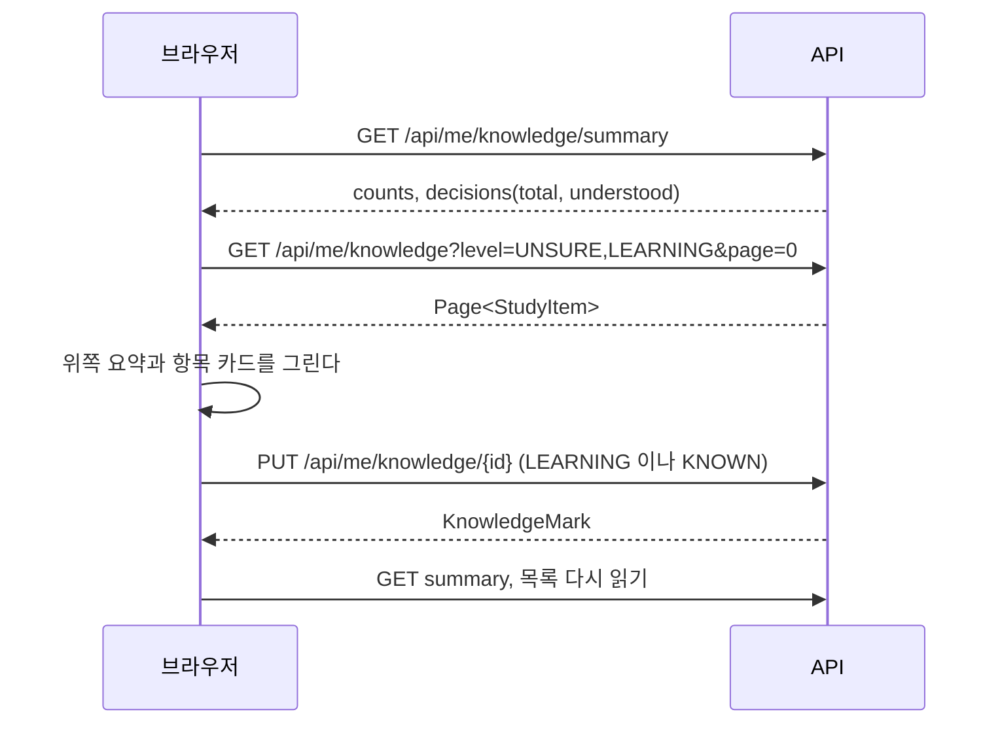

- 위쪽에 「잘 모름 N」, 「공부 중 N」, 「이해함 N」 과 「내 능력 범위: 투자 결정 N개 가운데 M개는 근거를 다 이해함」 이 있다. 결정이 0 개면 능력 범위 줄은 「아직 투자 결정이 없습니다.」 다. 결정이 200 개를 넘으면 「앞 200개만 셌습니다」 를 붙인다.
- 「잘 모름」 과 「공부 중」 칩으로 목록을 좁힌다(`level`, replace). 처음에는 둘 다다.
- 항목 카드마다 아래가 있다.
  - 타입 배지와 이름, 「보관됨」 배지(보관된 항목).
  - 단계 맥락. 「{결정 이름}의 {N}단계 위」(결정이 아니면) 또는 「투자 결정」(그 항목이 결정이면). 결정이 여럿이면 앞 셋을 쉼표로 잇는다. 없으면 「이어진 투자 결정이 없습니다」 다.
  - 내 메모.
  - 할 일 목록. 근거 문서마다 「「{제목}」 읽기」(문서 주소를 새 창으로 연다), 개념마다 「개념 「{이름}」 설명 읽기」(개념 상세를 연다), 근거 문서가 없으면 「근거 문서가 없습니다. 공부한 자료를 근거로 붙여 주세요」 다.
  - 단추 「근거 따라가기에서 보기」(보관되지 않았을 때), 「공부 중」(`LEARNING` 이 아닐 때), 「이해했어요」(`KNOWN` 으로 쓰고 목록에서 뺀다), 「메모 남기기」.
- 빈 상태: 「아직 공부할 항목이 없습니다. 근거 따라가기나 상세에서 「잘 모르겠어요」 를 누르면 여기에 모입니다.」
- 목록이나 요약을 받지 못하면 그 자리에 오류 이유와 「다시 시도」 를 보인다.

## 개념 설명

항목이 쓰는 개념(`USES_CONCEPT` 처럼 Concept 으로 나가는 관계)은 상세 칸과 근거 따라가기 단계에 점선 칩으로 붙는다. 저장 모델은 [데이터 스키마](data-schema.md) 의 「관계」 다.

- 칩 글자는 「개념 · {이름}」 이다. 넓은 화면에서는 마우스를 올리거나 키보드 초점이 가면 칩 아래에 한 줄 정의(`summary`)가 뜨고, 누르면 그 개념의 상세를 연다(`/workspace?node=…`). 좁은 화면에서는 누르면 한 줄 정의와 「개념 설명 전체 보기」 가 뜨고, 그것을 누르면 상세를 연다. 한 줄 정의가 없으면 「한 줄 정의가 없습니다.」 다.
- 칩을 잇거나 떼는 일은 지금처럼 상세의 「연결」 절에서 한다(「＋ 연결 추가」 와 「연결 보관」).

### 개념 상세

개념 노드의 상세는 읽기 카드 위에 아래 절을 더한다. 모두 `GET /api/nodes/{id}` 응답에서 만든다.

| 절 | 보이는 것 |
| --- | --- |
| 강조한 사람 | 이 개념이 대상인 `ADVOCATES` 주장의 주체 이름과 검토 상태 |
| 비판한 사람 | 이 개념이 대상인 `CRITICIZES` 주장의 주체 이름과 검토 상태 |
| 관련 개념 | 이 개념과 다른 개념을 잇는 관계(방향 상관없이)의 상대 개념 |
| 이 개념을 쓴 곳 | 개념이 아닌 항목에서 이 개념으로 들어오는 관계의 시작 항목. 타입 배지와 이름 |

- 절이 비면 「아직 없습니다」 다. 이름을 누르면 그 항목을 연다(상세만 바꾸는 열기).
- 강조와 비판 밖의 주장 종류가 개념을 대상으로 받으면 「{주장 종류 표시 이름} 주장」 절로 보인다.

## 변경 이력 보기

변경 이력 화면은 최근 것부터 보인다. 칸 이름과 값은 화면에 보일 말로 바꾼다.

- 항목 이름: 온톨로지 속성이면 그 속성의 `label`, 아니면 `changeFields.<키>.label` 이다. 둘 다 없으면 키를 그대로 보인다.
- 값: enum 은 선택지 이름, 검토 상태는 `reviewStatuses` 이름, 역할은 「열람자」, 「편집자」, 「관리자」, 참과 거짓은 「예」, 「아니오」, 시각(`reviewedAt`)은 날짜와 시각, 비어 있으면 「(없음)」 이다. 노드 ID 와 검토자 ID 는 응답의 `refs` 로 이름을 보인다. 노드 ID 하나는 이름을 누르면 그 항목을 연다. 목록 값(`documentIds`)은 이름을 쉼표로 잇고 누를 수 없다. 찾지 못한 ID 는 「(찾을 수 없는 항목)」 이다.
- 대상으로 좁히기: 이름으로 검색해 항목 하나를 고른다(노드 고르기 칸). 고른 항목은 이름과 「지우기」 로 보인다. 상세 「⋯」 메뉴의 「변경 이력」 으로 들어오면 그 항목이 골라져 있다. 고르기 칸은 보관된 항목을 찾지 않으므로, 보관된 항목의 이력은 고급 필터의 「보관 포함」 검색으로 상세를 연 뒤 「⋯」 의 「변경 이력」 으로 본다.
- 사용자로 좁히기: `GET /api/changes/actors` 로 받은 사용자를 표시 이름으로 고른다. 「(모두)」 가 기본이다. 고르면 바로 다시 읽는다.
- revision 열은 두지 않는다. 행에 마우스를 올리면 제목으로 보인다.

## 보관과 복원

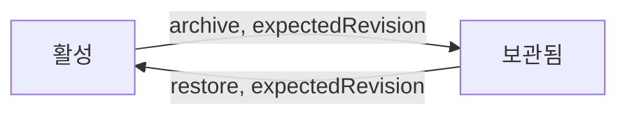

두 전이 모두 revision 을 올리고 ChangeEvent(`ARCHIVE`, `RESTORE`)를 남긴다. 이전 이력은 지우지 않는다.

## 온톨로지 편집

온톨로지 상세 화면(더보기의 「온톨로지 상세」)은 모든 역할에게 지금 버전을 보여 준다. 머리에 버전 번호와 저장한 사람, 시각이 있다.
ADMIN 에게만 「폼으로 편집」, 「YAML 로 편집」, 「버전 기록」, 「YAML 내려받기」 단추가 보인다. 결정과 근거는 [ADR-008](adr/008-ontology-versions-in-db.md), 저장 규칙은 [데이터 스키마](data-schema.md) 의 「온톨로지 버전」 이다.

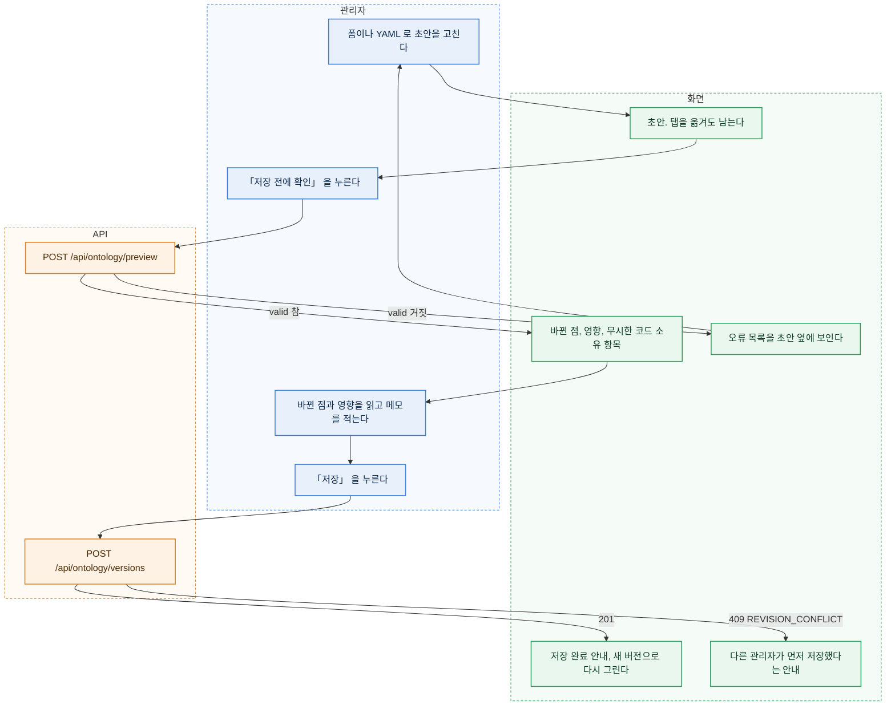

### 초안

- 폼 편집기와 YAML 편집기는 초안 하나를 함께 쓴다. 처음 열면 지금 버전에서 시작하고, 시작한 버전이 `baseVersion` 이다.
- 폼에서 YAML 로 옮기거나 YAML 에서 폼으로 옮길 때는 미리보기 API 가 정규화한 `yaml` 과 `definition` 으로 바꾼다. 웹은 YAML 을 직접 읽거나 쓰지 않는다. YAML 이 틀려 바꿀 수 없으면 옮기지 않고 오류를 보인다.
- 초안은 화면 메모리에 있다. 다른 탭에 다녀와도 남고, 저장하거나 「초안 버리기」 를 누르면 사라진다. 새로고침과 창 닫기 전에는 브라우저가 떠날지 묻는다(`beforeunload`). 새로고침하면 초안은 사라진다.
- 미리보기와 저장은 초안 전체를 보낸다. 고친 부분만 보내지 않는다.
- 서버가 정규화한 YAML 에는 주석이 남지 않는다. YAML 편집기 위에 키 설명(`label`, `valueLabels`, `description`, `hintProperties`, `display`, `searchProperties`, `createPicker`, `valueAliases`, `sentence` 의 뜻과 흐름 표기의 따옴표 규칙)을 접힌 도움말로 둔다.

### 미리보기와 저장

- 「저장 전에 확인」 은 미리보기 API 를 부른다. 결과에 바뀐 점(더함, 뺌, 바뀜)과 영향 목록, 무시한 코드 소유 항목이 나온다. 바뀐 점이 없으면 「바뀐 점이 없습니다」 를 보이고 「저장」 을 두지 않는다.
- 영향이 있으면 항목마다 「노드 3개가 이 속성 값을 가지고 있습니다」 처럼 보이고, 「기존 데이터와 어긋나는 것을 알고 저장합니다」 확인란을 켜야 「저장」 이 눌린다. 확인란을 켜면 저장 요청에 `confirm: true` 를 담는다.
- 저장에 성공하면 화면이 새 버전으로 온톨로지를 다시 읽고 보기 화면(`/ontology`)으로 간다(push). 안내는 「버전 N 을 저장했습니다.」 다.
- 미리보기와 저장 사이에 데이터가 바뀌어 영향이 새로 생기면 저장이 `409 ONTOLOGY_IMPACT_UNCONFIRMED` 로 거절될 수 있다. 화면은 그 응답의 영향 목록으로 미리보기를 다시 그린다.
- 다른 관리자가 먼저 저장하면 저장이 `409 REVISION_CONFLICT` 다. 초안은 남는다. 화면은 「다른 관리자가 버전 N 을 저장했습니다.」 와 두 단추를 보인다.
  - 「최신 버전에서 다시 시작」: 초안을 버리고 최신 버전으로 새 초안을 연다.
  - 「내 초안을 최신 버전 위에 저장」: `baseVersion` 을 최신 번호로 바꾸고 미리보기를 다시 부른다. 바뀐 점은 최신 버전과 비교한 것이라, 다른 관리자의 변경을 덮어쓰면 그것이 「뺌」 이나 「바뀜」 으로 보인다.

### 폼 편집기

폼은 자주 하는 변경만 다룬다. 그 밖의 항목(`hintProperties`, `searchProperties`, `valueAliases`, `createPicker`, `labelProperty`)은 YAML 편집기에서 고친다. 폼은 이 항목을 읽기만 하고 그대로 둔다.

| 대상 | 더하기 | 고치기 | 빼기 |
| --- | --- | --- | --- |
| 노드 타입 | 키, 표시 이름, 설명, 라벨 속성(새 타입의 첫 속성), 색과 모양 | 표시 이름, 설명, 색과 모양 | 된다. 영향은 미리보기에서 본다 |
| 속성 | 키, 값 타입, 필수, 표시 이름, 설명, 길이와 범위, enum 값과 그 표시 이름 | 표시 이름, 설명, 필수, 길이와 범위, enum 값 더하기와 빼기, enum 표시 이름 | 된다. 라벨 속성은 뺄 수 없다 |
| 관계 종류 | 키, 표시 이름, 문장 틀, 설명, 시작 타입, 끝 타입 | 표시 이름, 문장 틀, 설명, 시작과 끝 타입 | 된다 |
| 주장 종류 | 키, 표시 이름, 문장 틀, 설명, 주체 타입, 대상 타입 | 표시 이름, 문장 틀, 설명, 주체와 대상 타입 | 된다 |

- 키는 더할 때만 적는다. 이미 있는 키는 입력칸이 아니라 글자로 보인다. 키 형식은 타입이 `PascalCase`, 관계 종류와 주장 종류가 `UPPER_SNAKE_CASE`, 속성이 `camelCase` 다. 형식이 틀리면 입력칸 아래에 바로 알린다.
- Claim 타입과 코드 소유 항목(검토 상태, 이력 이름, 주장 관계)은 폼에 나오지 않는다. 코드가 이름으로 읽는 키는 「빼기」 와 값 타입, 필수 칸이 꺼져 있다.
- 빼기는 그 자리에서 지우지 않고 줄에 「뺄 예정」 표시를 남긴다. 「되살리기」 로 되돌린다. 미리보기에 들어가야 영향이 보이기 때문이다.

### 버전 기록과 되돌리기

- 「버전 기록」(`view=history`)은 최근 버전부터 번호, 시각, 저장한 사람, 메모를 보인다. 되돌린 버전은 「버전 N 으로 되돌림」 이 함께 보인다.
- 버전을 누르면(`version=N`) 그 버전의 YAML 을 읽기 전용으로 보이고, 「이 버전 내려받기」 와 「이 버전으로 되돌리기」 가 있다.
- 「이 버전으로 되돌리기」 는 그 버전의 YAML 로 미리보기를 부른다. 바뀐 점과 영향은 최신 버전과 비교한 것이다. 확인하고 저장하면 `POST /api/ontology/versions/{N}/restore` 로 새 버전이 생긴다. 예전 버전은 그대로 남는다.
- 「YAML 내려받기」 는 `GET /api/ontology/export` 로 최신 버전 파일을 받는다. Git 에 백업하거나 저장소 YAML 과 비교할 때 쓴다.

### 다른 화면이 버전 바뀜을 아는 방법

- 요청 크기 검사가 거절한 `413`, `411` 응답을 뺀 모든 API 응답에 `X-Ontology-Version` 헤더가 있다. 화면은 들고 있는 온톨로지의 `version` 과 다르면 머리글 아래에 「온톨로지가 바뀌었습니다(버전 N). 다시 읽으면 바뀐 타입과 칸이 보입니다.」 와 「다시 읽기」 를 보인다.
- 저절로 다시 읽지 않는다. 쓰던 폼의 칸이 바뀌어 입력이 사라질 수 있기 때문이다. 「다시 읽기」 는 온톨로지만 다시 받고 주소와 쓰던 입력은 그대로 둔다.
- 다시 읽기 전에 저장한 쓰기도 서버는 최신 버전으로 검증한다. 빠진 속성이나 타입을 보내면 지금처럼 `400 ONTOLOGY_VIOLATION` 이다.
- 자기가 저장한 관리자의 화면은 저장 응답을 받은 뒤 바로 다시 읽으므로 이 안내가 나오지 않는다.

## 첫 접속 가이드

`CurrentUser.guideDoneAt` 이 `null` 이면 로그인한 뒤 첫 화면(개념 지도)에서 가이드가 열린다. 다른 화면의 링크로 들어왔으면 그 화면을 그대로 두고, 처음 개념 지도나 작업 공간에 들어올 때 연다. 머리글의 「사용법」 을 누르면 언제든 다시 연다. 다시 열어도 기록은 바뀌지 않는다.
가이드는 역할에 따라 둘이다. 편집자와 관리자는 연습 항목을 직접 만들어 보고, 열람자는 만들기 없이 둘러본다.

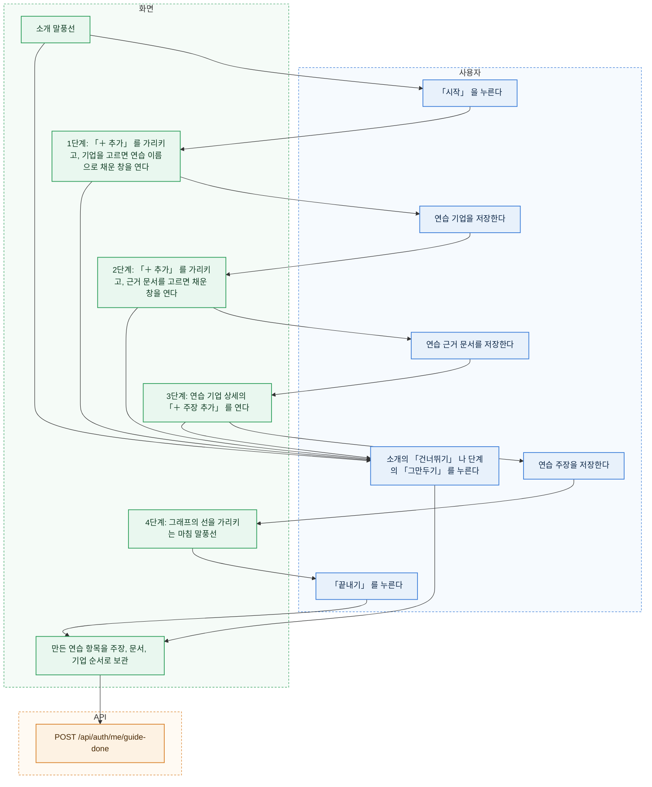

### 편집자와 관리자의 따라하기

| 단계 | 말풍선 | 화면이 미리 해 두는 것 | 다음 단계로 가는 때 |
| --- | --- | --- | --- |
| 소개 | 「투자 판단을 근거와 함께 쌓는 온톨로지입니다. 연습 항목 세 개를 직접 만들어 봅니다. 끝나면 연습 항목은 보관되어 검색에 나오지 않습니다.」 | 없음 | 「시작」 |
| 1. 기업 | 「먼저 기업을 하나 만듭니다. 오른쪽 위 「＋ 추가」 를 누르고 기업을 고르세요. 이름은 연습 이름으로 채워 둡니다.」 | 말풍선이 「＋ 추가」 를 가리킨다. 메뉴에서 기업을 고르면 이름에 연습 이름을 넣은 창이 열리고, 말풍선은 창의 만들기 단추를 가리킨다 | 기업을 만들었을 때 |
| 2. 근거 문서 | 「주장에는 근거가 필요합니다. 「＋ 추가」 에서 근거 문서를 골라 등록합니다.」 | 1단계와 같다. 근거 문서를 고르면 제목(연습 이름), 주소(`https://example.com/practice`), 자료 종류(기타)를 넣은 창이 열린다. 수집 시각은 폼의 기본값(지금)이다 | 근거 문서를 만들었을 때 |
| 3. 주장 | 「이제 주장을 만듭니다. 대상에 산업 하나를 고르고 「만들기」 를 누르세요. 관계, 근거 문서, 설명과 근거 문장은 미리 채웠습니다.」 | 연습 기업의 상세를 열고 「＋ 주장 추가」 를 연다. 관계는 「속한다」, 근거는 2단계의 문서로 미리 고르고, 설명과 근거 문장에 연습 문장(「[연습] 가이드로 만든 주장입니다」)을 넣는다 | 주장을 만들었을 때 |
| 4. 마침 | 「주장이 그래프에 기업과 대상을 잇는 선으로 보입니다. 다른 편집자가 검토하면 실선이 됩니다. 「끝내기」 를 누르면 연습 항목을 보관합니다.」 | 연습 기업을 그래프 중심으로 연다 | 「끝내기」 |

- 연습 이름은 「[연습] <표시 이름> 기업 <시각>」, 「[연습] <표시 이름> 메모 <시각>」 이다. 시각은 가이드를 시작한 시각의 `MMDD-HHmm` 이다. 다시 연습해도 이름이 겹치지 않고, 「[검토용]」 처럼 연습 항목이라는 것이 이름에 드러난다.
- 각 단계에서 사용자는 미리 채운 값을 고칠 수 있다. 다음 단계로 가는 판단은 그 종류의 항목을 만들었는지만 본다. 이름은 보지 않는다. 기업, 근거 문서, 주장 단계에는 「다음」 이 없고 「그만두기」 만 있다. 주장 폼을 취소하면 말풍선에 「폼 다시 열기」 가 나온다. 기업과 근거 문서 창을 닫으면 말풍선은 다시 「＋ 추가」 를 가리킨다.
- 주장 종류는 기업을 주체로 받는 것 가운데 대상 타입의 활성 항목이 하나라도 있는 첫 종류다. 「속한다」(대상 산업)를 먼저 본다. 말풍선과 미리 채우기의 관계와 대상 이름은 고른 종류의 표시 이름과 대상 타입의 첫 표시 이름이다. 그런 종류가 없거나, 온톨로지에 기업이나 근거 문서 타입이 없으면 따라하기 대신 둘러보기를 연다. 새로 배포한 DB 처럼 고를 대상(산업, 기업 등)이 하나도 없는 경우다.
- 자료 종류의 「기타」(`OTHER`)가 온톨로지에서 빠졌으면 자료 종류는 비워 둔다.
- 미리 채우기는 메뉴에서 그 단계의 종류(기업, 근거 문서)를 골랐을 때만 한다. 다른 종류를 고르면 빈 창이 열린다.
- 만들기 창이 열린 동안 말풍선은 창 위에 보인다. 창 밖을 누른 것으로 보지 않아 말풍선의 「그만두기」 를 눌러도 창이 먼저 닫히지 않는다.
- 가이드가 열린 동안 다른 동작(검색, 탭 이동)도 막지 않는다. 말풍선은 가리키는 요소가 보이지 않으면 화면 아래쪽 카드로 바뀐다.
- 넓은 화면에서 말풍선은 대상 옆에 붙는다. 그래프처럼 큰 대상은 그 안쪽 위 모서리에 둔다. 옆 칸(상세)을 덮지 않게 하려는 것이다.
- 「끝내기」, 「그만두기」, 소개의 「건너뛰기」 는 모두 만든 연습 항목을 주장, 근거 문서, 기업 순서로 보관한 뒤 `POST /api/auth/me/guide-done` 을 부른다. 보관 이유는 「첫 접속 가이드 연습 항목」 이다. 근거 문서보다 주장을 먼저 보관해야 「유일한 근거」 규칙(`409 LAST_EVIDENCE`)에 걸리지 않는다.
- 보관은 하나가 실패해도 나머지를 계속 시도한다. 실패한 것이 있으면(다른 사람이 그 사이 고쳐 `409 REVISION_CONFLICT` 등) 「연습 항목을 보관하지 못했습니다. 이름을 눌러 직접 보관하세요.」 와 그 항목 이름들을 보이고, 기록은 그대로 남긴다. 이미 보관됐거나 찾을 수 없는 항목은 건너뛴다. 단추는 누르는 동안 꺼져 두 번 보내지 않는다.
- 진행 중인 단계와 만든 항목 ID 는 브라우저 저장소(`localStorage`, 키 `workbench.guide`, 사용자 ID 와 함께)에 둔다. 새로고침하거나 다시 로그인하면 끝낸 기록과 상관없이 그 단계부터 「이어서 하기」 와 「그만두기」 를 묻는다. 「사용법」 으로 다시 연습하던 사람도 연습 항목이 남지 않게 하려는 것이다. 진행 중인 연습이 있을 때 「사용법」 을 눌러도 같은 질문을 먼저 한다. 저장소를 쓸 수 없으면 처음부터 다시 연다.
- 연습 항목을 만들고 보관한 일은 다른 변경처럼 변경 이력에 남는다. 연습 주장은 보관되기 전까지 다른 편집자의 검토 대기에 보일 수 있다.

### 열람자의 둘러보기

| 단계 | 가리키는 곳 | 말풍선 |
| --- | --- | --- |
| 1. 개념 지도 | 개념 지도 그림(`/map`) | 「워크벤치가 담는 지식의 종류와 서로의 관계입니다. 상자를 누르면 그 종류의 항목을 봅니다.」 |
| 2. 검색 | 작업 공간의 검색 입력칸 | 「기업, 인물, 개념의 이름으로 찾습니다.」 |
| 3. 그래프 | 그래프 | 「고른 항목과 이어진 항목이 그래프로 보입니다. 기업 사이의 선은 주장입니다.」 |
| 4. 상세 | 상세 칸(항목을 고르지 않았으면 빈 안내) | 「항목을 누르면 속성, 연결, 주장, 검토 상태가 여기에 나옵니다.」 |

- 단계 앞에 소개 단계가 한 장 있다. 「투자 판단을 근거와 함께 쌓는 온톨로지입니다. 화면을 차례로 둘러봅니다.」
- 개념 지도 단계는 `/map` 으로, 나머지 단계는 `/workspace` 로 바꿔 연다(기록을 쌓지 않는다).
- 끝냈다는 기록을 서버에 남기지 못하면 「가이드를 끝냈다는 기록을 남기지 못했습니다. 다음 로그인 때 다시 열릴 수 있습니다.」 를 보이고, 같은 접속 안에서는 자동으로 다시 열지 않는다.
- 「다음」 으로만 넘어가고 만드는 것은 없다. 마지막 단계의 「끝내기」 와 어느 단계의 「건너뛰기」 든 `POST /api/auth/me/guide-done` 을 부른다.

### 좁은 화면

- 폭 1024px 미만에서는 단계마다 그 단계의 대상이 있는 작업 공간 탭(`pane`)으로 바꿔 연다(기록을 쌓지 않는다). 주장 단계는 상세 탭, 마침 단계는 그래프 탭이다. 기업과 근거 문서 단계는 「＋ 추가」 가 어느 화면에나 있어 화면을 옮기지 않는다.
- 말풍선은 언제나 화면 아래쪽 카드로 보인다. 카드는 화면 높이의 40% 를 넘지 않고, 페이지에 가로 스크롤을 만들지 않는다. 카드가 열린 동안 본문 아래에 카드 높이만큼 여백을 둬 만들기 단추를 끝까지 내려 볼 수 있다.
- 탭은 단계에 들어갈 때 한 번만 옮긴다. 그 뒤 사용자가 다른 탭을 눌러도 되돌리지 않는다.
