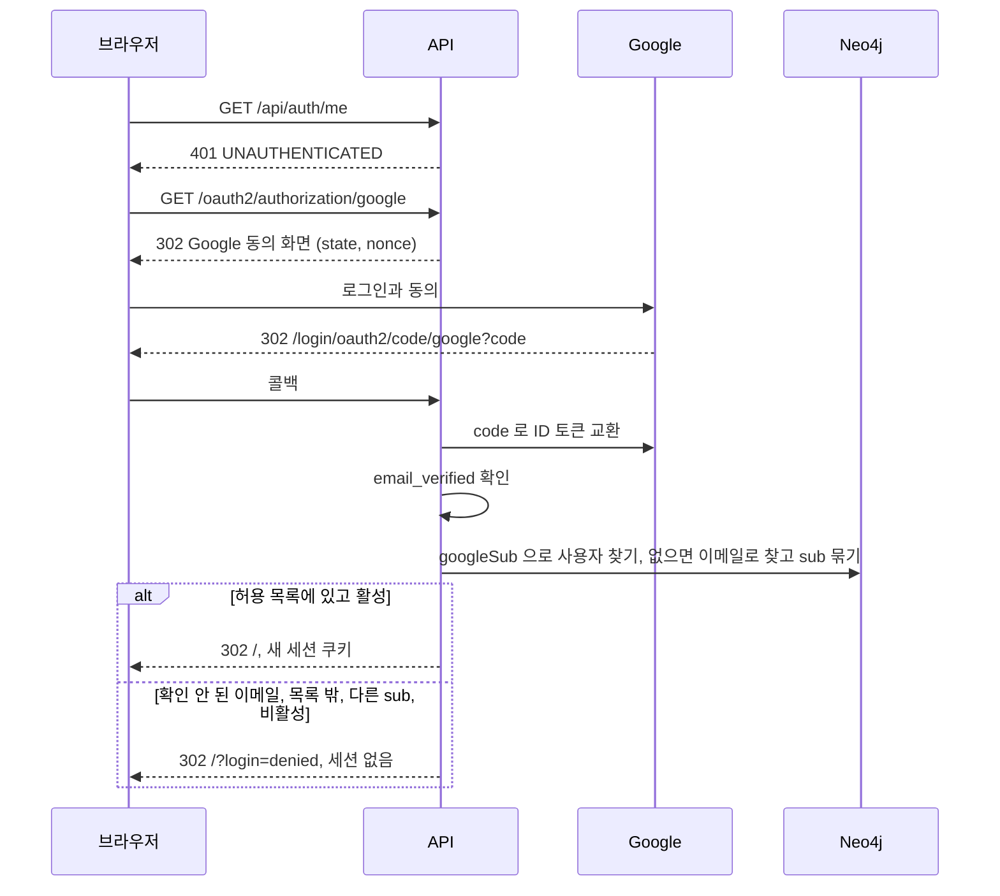
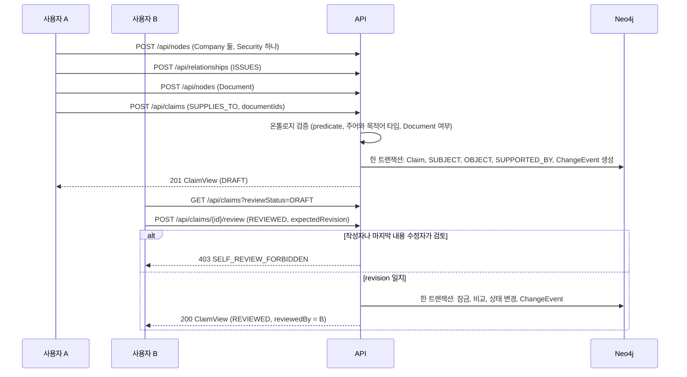
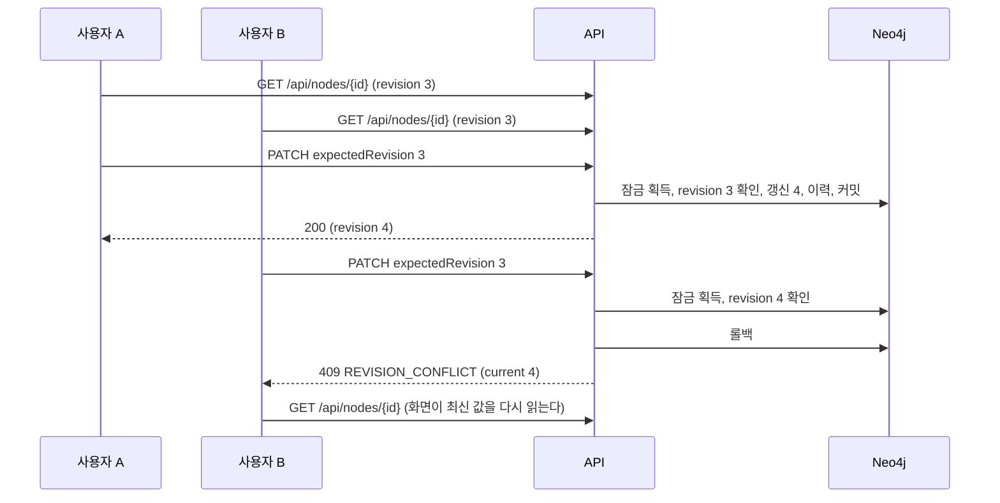
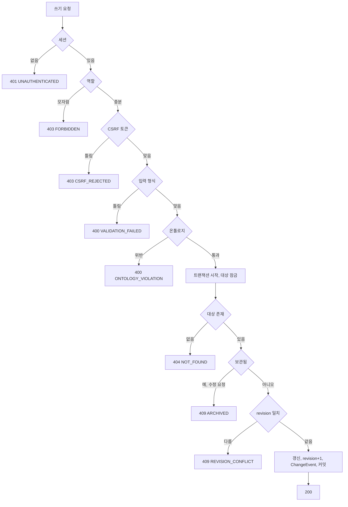
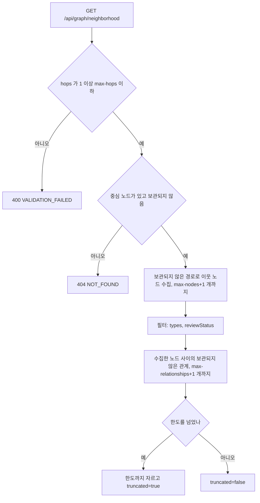
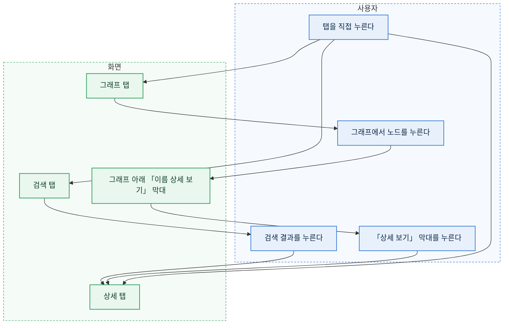
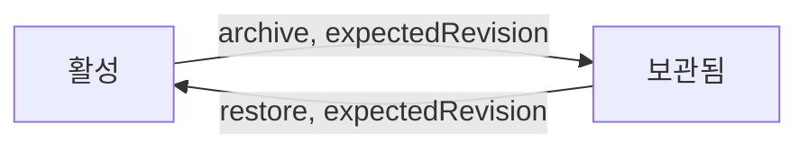

# 흐름

## 로그인

로그인한 뒤에도 API 는 요청마다 사용자 상태와 역할을 다시 읽는다.
관리자가 사용자를 비활성화하면 그 사용자의 다음 요청은 `401` 이고 세션이 지워진다.

## 공급 관계 Claim 등록과 검토

## 동시 수정

두 요청이 같은 순간에 오면 한쪽이 잠금을 기다린다. 기다린 쪽은 먼저 커밋된 revision 을 읽고 409 를 받는다.

## 쓰기 공통 분기

이력 기록이 실패하면 트랜잭션 전체가 롤백된다. 데이터만 바뀌고 이력이 없는 상태는 생기지 않는다.

## 주변 그래프

이웃이 없으면 중심 노드 하나만 돌려준다. 화면은 「연결된 노드가 없습니다」 를 표시한다.
시간 제한(`workbench.graph.timeout`)을 넘으면 트랜잭션이 끊기고 `500 INTERNAL_ERROR` 가 아니라 `503 QUERY_TIMEOUT` 을 낸다.

## 좁은 화면의 작업 공간

폭 1024px 이상에서는 검색, 그래프, 상세가 세 칸으로 함께 보인다.
1024px 미만에서는 같은 세 칸을 탭으로 나누고 한 번에 하나만 보인다.
작업 공간을 열 때 고른 항목이 없으면 검색 탭, 있으면 상세 탭으로 시작한다. 목록, 검토 대기, 변경 이력에서 항목을 열면 상세 탭이 열린다.

- 검색 결과를 누르면 그래프 중심과 상세를 함께 바꾸고 상세 탭으로 넘어간다. 검색 탭에서 노드를 새로 만들어도 같다.
- 그래프에서 노드를 누르면 상세만 바꾸고 그래프 탭에 머문다. 이웃을 잇달아 둘러볼 수 있게 하려는 것이다. 그래프 아래 「그래프에 나온 항목」 목록에서 고를 때도 같다. 고른 노드가 그래프에 있으면 그래프 아래 막대에 그 이름이 나오고, 막대를 누르면 상세 탭으로 간다. 더블클릭이나 「이웃 확장」 으로 이웃을 넓히는 동작과 「선택한 항목을 중심으로」 는 넓은 화면과 같고 탭을 옮기지 않는다.
- 아무것도 고르지 않았으면 상세 탭은 「항목을 선택하면 상세가 여기에 나옵니다.」 를 보인다. 그래프 탭은 넓은 화면과 같은 시작 안내(`WelcomeGuide`)를 보인다.
- 그래프를 읽다 실패하면 오류는 그래프 탭 안에 나온다. 다른 탭에 있으면 그 탭으로 옮기지 않는다.
- 창 폭이 1024px 를 넘나들어도 고른 노드, 그래프, 마지막 탭은 그대로다. 그래프 탭이 다시 보이면 그래프 크기를 다시 재고 화면에 맞춘다. 숨겨져 있던 동안에는 크기가 0 이라 그대로 두면 빈 캔버스가 남는다.
- 머리글의 탭 여섯 개와 표 화면(목록, 검토 대기, 변경 이력, 사용자)은 좁은 화면에서 가로로 밀어서 본다. 페이지 전체에는 가로 스크롤이 생기지 않는다.

## 보관과 복원

두 전이 모두 revision 을 올리고 ChangeEvent(`ARCHIVE`, `RESTORE`)를 남긴다. 이전 이력은 지우지 않는다.
